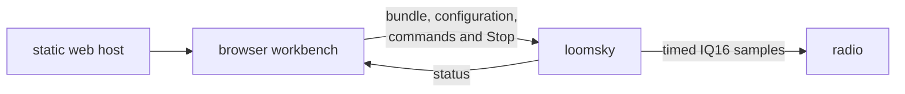

# LoomSky

LoomSky prepares GNSS scenarios in a browser and transmits their IQ16
samples through a software-defined radio. The browser edits trajectories,
binds navigation data and packs a Pharos bundle. `loomsky`, a Zig 0.16
program on the radio host, generates the samples in memory and sends timed
bursts through UHD.



| Part | Runs on | Owns |
|---|---|---|
| Browser workbench | the operator's computer | Library, editing, checks, previews and local records |
| Static web host | any host reachable by the browser | the page, WebAssembly modules and schemas |
| `loomsky` | the computer connected to the radio | admission, sample generation, the radio clock and transmission |

[Pharos](https://github.com/Mirai-Research/Pharos) supplies trajectory generation,
scenario packing and GNSS simulation. LoomSky supplies the workbench and
radio execution. Once accepted, a transmission belongs to the radio host;
closing the browser does not stop it.

## Build and run

Install Zig 0.16 and UHD's library and headers; the web build also needs
Node 24 or later and npm. Zig fetches the Pharos revision pinned in
`build.zig.zon`. See [Install](docs/guide/install.md) for the radio images,
service configuration and local dependency development.

```bash
zig build --release -Duhd=<prefix>
zig-out/bin/loomsky <address:port> <host.json>
```

In a separate terminal, build and serve the page:

```bash
cd web
npm ci
npm run build
npm run serve -- <address:port>
```

Open the site root for Home, then choose **Open Library**. Other static
servers need the [UI path fallback](docs/guide/install.md#build-and-serve-the-page).

The native build installs `loomsky` under `zig-out/bin` and the browser's
three Pharos modules (`pharos_traj.wasm`, `pharos_pack.wasm` and
`pharos_obs.wasm`) plus two schemas under `zig-out/web`. The browser loads
each product when needed. The web build writes a static site to
`web/out`. To build only the page, use `zig build web` before the npm
commands; this does not need UHD. [Quick start](docs/guide/quick-start.md)
takes the supplied Pharos example files through Library, preview and
transmission review.

## Deploy the protected web page

`.github/workflows/deploy.yml` builds and deploys the page to the `loomsky`
Cloudflare Worker on pushes to `main` or by a manual workflow run. It checks
out the Pharos commit pinned in `build.zig.zon`, builds only Zig's `web` step
(no UHD needed), runs the Next.js static export, then deploys `web/out` with
Wrangler. The TypeScript Worker in `web/worker.ts` checks Login before
serving HTML, JavaScript, WASM, schemas, or any other asset. It uses
`loomsky.panel.mirairesearch.com` and preserves the page routes in
`web/serve.ts`. The custom domain is managed in the Cloudflare dashboard;
`wrangler.jsonc` intentionally omits `routes` so CI deploys do not change it.

Before the first workflow run, create a Worker named `loomsky` in the same
Cloudflare account as `login` and attach the exact custom domain
`loomsky.panel.mirairesearch.com` yourself. The workflow keeps that domain
unchanged. The first Actions deployment then replaces the placeholder script
with the protected TypeScript Worker and static assets.

Set these **LoomSky repository Actions secrets** before the first run:

| Secret | Value |
|---|---|
| `PHAROS_DEPLOY_KEY` | Private half of a dedicated SSH deploy key. Add its public half to the private Pharos repository under **Settings → Deploy keys**, without write access. |
| `CLOUDFLARE_API_TOKEN` | Cloudflare account-owned token with Workers `Editor` scoped to the existing `loomsky` Worker. No zone route permission is needed while the custom domain remains unchanged. |
| `CLOUDFLARE_ACCOUNT_ID` | Account ID of the Cloudflare account holding the `login` Worker and `mirairesearch.com` zone. |

Add the secrets in LoomSky's **Settings → Secrets and variables → Actions**.
Do not commit private keys or tokens. The `LOGIN` service binding and
`ASSETS` binding are declared in `wrangler.jsonc`; the deployment token does
not replace the separate Pharos repository key.

In the login Worker's production `ALLOWED_RETURN_ORIGINS`, append
`https://loomsky.panel.mirairesearch.com` while retaining the existing Panel
origin. In the native radio host's `host.json`, add the same origin to
`origins` and restart the host. An HTTPS page connecting directly to an HTTP
radio host may still be blocked by browser mixed-content rules; check that
connection separately before relying on it in production.

After deployment, an unauthenticated page visit should redirect to Login,
and a direct request for `/pharos_traj.wasm` should return 401. A signed-in
visit to `/library` should load the workbench. No Cloudflare Git-connected
build is needed for this repository because GitHub Actions deploys it.

## Documentation

| Part | Content |
|---|---|
| [Documentation](docs/README.md) | entry points by task |
| [User guide](docs/guide/README.md) | setup, Library, authoring, previews, transmission and storage |
| [HTTP API](docs/guide/api.md) | requests, operation identities, commands and status snapshots |
| [Design](docs/design/README.md) | architecture, data flow, workbench ownership and radio timing |
