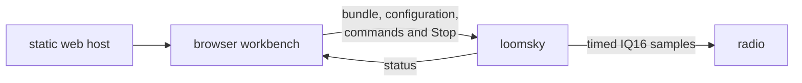

# LoomSky

LoomSky prepares GNSS scenarios in a browser and transmits their IQ16
samples through a software-defined radio. The browser edits trajectories,
binds navigation data and packs a Pharos bundle. `loomsky`, a Zig 0.16
program on the radio host, generates the samples in memory and sends timed
bursts through UHD.



| Part | Runs on | Owns |
|---|---|---|
| Browser workbench | the operator's computer | Library, editing, checks, previews and local records |
| Static web host | any host reachable by the browser | the page, WebAssembly modules and schemas |
| `loomsky` | the computer connected to the radio | admission, sample generation, the radio clock and transmission |

[Pharos](https://github.com/Mirai-Research/Pharos) supplies trajectory generation,
scenario packing and GNSS simulation. LoomSky supplies the workbench and
radio execution. Once accepted, a transmission belongs to the radio host;
closing the browser does not stop it.

## Build and run

Install Zig 0.16 and UHD's library and headers; the web build also needs
Node 24 or later and npm. Zig fetches the Pharos revision pinned in
`build.zig.zon`. See [Install](docs/guide/install.md) for the radio images,
service configuration and local dependency development.

```bash
zig build --release -Duhd=<prefix>
zig-out/bin/loomsky <address:port> <host.json>
```

In a separate terminal, build and serve the page:

```bash
cd web
npm ci
npm run build
npm run serve -- <address:port>
```

Open the site root for Home, then choose **Open Library**. Other static
servers need the [UI path fallback](docs/guide/install.md#build-and-serve-the-page).

The native build installs `loomsky` under `zig-out/bin` and the browser's
three Pharos modules (`pharos_traj.wasm`, `pharos_pack.wasm` and
`pharos_obs.wasm`) plus two schemas under `zig-out/web`. The browser loads
each product when needed. The web build writes a static site to
`web/out`. To build only the page, use `zig build web` before the npm
commands; this does not need UHD. [Quick start](docs/guide/quick-start.md)
takes the supplied Pharos example files through Library, preview and
transmission review.

## Documentation

| Part | Content |
|---|---|
| [Documentation](docs/README.md) | entry points by task |
| [User guide](docs/guide/README.md) | setup, Library, authoring, previews, transmission and storage |
| [HTTP API](docs/guide/api.md) | requests, operation identities, commands and status snapshots |
| [Design](docs/design/README.md) | architecture, data flow, workbench ownership and radio timing |
