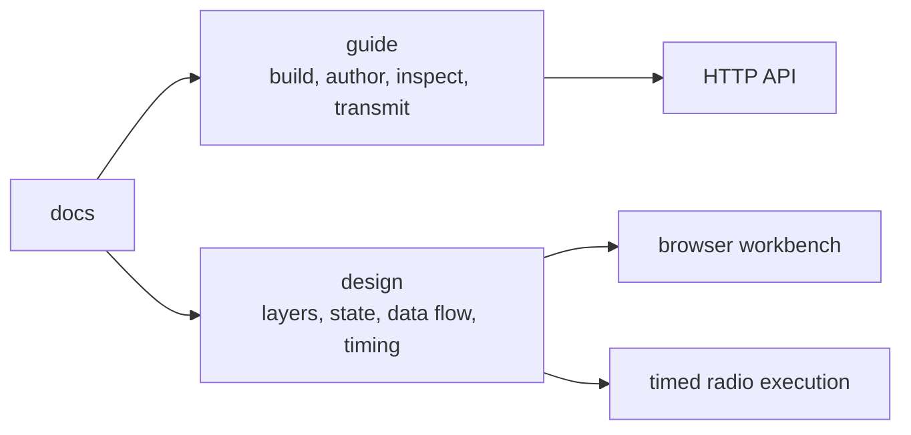

# LoomSky documentation

The guide explains LoomSky's operation. Design explains the ownership and
mechanisms behind it.

| Task | Start at |
|---|---|
| Understand the parts and files | [Overview](guide/overview.md) |
| Make a first scenario and review a transmission | [Quick start](guide/quick-start.md) |
| Build or deploy LoomSky | [Install](guide/install.md), [Host file](guide/host.md) |
| Find, import or reuse resources | [Library](guide/library.md) |
| Author a scenario or receiver path | [Scenarios](guide/scenarios.md), [Trajectories](guide/trajectories.md) |
| Inspect predictions or download modeled outputs | [Previews and outputs](guide/previews.md) |
| Operate a transmitter | [Transmission](guide/transmission.md) |
| Resolve a problem or understand saved state | [Activity](guide/activity.md), [Browser storage](guide/storage.md) |
| Integrate an HTTP client | [HTTP API](guide/api.md) |
| Change the implementation | [Design](design/README.md) |

The [user guide index](guide/README.md) follows the operator workflow.
The [design index](design/README.md) follows the implementation from
dependencies to execution. GNSS signals, navigation messages, physical
models and Pharos file formats are described in the
[Pharos documentation](https://github.com/Mirai-Research/Pharos/tree/main/docs).
