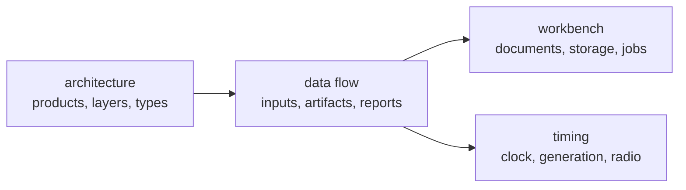

# Design

These pages explain how LoomSky is built and why its state has separate
owners. The [user guide](../guide/README.md) describes the controls and
operating procedures. The [HTTP API](../guide/api.md) defines the contract
between the browser and radio host.

| Page | Covers |
|---|---|
| [Architecture](architecture.md) | Pharos and UHD boundaries, modules, dependency direction and central types |
| [Data flow](data-flow.md) | working copies, saved versions, retained builds, predictions and radio reports |
| [Browser workbench](workbench.md) | document lifetimes, transactions, asynchronous work, feedback and recovery |
| [Timed transmission](timing.md) | sample epochs, lead, ring, clocks, commands, faults and watchdog |

LoomSky consumes Pharos's trajectory, packing and run interfaces. The GNSS
physics, message encoders and simulation engine remain documented in
[Pharos's design](https://github.com/Mirai-Research/Pharos/tree/main/docs/design).
