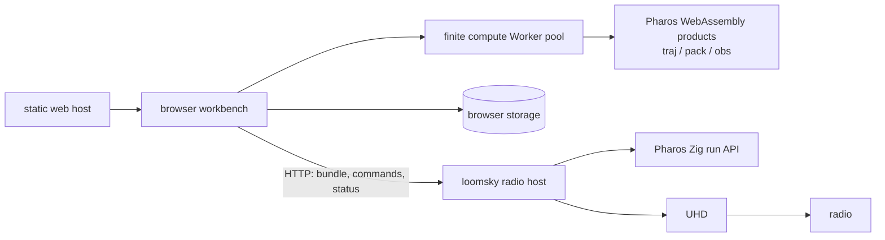
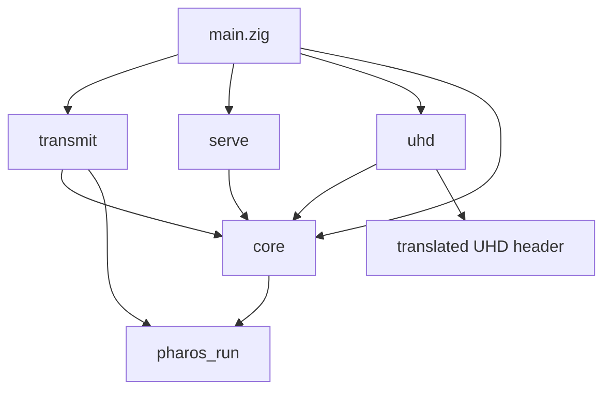
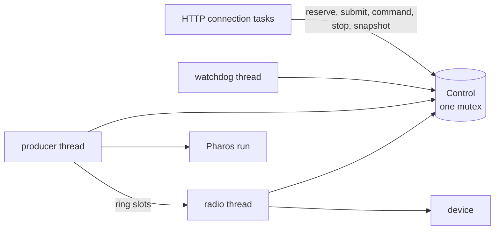
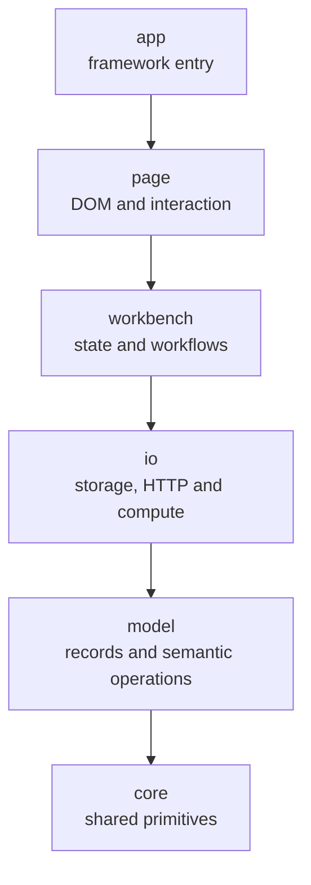
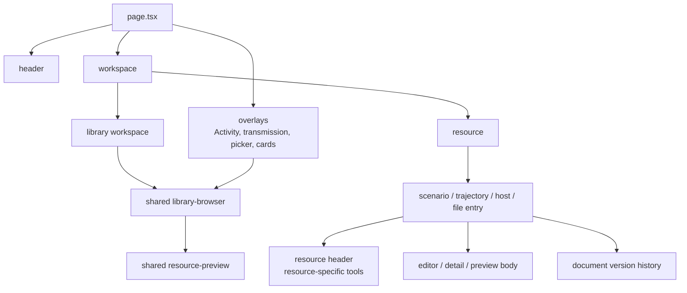

# Architecture

LoomSky joins a browser workbench to a timed radio host. The browser
prepares trajectories and scenarios with Pharos; the host pulls samples
from Pharos and sends them through UHD. This page describes the dependency
boundaries, owners and identities. [Data flow](data-flow.md) follows a
working copy, saved version, build and submission through them.

The web host serves files. It owns neither document state nor radio state.
The radio host owns its device and current run independently of browser
connections. Pharos owns trajectory geometry, GNSS models, navigation
messages and sample generation; those mechanisms remain in the
[Pharos documentation](https://github.com/Mirai-Research/Pharos/tree/main/docs).

## Principles

| Rule | Consequence |
|---|---|
| dependencies point toward their owners | views compose workflows; workflows use I/O; record and value modules do not call the workbench |
| edit revisions identify in-memory work | an asynchronous result is installed only for the document or request that produced it |
| navigation and business operations have separate lifetimes | history restores presentation; page sessions expire on departure, while document saves and confirmed submissions retain their owners |
| Save appends complete versions | accepted edits remain in the working copy until an explicit Save; older saved source is immutable |
| source versions and builds have separate identities | a saved source can have several retained build results, each with its engine fingerprint and exact artifact digests |
| selection and submission capture values | later Library edits do not change a selected trajectory version or submitted run |
| persistence has a completion boundary | a successful IndexedDB request is insufficient; the transaction must complete |
| committed storage state is authoritative across tabs | completed writes announce the affected scope and key; readers reload stored records, and expected record revisions reject stale writes |
| one caller owns each native object | the producer calls its Pharos run; the radio thread calls the device; each browser native object stays in its compute Worker |
| limits precede transmission setup | the plan resolves format, band, gain and window before a run is tuned or sent |
| expensive calls stay outside the control lock | driver and Pharos work cannot hold the mutex needed by Stop and status requests |
| epoch and clock conversion has one owner | `Window.air` maps a generator epoch to radio time; `Window.entry` maps radio time back to an entry epoch |

The device opens when the native process starts. Plan validation governs
setup of each transmission; it does not replace that initial device open.
[Timing](timing.md) describes the clock, entry and recovery rules.

## Native modules

`build.zig` creates separate Zig modules and gives each its allowed
imports. An arrow below means “imports”; `std` is omitted.

| Module | Entry | Responsibility |
|---|---|---|
| `core` | `src/core/root.zig` | checked time, host configuration, request identities, commands, status and the device contract |
| `transmit` | `src/transmit/root.zig` | `Transmitter(Device)`, its control state, plan, producer, ring and radio execution |
| `serve` | `src/serve/root.zig` | `Server(T)` for HTTP and `Watchdog(T)` for signals and deadlines |
| `uhd` | `src/uhd.zig` | the device contract over UHD's C interface |
| executable | `src/main.zig` | `Transmitter(Uhd)`, process startup, listener and long-lived threads |

The producer imports the typed `pharos_run` Zig module directly. `core`
uses its GNSS identity types. Only UHD needs a translated C header.
The build also installs `pharos_traj.wasm`, `pharos_pack.wasm`,
`pharos_obs.wasm`, `trajectory.schema.json` and `scenario.schema.json`
for the browser. Each WebAssembly product has its own exports, layout and
memory. Products exchange PHT or PHB bytes, never native handles.

The device and generator implementations meet through the transmitter's
contracts. `Transmitter(Device)` checks the device methods and their
signatures at compile time. `Server(T)` and `Watchdog(T)` call the
transmitter interface without knowing the driver type.

### Execution owners

| Context | Lifetime | Owns |
|---|---|---|
| main / server | process | listener and concurrent connection tasks |
| connection task | connection | authentication, origin check, bounded requests and upload handling |
| watchdog thread | process | signal handling and observation of stuck driver calls or stops |
| radio thread | process | device open/close, tune, clock and timed sends |
| producer thread | accepted transmission | decoded bundle, Pharos run and production into ring slots |

`Control` protects the admitted operation, job, run status, commands,
stop state, plan handoff and ring transitions. The producer writes a slot
in `filling`; the radio reads it in `sending`. Both byte operations happen
outside the mutex. A ring generation prevents a producer result from an
old entry point from becoming a current slot.

The handoff's `ready` payload owns the validated plan and its ring.
The radio receives a plan snapshot under the mutex; the ring stays in
control until the producer has joined and the radio releases it.

The producer destroys its Pharos run before releasing the arena that
owns the decoded bundle. The radio thread joins the producer before
releasing the ring and publishing the final outcome. Connection tasks
reach this state through transmitter methods.

### Native source map

| Area | Files and contracts |
|---|---|
| time and identity | `core/time.zig`: `GpsTime`, `Epoch`, `Window`, `Leap`; `core/identity.zig`: boot, operation and run identities |
| inputs | `core/host.zig`, `config.zig`, `command.zig`; `json.zig` rejects unknown or duplicate fields and nonfinite numbers |
| outputs and driver seam | `core/status.zig`, `device.zig`, `console.zig` |
| admission and handoff | `transmit/transmitter.zig`, `control.zig`, `plan.zig` |
| production | `transmit/producer.zig`, `ring.zig` |
| device execution | `transmit/radio.zig`, `stream.zig`, `clock.zig` |
| serving and termination | `serve/http.zig`, `watchdog.zig` |

`GpsTime` checks values entering from the bundle and device. Plan
resolution also checks that the whole window fits its range, so epoch
arithmetic stays inside those bounds.

## Browser layers

The static application lives in `web/src/`. Imports point toward lower
layers; an owner may use a lower layer directly. The diagram shows the
ordering, rather than every import.

| Layer | Owns |
|---|---|
| `app/` | Next.js entry, layout, theme tokens and base styles |
| `page/` | rendered resource hierarchy, controls, overlays, mounted CodeMirror views and maps |
| `workbench/` | active documents, Library, editing sessions, navigation, host lifecycle, preview sessions, background operations and feedback |
| `io/` | IndexedDB, committed-change synchronization and preferences, HTTP transport and status polling, finite compute execution, output sinks and Pharos product bindings |
| `model/` | GNSS and observation values, bundle summaries, saved records, text and schema values, pure Plan commands and geometry, diagnostics and host protocol values |
| `core/` | stores, generic formatting, JSON guards, hashes, identifiers and downloads |

A multi-file owner exposes an entry beside its implementation directory:
`workbench/documents/trajectory.ts` over `documents/trajectory/`, for
example. Callers use that entry. Helpers and types needed only inside the
owner stay private; the entry exports the operations its consumers need.
Grouping directories such as `page/shared/documents/` collect related
owners without an umbrella export file. A resource's working copy,
editing, saved builds and user actions have separate entries inside that
resource's directory. Actions may coordinate other resources; a working-copy
entry does not re-export those actions back into its own dependencies.

### Browser naming and style

Names at module boundaries identify their resource: `ScenarioDoc` and
`TrajectoryDoc`, `openScenario` and `openTrajectory`, `scenarioCatalog`
and `trajectoryCatalog`. Lookup uses `peekScenario` and `peekTrajectory`;
opening a resource installs one working copy in the tab's visited-document
Map. It stays available across navigation. Each document composes an
`editor`, `saved` state and a nullable evaluation `view`. Shared concepts use shared names: `DocumentDiagnostic`
associates a diagnostic with a document kind, and `ArtifactFile` identifies a
retained build file by name and digest. The latter belongs in
`model/artifact.ts` because both scenario and trajectory builds use it.

Component properties name the value they carry, such as `host`. Callbacks
use `on` plus the event or action; controlled values use `onValueChange`,
and pointer or keyboard callbacks name that event explicitly. Time values
include their unit when the surrounding contract does not already fix it.

Type-only declarations use `import type` or `export type`. Mixed declarations
list values before inline `type` bindings. Keep the relative order of value
imports, which can affect module initialization.

### Browser source map

| Owner | Boundary |
|---|---|
| `page.tsx`, `page/header/`, `page/workspace/`, `page/overlays/` | application composition and mounted views |
| `page/workspace/library.tsx`, `resource.tsx` | Library workspace and the common resource shell |
| `page/workspace/resource/{scenario,trajectory,host}/` | resource headers beside their editor or detail bodies |
| `page/workspace/resource/version-history.tsx` | history view mounted for the open resource |
| `page/shared/resources/` | browsing, summaries, actions and read-only resource previews shared by the workspace and picker |
| `page/shared/documents/` | text editors, field controls, editing-session view adapters, saved-version views and document summaries |
| `page/shared/preview/` | frame consumers for maps, signal displays and effective values, preview bookmark adapters and output buttons |
| `page/shared/navigation.tsx`, `navigation/restore.ts` | canonical links and mounted viewport capture/restoration |
| `page/shared/ui/`, `feedback/` | general controls, focus handling and problem presentation |
| `workbench/documents/{scenario,trajectory}/` | each resource's working copy, evaluation, collection, transfer, editing, saved builds and user actions |
| `workbench/documents/{editing,versions,builds}/` | shared editing-session contract and draft transactions, saved-history workflows and build-attempt/artifact mechanics |
| `workbench/files/` | retained file catalogue, file inspection and file actions |
| `workbench/library/` | cross-resource browsing, resolution, relations, import orchestration, picker and preview projections |
| `workbench/navigation/` | canonical routes, browser history, page visits, typed presentation memory, attention and owned sessions |
| `workbench/transmit/` | complete transmission source and configuration session, validation and review |
| `workbench/hosts/` | connection, actions and history submodules; host source, pending work, display and direct per-tab polling |
| `workbench/preview/` | preview sessions, source resolution, shared frames, scenes and observation queries |
| `workbench/operations/` | captured imports, duplication and exports, including observation/position files; progress, cancellation and results |
| `workbench/feedback/` | current-condition sources, operation failures, confirmations, presentation and Events |
| `workbench/schemas.ts`, `basemaps/` | schema loading and retry; basemap state |
| `io/storage/`, `hosts/` | transactions, scope/key commit hints, focus refresh, preferences and host transport |
| `io/output.ts` | temporary export files, bounded memory fallback and output cleanup |
| `io/compute.ts`, `compute/{client,protocol,demand,pool,worker}.ts` | typed operations, scoped priority demands, one shared queue, consumer cancellation, finite Worker capacity and execution |
| `io/compute/worker/obs/`, `worker/archive.ts` | observation sources, queries, lanes and output handles; ZIP assembly |
| `io/pharos.ts`, `pharos/{modules,memory,traj,pack,obs,schema}.ts` | product loading and instantiation, ABI translation, borrowed-memory copying and schema access |
| `model/gnss/`, `bundle.ts`, `observation/` | systems, signals, time scales, bundle summaries, observation commands, truth and effective-value contracts |
| `model/host/protocol/` | run and operation identities, commands and status snapshots, with their respective validation |
| `model/trajectory/` | Plan structure, geometry and pure source transformations |

`page/` follows the rendered hierarchy. Each resource entry composes its
header and body as siblings; document entries also mount version history.
Header tools live beside their editor or detail body. The header host strip
scrolls horizontally as registrations grow. Shared browsers and
previews serve both workspaces and pickers. The shared document, resource
and preview groups keep their distinct concepts below named owners.
Views subscribe to workbench
state and forward intent. Styles stay beside their components.
`app/globals.css` owns shared tokens and base rules; CodeMirror's theme
uses those tokens. The [workbench design](workbench.md) explains the
lifetimes behind these views.

## Identities across boundaries

| Identity or value | Owner | Rule |
|---|---|---|
| document `id` and editor `rev` | visited document | the id names a working copy; its monotonic edit counter rejects stale work and is not a saved version number |
| document `workingSequence` | active document | changes with applied content and pending field, name or scratch input; confirmations and asynchronous edits reject a changed working copy |
| visited document | document collection | one instance per opened resource remains in the tab; its mounted evaluation view owns generated results and cancellation |
| draft ID, runtime ID and revision | draft storage | plain checkpoints retain source, baseline and pending input separately from saved versions; a new runtime forks a recovered draft, with a fresh undo history |
| `FieldReference` | document model | an object ID resolves a field's current array position; missing or duplicate IDs fail resolution; arrays without object IDs use positional paths |
| `ScenarioSession`, `TrajectorySession` | active document | own unapplied input and editor state across view changes; view departure cancels transient interaction, and restoration or disposal resets the session |
| `PreviewSession` | scenario, trajectory, host or saved-run preview | owns manual/follow time intent, a pinned run and signal selection; resolves the frame consumed by that page's views |
| `PreviewFrame` | preview session | binds source, window, cursor and sampled epochs, commands, lanes and available actions in one resolved value |
| `PreviewBookmark` | preview view adapter | captures time, selection and a lightweight frozen run reference with commands, range and lane; it holds neither bundle bytes nor a track |
| background operation | `workbench/operations/` | captures input before asynchronous execution; page changes cannot replace it, and Activity projects its progress and terminal result |
| route and `entryId` | navigation | the canonical path and query name Home, Library or a resource, section and Form/JSON view; the History API entry identifies its saved browsing position |
| resource instance | navigation memory | persisted resource id or host registration id scopes bounded presentation state; removal invalidates that state without retaining a document object |
| `visitId` and `AttentionToken` | navigation | each page activation has a new visit; subsequent interaction invalidates late restoration and automatic navigation |
| `PageSession` | navigation | an abortable picker or transmission owner expires on page departure; parent abort closes child sessions; overlays do not add browser history entries |
| `ResourceHead` | version storage | names a resource and its latest saved version; archival hides it from the active Library |
| record revision and commit hint | storage transaction owner | expected revisions reject stale writes; scope/key hints and focus refresh trigger authoritative reads |
| `SavedVersion` | version model and storage | a complete immutable source snapshot with a per-resource `vN`, parent, content digest and optional restoration source |
| `BuildRecord` | build owner and storage | identifies the saved input version, exact trajectory or pack engine fingerprint, diagnostics and retained artifact digests; another build does not overwrite it |
| `TransmissionSession` | transmission workbench | owns one saved scenario build, configuration drafts and review in the same modal until close or submission |
| file digest | byte store | SHA-256 identifies bytes independently of Library name or catalogue id |
| selected trajectory | scenario snapshot | stores only `{ versionId, buildId }`; resolving those immutable records provides source, name, PHT and track |
| `ScenarioResult` | mounted scenario evaluation | temporary packed bytes and summary belong to one captured working copy and input set; current and last successful results remain distinct |
| `OperationId` | browser request / native admission | boot, operation sequence and nonce identify one submission attempt |
| `RunId` | native host | boot and run sequence identify an accepted run |
| command `actionId` | browser command attempt / native command record | retries of the same run, ID and parsed command return its existing receipt; reusing the ID for a different command conflicts |
| `SubmissionRecord` | browser host lifecycle | binds an immutable run snapshot to structured scenario version and build identities, exact bytes, address and run identity |
| `RunKnowledgeRecord` | run-history storage | records advancing sent bounds and applied-command history separately from the immutable submitted payload |
| `Epoch`, `GpsTime`, `Window` | native core | whole 1 ms generator epochs map to checked GPS nanoseconds for the device |
| `Snapshot` | native control | reports current device, operation and run state without consulting browser state |

Operation sequence and run sequence serve different purposes. An upload
can be cancelled or refused without becoming a run. A reused address or
changed label also does not establish run identity. The
[HTTP API](../guide/api.md) defines their wire representation and matching
rules; [data flow](data-flow.md) shows where each identity is captured.

## Where changes belong

| Change | Owner |
|---|---|
| another radio implementation | the `core/device.zig` contract, a driver binding and the composition in `main.zig` / `build.zig` |
| native admission or radio behavior | transmitter contracts and control; timing rules stay with stream and clock execution |
| an HTTP operation | typed core input/output, transmitter method and `serve/http.zig` |
| a browser record or pure interpretation | `model/`; persistence belongs in `io/storage/` |
| an application action | `workbench/`; the page renders and forwards interaction |
| a Pharos calculation | the product API translated by `io/pharos/`, scheduled through `io/compute/`; results reach views through workbench state |
| a computation's demand or lifetime | its workbench owner; the compute pool receives typed inputs, priority and cancellation without reading routes or documents |

This keeps radio execution, browser interaction and GNSS computation under
the owner that can enforce each contract.
