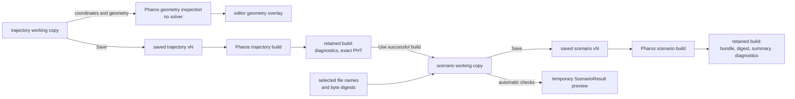
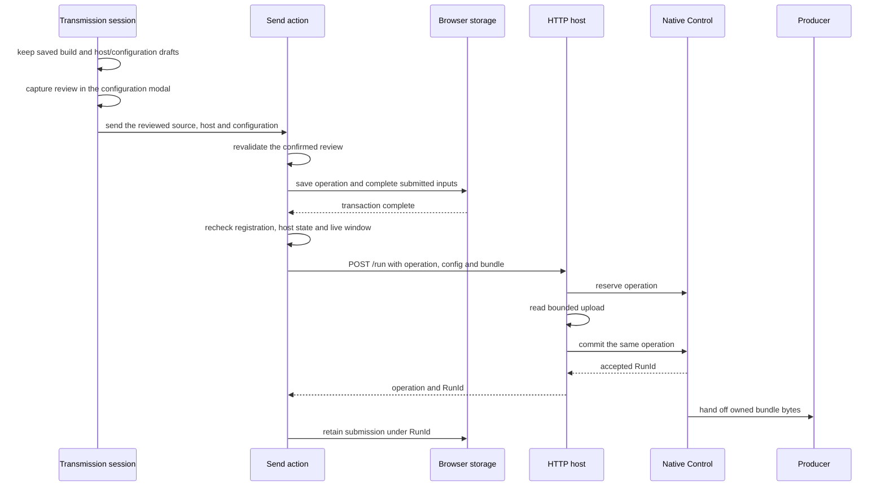
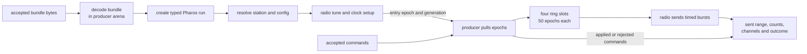
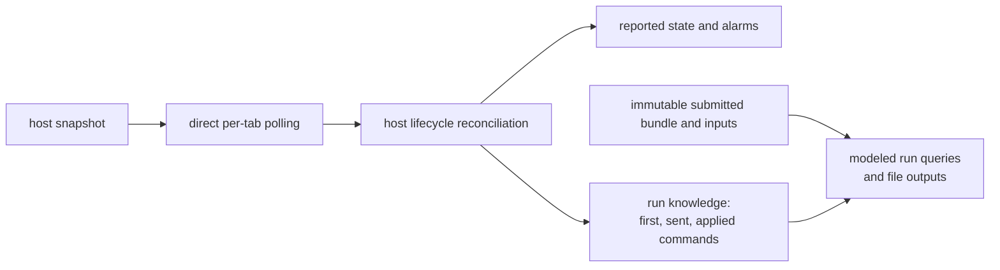

# Data flow

A working copy becomes an immutable saved version through an explicit
Save. Builds retain the results made from saved versions; a transmission
captures one successful scenario build. The radio host admits that submission and
owns the run until it ends. Predictions branch from the same packed
inputs; status comes back from the host.

## Authoring and packing

| Stage | Input | Output | Owner and completion rule |
|---|---|---|---|
| geometry inspection | Plan coordinates and geometry for a visible view | inspected points, curves and regions | trajectory editing owner requests short interactive computation; input identity and cancellation reject stale results; no solve or saved build |
| working-copy evaluation | current Plan or scenario source and selected inputs | candidate, diagnostics or temporary ready preview | the mounted editor owns evaluation; edit revision and request identity must still match; operations compute from captured snapshots |
| Save | source, metadata, bindings and valid pending input | complete immutable `SavedVersion` and updated resource head | prepare all fields, tables, drawings and ranges before one editor transaction; storage appends the captured snapshot and advances the head together |
| saved trajectory build | saved Plan source and exact engine fingerprint | append-only `BuildRecord`, diagnostics and verified PHT when successful | build owner; retained artifact digests identify the exact bytes |
| trajectory selection | explicitly selected saved version | undoable `{ versionId, buildId }` pin in the scenario | browsing reads saved content; Use obtains a successful build and applies it while the target still matches |
| saved scenario build | saved scenario text, selected name/digest bindings and selected trajectory build | retained bundle, diagnostics and canonical summary | build owner; PHT and track remain owned by the pinned trajectory build |

Trajectory names and Library file names describe resources. Content
identity comes from a digest. A scenario binds a filename to selected
bytes and captures a particular saved trajectory version and build.
Renaming a catalogue entry or editing a working copy cannot change those
saved bindings. Save, export and duplication use the same snapshot
preparation: valid fields, names, tables, drawings and ranges are applied
in one undoable transaction. Invalid or unfinished pending input blocks
capture and remains editable; raw JSON with syntax or domain errors can
still be saved or exported as text. **Use** changes the scenario working
copy; its next Save retains the selected pin.

Saved trajectory builds include the fingerprint of the exact
`pharos_traj.wasm` bytes; saved scenario builds use `pharos_pack.wasm`.
Scenario snapshots retain only the trajectory version/build IDs. Resolution
validates their relationship and obtains the exact PHT digest from the build,
independently of the current trajectory engine. A matching successful
build or source-check failure can be reused. An execution failure remains
in history and is retried by the next build. A completed explicit rebuild
or new input/engine combination appends a record with
its own artifact identities. Temporary working-copy checks do not create
source versions or become historical builds. Historical readers load the
retained artifacts without invoking the current product engine.

Saved-build attempts share a promise per version and engine. Closing a
picker cancels its wait; the shared attempt retains its workbench lifetime.
Scenario build records retain the bundle and summary, while the pinned
trajectory build owns the PHT and track. A mounted scenario evaluation
reuses its decoded trajectory while both version and build IDs match;
a changed pin or suspension releases it.

The compute pool schedules typed trajectory, pack and observation work,
file hashing and ZIP compression. It shares matching in-flight native
requests and applies the highest consumer priority. The workbench still
owns document revisions, active-view demand, immutable build attempts and
result installation. Save captures source independently of computation.
Storage copies and hashes new byte inputs before opening the transaction
that atomically writes those same bytes with their records.
Preparation checks file-size metadata against a shared input budget before
reading file bodies. A resource-limit failure leaves the captured source
available for correction or a later attempt.

After a write transaction completes, tabs announce the affected scope and
key. Subscribers reread committed records. Focus, page show and visibility
return trigger a full refresh; there is no revision journal to replay. A
visited document without local edits or editing history adopts a newer head.
Edits, pending input and undo/redo history preserve the working copy. The
next Save appends it after the current stored head without a conflict mode.

The pack summary supplies the resolved GPS window and leap schedule,
sample format, rate and centre frequency, elevation mask, and declared
observation and position outputs. Transmission and predictions use this
summary with its bundle. They do not reconstruct a ready result from the
current form fields.

An unsuccessful trajectory solve can return a candidate for the current
working copy without compiled PHT. A checking or erroneous document can also
retain an older display shape. Neither makes the current working copy ready.
The workbench keeps source edits, current candidates, verified results
and temporary editing previews separate; their
[identity checks](workbench.md#documents-and-edits) decide which result may
be installed or adopted.

## From review to an accepted run

| Owner | Captured state |
|---|---|
| transmission session | complete saved scenario build, selected host, mode, gain text and replay-offset text |
| review | copied source payload, resolved configuration, registration, host boot/run/operation and station settings |
| host lifecycle | durable operation, pending payload, cancellation and run identity |

The editor's explicit **Save & review** saves changed working content before
opening a session with its successful build. The saved-version picker
browses saved content and only loads or builds its selected version on Use.
Configure, review and send remain in one modal. Changing configuration
clears the review; returning to the form keeps its drafts.

Send revalidates the captured registration, host identity and settings.
Preparation and send check them again across asynchronous storage work, including the Live window. Its copied source and configuration remain
fixed; later working-copy edits do not change them.

The browser saves a `PendingSubmissionRecord` before sending the upload.
It already contains the operation identity, structured saved-version and
build provenance, source texts, file identities, bundle bytes and summary.
The returned `RunId` turns that captured payload
into a submitted-run record; a matching status snapshot can establish
acceptance if the HTTP reply was lost.

Admission and upload are separate native steps. Reservation claims the
next operation under `Control`'s mutex. The body is read outside the
mutex. Commit must still own that same operation. Cancellation,
replacement or shutdown can invalidate an upload before commit; its late
completion cannot claim the slot again. The [API](../guide/api.md) owns
the complete run, cancellation and status contract.

## Production and transmission

The producer decodes the bundle into its own arena and releases the
uploaded byte buffer. Its typed Pharos run holds the decoded bundle for
its lifetime. It resolves a plan before the radio configures this
transmission. The run is destroyed before the arena; the producer is
joined before the ring is freed.

The ring separates generation from device calls. A slot contains bytes,
its first epoch, epoch count, clip count and channel set. State transitions
happen under the control mutex; generation and sending happen outside it.
A new radio entry increments the ring generation. Publication from an
older generation releases that slot instead of sending obsolete epochs.

The radio's clock determines entry and send times. Browser polling and
rendering do not drive RF timing. [Timing](timing.md) derives the epoch
mapping, lead, clock setup, burst recovery and final drain.

## Status and retained run context

A snapshot identifies the boot and run. The browser attaches a local
submission only when address, boot and run match. Its retained truth
context contains the first reported epoch, last reported sent epoch and
commands with their application epochs. Updates preserve the first epoch,
advance the sent epoch and extend the same command prefix.
This knowledge is stored separately from the immutable submission payload,
so progress does not rewrite bundle bytes. Concurrent patches are compared
inside the write transaction; stale observations cannot shorten retained
history. Each tab polls its registered hosts directly, with one request in
flight per registration. Registration and credential checks reject late
results from a replaced connection.

A command carries a captured `actionId` as well as its target. An exact
retry returns the same receipt; a reused ID with different command content
is rejected. Queued acceptance and later application remain separate states.

The browser keeps pending cancellation and Stop records until snapshots
prove completion. An older idle snapshot cannot settle a newer operation.
Finishing a run also leaves storage work: archive the captured submission
and remove recovery records. Failed storage completion is retried
independently of new radio operations. [Workbench recovery](workbench.md#submitted-runs-and-recovery)
explains those lifetimes.

## Prediction and output branches

| Branch | Captured input | Result |
|---|---|---|
| trajectory display | current candidate or verified path and inspection, with any older reference shape marked | map path, event states, rule residuals and editor geometry |
| scenario prediction | one preview frame resolved from a `ScenarioResult`, time intent and selection | map, sky, channels, C/N0, DOP and timeline |
| submitted-run prediction | a frame with the matching submitted bundle, run identity, applied commands and cursor/sample epochs | modeled values for the followed or pinned run |
| effective values | the frame's source, command log and sampled epoch, plus satellite and signal | model, navigation, prepared-message and service groups |
| observation or position file | frozen source, epoch range, commands, creation time and filename | UTF-8 chunks written to a temporary output sink with backpressure, then handed to the browser download |

A scenario retains its last successful snapshot while checking newer
inputs or showing their errors. Map, sky and timeline identify when they
show an earlier result. Effective values use that same marked snapshot.
Each page resolves one `PreviewFrame` for its map, timeline,
sky and effective-value consumers. `PreviewSession` owns time intent and
selection; navigation captures and restores its bookmark.
Bookmarks retain source identities and frozen pin context, without bundle
or track buffers. The last mounted consumer releases heavy preview state;
returning loads and validates the same source before restoring the pin.

Following samples the exact current receiver epoch at a bounded cadence;
it does not round that epoch down to a whole second. Asynchronous readings
carry their source, run, commands and sampled epoch. A retained reading
shows its own time while a newer sample is pending, and a changed source
cannot reuse it as current. Effective-value failures offer a retry for the
current query while that source and selection remain active.

Manual inspection of a host pins the submitted run identity. A later run
or host restart cannot substitute another bundle or command context.
Following the host clears that pin. If a followed host becomes unknown,
inspection freezes at the last confirmed sent epoch and commands; the
uncertainty stretch is shown separately.

Scenario file outputs use the modeled window, including its endpoint
when the output interval lands there. Run file outputs freeze the reported
half-open range `[first, sent + 1)` and applied commands when the job starts.
Later host progress does not enlarge that job. Navigation leaves the
captured export running; Activity exposes its progress and cancellation
from the shared operation owner. Imports, duplication and all exports use
that same lifecycle. Their inputs are captured before asynchronous work;
completed import items remain saved if a later item fails or is cancelled.
Export completion records that the browser download was requested, with
its filename and byte count.
ZIP compression reads one captured entry at a time, and output producers
wait for each sink write before sending another chunk. Temporary browser
files keep completed output out of page memory where supported. The bounded
memory fallback and input budgets report explicit resource-limit errors.
Cancellation and failure remove partial output. Finished operations release
their captured inputs and retain only Activity metadata. Another attempt is
started from the source.

Reported state and predictions have distinct sources. Host status gives
admission, transmission progress, faults and outcomes. Pharos evaluates the
captured model. A host run without matching local inputs can still be
monitored, but the browser cannot supply its track and sky from its label.
The [preview guide](../guide/previews.md) explains the interpretation and
availability of each view.

## Rates and units

| Work | Schedule or unit | Owner |
|---|---|---|
| document Save | explicit Save or Ctrl/Cmd+S; create, import and duplicate start at v1 | scenario and trajectory documents |
| normal generation or packing | debounced after calculation inputs change while an editor view is mounted; operations evaluate captured snapshots separately | document views and compute pool |
| trajectory gesture preview | one generation in flight; only the newest waiting candidate is kept | trajectory document |
| browser display clock | 200 ms tick | workbench clock |
| host status polling | target 5 Hz, or 1 Hz for an `off` host; one request in flight per registration | each tab's host runtime |
| host recovery service | 250 ms tick; failed cancellation, Stop and completion work uses a 3 s retry delay | host lifecycle |
| followed signal and effective-value sample | at most one new sampled epoch per second while the source and commands are unchanged; preserve the exact millisecond epoch | preview session |
| satellite-count lane | bounded epoch batches with cancellation checks between slices | compute Worker |
| output byte production | bounded output batches with cancellation checks between slices | compute Worker |
| native generation epoch | 1 ms | Pharos / native `Epoch` |
| native ring capacity | four slots of 50 epochs: 200 ms of samples | transmitter |
| native device time | GPS nanoseconds | `GpsTime` and `Window` |

Polling schedules from the previous request's start and never overlaps
requests for the same registration. A slow or failed network request can
therefore lower the observed polling rate. The status transport's timeout
and refusal interpretation belong to `io/hosts/`; radio deadlines belong
to the native [timing model](timing.md).

Each compute Worker holds one execution slot until its job finishes or
stops safely, including while batched work yields. Short geometry, truth
and effective-value requests have reserved capacity; host polling and
control HTTP run independently of the compute queue. A synchronous WASM,
hash or compression call cannot process cancellation mid-call; the pool
terminates an unresponsive Worker after the cancellation grace period.
See [Worker lifetimes](workbench.md#worker-lifetimes) for
source sharing, query ownership and cancellation.
