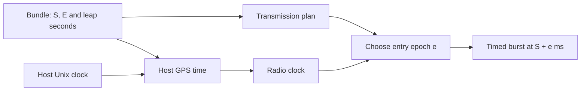

# Timing

The bundle defines a window starting at GPS time S and lasting E
one-millisecond epochs. S includes its fractional millisecond. The
radio schedules epoch k at one fixed instant:

```text
air(k) = S + k × 1 ms
```

Entry, replay and fault recovery all use this relation. They choose
which epoch to send next; they do not move its scheduled time.



## The lead

A four-slot ring connects the producer and radio threads. Each slot
holds up to 50 epochs. Its total capacity sets the nominal lead L:

```text
L = K × N × 1 ms = 4 × 50 × 1 ms = 200 ms
e = max(0, ceil((t + L − S) / 1 ms))
```

Here t is the radio's current GPS time. An entry exists only when e is
less than E. This chooses the first epoch at least one lead ahead of
the radio clock.

| Quantity | Value |
|---|---|
| N, slot capacity | 50 epochs, one producer pull |
| K, ring capacity | 4 slots |
| L, nominal lead | 200 ms |
| first-slot deadline | at least 50 ms before its scheduled air time |
| send timeout | L + 1 s = 1.2 s |

The ring can contain free, filling, full and sending slots. Publication
and consumption happen under the control mutex; generation and device
calls happen outside it. A short final pull uses only the filled part
of its slot.

The ring lead is separate from UHD's transmit transport buffers.
Increasing transport capacity can also increase the samples queued ahead
of air time, command latency and the time needed to drain a stopped
burst. The host file defines the [B200 transport defaults](../guide/host.md#station).

## The clock

Each transmission sets the radio clock after tuning. Tuning can change
the master clock, so a previous transmission's clock setup is never
reused. GPS time places samples; monotonic awake time measures polling
deadlines, device-call age and stop duration.

### Live and replay

| Reference | Live | Replay |
|---|---|---|
| `none` | set directly from host GPS time | set to S + `replay_ms` when the first slot is ready |
| `external` | wait for reference lock, then latch host GPS time at PPS | wait for reference lock, then set as above |
| `gpsdo` | wait for reference and GPS locks, then latch host GPS time at PPS | wait for both locks, then set as above |

Replay chooses its first entry from S + `replay_ms` before seeking.
Only after that first slot is ready does it set the radio clock to the
replay point. The seek's duration therefore does not consume the
initial lead. Subsequent entries use the running radio clock.

For a live reference latch, the host first observes a PPS edge. It then
rounds host GPS time to the nearest second, adds one second, and asks
UHD to set that time on the next PPS. The host checks the latched time
against that exact second.

| Check | Deadline or interval |
|---|---|
| reference locks | poll every 100 ms, for up to 10 s |
| each PPS edge | poll every 5 ms, for up to 1100 ms |
| reference locks while sending | check after a slot when the 1 s interval has elapsed |
| first-slot hold | sleep in steps of at most 10 ms |

A lost required lock ends the burst. A failed sensor or clock read is
a device failure; a missing lock, failed time set or incorrect PPS
latch is a clock failure.

### Leap seconds

Host GPS time is derived from the host's Unix clock:

```text
GPS time = Unix time − 315 964 800 s + ΔtLS
```

The bundle supplies ΔtLS at S and, when present, a later change instant
and offset. To decide which offset applies, the host converts the
change instant to Unix time using the new offset, then compares it with
the host clock. LoomSky keeps no separate leap table. Unix time does
not represent the inserted UTC second.

## A transmission

Operation admission, run identity and command admission share the
control mutex. The [API](../guide/api.md#operations-and-runs) defines
their wire format and cancellation rules.

An upload reserves an operation before reading its body. Commit
transfers the bytes only while that operation still owns the upload
and the host remains open. Cancellation retires a pending upload or
requests the stop of its accepted run. Shutdown closes admission
before stopping; neither cancellation nor shutdown lets an old upload
commit later.

### Plan and ownership

The HTTP request owns the uploaded bytes until commit. The producer
decodes them into its arena, then frees the upload buffer. Its typed
Pharos run borrows the decoded bundle. Destruction proceeds in order:
destroy the run, free its arena, join the producer, then free the sample
ring.

| Plan check | Requirement |
|---|---|
| sample format | IQ16 |
| sampled band | centre ± rate/2 lies inside one allowed host band |
| transmit gain | no greater than the host's maximum |
| window and leap change | representable by the host's GPS-time type |
| replay point | less than E |
| first entry | at least one epoch remains a lead after live time or the replay point |

A failed plan check produces `refused` before that submission tunes
the radio. The process may already have opened the device at startup.
If the device is closed, a valid plan triggers a new open attempt.

```mermaid
sequenceDiagram
    participant R as Radio thread
    participant P as Producer thread
    participant D as Radio
    R->>P: Committed bundle and config
    P->>P: Decode bundle, create run, resolve plan
    P-->>R: Plan or outcome
    R->>D: Open if needed; tune and read back
    R->>D: Empty end of burst; drain events
    R->>D: Set live clock or await replay locks
    loop Each entry
        R->>P: Entry e with a new generation
        P->>P: Seek forward; fill available slots
        P-->>R: First slot
        opt First replay entry
            R->>D: Set clock to replay point
        end
        R->>R: Check deadline and hold until air(e) − L
        R->>D: Timed start of burst
        loop Until EOF, stop or fault
            P-->>R: Next slot
            R->>D: Untimed continuation
        end
        R->>D: End of burst
    end
```

### Tune and read back

UHD sets the channel's sample rate, centre frequency and gain, creates
an IQ16 stream and reads back the settings.

| Read-back field | Accepted value |
|---|---|
| sample rate | exactly the requested rate |
| centre frequency | within 1 Hz of the requested centre |
| gain | finite and no greater than the host maximum |

The gain need not equal the requested value. The accepted read-back
values are what the snapshot shows.

Before clock setup, the radio thread sends an empty end of burst and
drains pending events. After those steps succeed it publishes the plan
in status. This separates the new stream from an earlier burst's
pending state.

### Enter and send

Each entry, including recovery, sets status to `starting`, increments
the ring generation and releases queued full slots. A producer result
from an older generation is discarded when published. The producer
seeks to `max(e, next)`, where `next` is the first epoch it has not
pulled. It never seeks backward.

Seeking advances in chunks of at most 10,000 epochs. Between chunks
the producer checks whether production has ended or the requested
generation changed. After each seek it rebuilds the channel set from
Pharos events.

When the first slot arrives, the radio thread compares its start with
the current device time. If fewer than 50 ms remain, it releases the
slot, increments `late` and chooses another entry. The discarded slot
does not increase the sent or clipped counts. A long seek can therefore
require several entries before a slot meets the deadline.

An early first slot waits until `air(e) − L`. During that hold the
status is `waiting` while the radio clock is before S. The first send
has a start-of-burst timestamp at `air(e)`; subsequent slots continue
the burst without timestamps.

Only a complete send sets status to `on_air`. It records the first and
latest epochs sent, the slot's channel set and its clipped count, then
releases the slot. A short send goes through recovery without recording
that slot as fully sent.

At EOF or Stop, the radio sends an end of burst and waits up to 1 s
for its acknowledgement. Fault events received during this wait are
counted. The wait ends on an acknowledgement or its deadline; a missing
acknowledgement alone does not turn completion into failure.

## Recovery

The UHD stream uses `underflow_policy=next_burst`. LoomSky handles
each recoverable stream fault by counting the triggering fault,
ending the burst and choosing a new entry from device time. Pending
events are drained before the next timed burst.

| Fault | Observation | Counter |
|---|---|---|
| radio ran out of samples, including within a packet | asynchronous underflow event | `underflow` |
| burst start arrived late | asynchronous time-error event | `late` |
| first slot missed its deadline | local device-time check before the burst | `late` |
| samples were lost in transport | asynchronous sequence-error event | `sequence` |
| radio accepted only part of a send before timeout | short send | `short` |

A stream fault is counted before the end-of-burst call, so the count
remains if that call fails. Further faults observed while finishing
the final burst are counted without starting another burst.

Recovery leaves a gap while the next entry is prepared. The entry
formula and the producer's forward-only position prevent an epoch
from being sent twice. The gap depends on device time, queued work and
seek duration; it is not a fixed delay.

## Failures

A failure that cannot be recovered ends the transmission. The
transmitter stops production, closes command admission, joins the
producer and records a terminal outcome. When tuning succeeded, it
also releases the transmit stream.

| Failure | Outcome | Device handle |
|---|---|---|
| open | `failed: device` | closed; `device` is `absent` or `failed` |
| tune | `failed: device` | freed; `device: failed` |
| time, PPS or lock-sensor read | `failed: device` | freed; `device: failed` |
| asynchronous receive or metadata read | `failed: device` | freed; `device: failed` |
| send or end of burst | `failed: send` | freed; `device: failed` |
| read-back mismatch | `failed: readback` | retained |
| setting time, acquiring locks or checking the PPS latch | `failed: clock` | retained |
| generator | `failed: generator` | retained |
| host memory or thread creation | `failed: host` | retained |

A retained device can be used by the next run. A freed device is opened
again only when a later accepted submission reaches a valid plan.

## Commands

HTTP accepts a command into the run's record list. Before each pull,
the producer takes the next batch and submits it to Pharos with the
default application epoch: the first epoch of that pull. The pull
reports the actual applied epochs, which the producer copies into
status.

A command rejected during conversion or submission keeps its message.
When Pharos's pending queue is full, the producer leaves the remaining
records for a later pull. The 200 ms sample lead describes normal
queueing; it is not a command-latency bound during seeking, a backlog
or fault recovery.

| End of consumption | Unapplied records |
|---|---|
| producer EOF | `discarded: completed` |
| Stop | `discarded: stopped` after the producer joins |
| plan refusal | `discarded: refused` |
| failure | `discarded: failed` after the producer joins |

Admission closes at EOF, Stop or failure. Settlement examines every
record, including a command already dispatched to a pending pull.
Applied records retain their epochs. An ended run has no queued
commands. The [API](../guide/api.md#commands) gives command shapes and
snapshot dispositions.

## The channel set

The producer tracks channel-added and channel-removed events from
Pharos. A seek clears its set and drains the events that add back the
channels held at the new position. A successful nonempty pull updates
the set again.

Each slot carries a copy. After a complete send the radio thread
publishes that copy, so snapshot `channels` corresponds to the slot
at `sent`, rather than to newer samples still in the ring.

## The watchdog

The watchdog wakes once a second. SIGTERM and SIGINT request shutdown,
which stops a run and closes the radio. The watchdog exits successfully
after closure.

| Condition | Action |
|---|---|
| device call has been busy for at least 30 s | report the call and exit 3 |
| stop remains unfinished for five watchdog ticks with no call busy | report the stop and exit 3 |
| radio thread has closed | exit 0 |

While a device call is busy, its timeout takes precedence over the stop
timer. A watchdog failure ends the process immediately: no destructor
can safely free the radio beside a stuck call. The
[service supervisor](../guide/install.md#run-the-service) starts a new
process, and clients see a new `boot`.

## Limits and messages

| Limit | Value |
|---|---|
| required locks | 10 s |
| each PPS edge | 1100 ms |
| burst acknowledgement | 1 s |
| seek chunk | 10,000 epochs |
| busy device call | 30 s |
| unfinished stop without a busy call | 5 watchdog ticks |

A refused or failed outcome carries `reason` and `message`. These are
run outcomes in [status](../guide/api.md#run-status); HTTP admission
refusals are listed in the [API](../guide/api.md#limits-and-messages).

| Reason | Message |
|---|---|
| `bundle` | `cannot read the bundle: <diagnostic>` |
| `bundle` | `the bundle has no samples block: nothing to generate` |
| `bundle` | `cannot create the run: <failure>` for unusable bundle content |
| `format` | `the bundle's samples are IQ<n>; the radio takes IQ16` |
| `band` | `<low> to <high> MHz lies in no band of bands_hz in the host file` |
| `gain` | `gain_db <g> is above max_gain_db <m> in the host file` |
| `window` | `the window of <E> ms from <S> ms lies beyond GPS time's range` |
| `window` | `the leap second change at <ms> ms lies beyond GPS time's range` |
| `window` | `replay_ms <r> lies beyond the window's <E> ms` |
| `window` | `no epoch of the window's <E> ms airs a lead after now`, or `after replay_ms` |
| `device` | `<call>: <reason>` from UHD |
| `device` | `<call>: the radio reads <s> s and <f>, outside GPS time` |
| `readback` | `the radio reads back <r> Hz, <c> Hz and <g> dB for <r> Hz, <c> Hz and <g> dB, at most <m> dB` |
| `clock` | `the <reference> reference did not lock within 10 s` |
| `clock` | `no PPS edge within 1100 ms` |
| `clock` | `the PPS latch read back <s> s, not <s> s` |
| `clock` | `the <reference> reference lost its lock on air` |
| `clock` | `<call>: <reason>` when setting the radio clock fails |
| `send` | `<call>: <reason>` when sending samples or an end of burst fails |
| `generator` | `cannot create the run: <failure>` |
| `generator` | `epoch <k> of <E> could not be generated: <error> (<reason>)` |
| `host` | `out of memory for the ring` |
| `host` | `the producer thread could not start` |
| `host` | `out of memory`, or `cannot create the run: <failure>` for an allocation failure |

UHD messages retain the failing call name and the driver's reason.
Generator diagnostics come from Pharos. If a generator diagnostic
exceeds its message buffer, the text is
`the generator's failure message is too long`.
