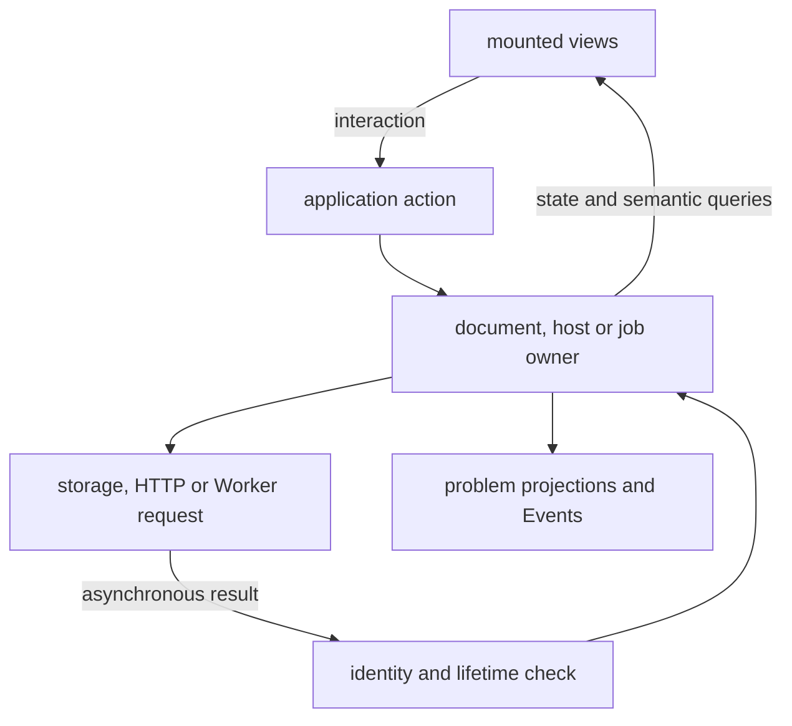
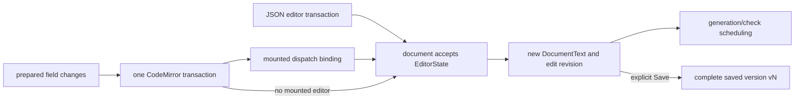
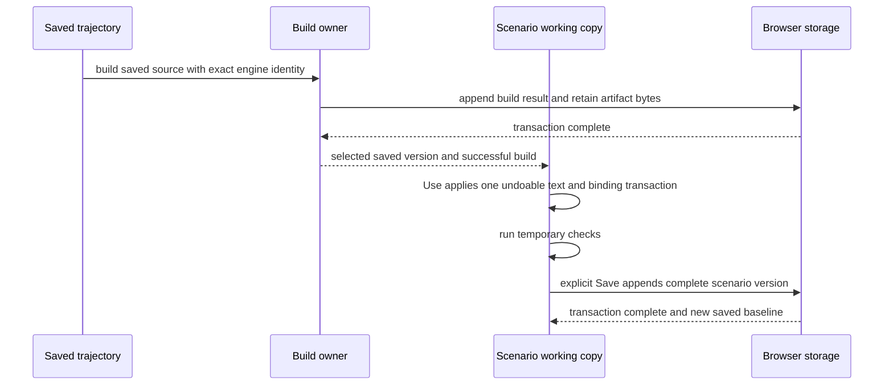
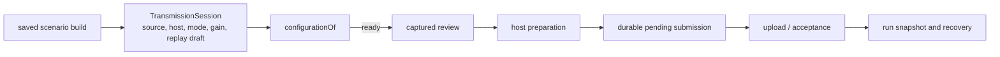

# Browser workbench

The workbench owns active documents and operations for one browser page.
Views subscribe to that state and forward interaction. Storage, network
and generator results return to the owner that can decide whether they
still belong to the current object.

[Architecture](architecture.md) defines the layers. The user-facing
[Library](../guide/library.md), [editing](../guide/scenarios.md),
[previews](../guide/previews.md) and [Activity](../guide/activity.md)
guides describe the controls built over these mechanisms.

## Page lifetime

| Owner | Lifetime and release |
|---|---|
| document catalogues | resource-head summaries plus derived working-copy or recovery-draft summaries for the tab |
| visited-document Map | one `ScenarioDoc` or `TrajectoryDoc` per opened resource, retained across navigation |
| document editor and saved state | source, same-tab undo history, pending input and saved baseline remain with the visited document |
| document evaluation view | mounted editor only; unmount cancels calculation and releases generated buffers |
| navigation and Library state | bounded history-entry and resource memories; cleanup invalidates captures |
| Library picker session | current page visit, optionally a parent session; closing aborts preparation and releases its history reader |
| version-history reader | requesting view or picker; disposal discards late results and releases subscriptions |
| transmission session | page-owned opening, configuration and review in one modal; submitted work has a host-operation lifetime |
| mounted editor or map | component mount; DOM view, dispatch binding and interaction listeners are released on unmount |
| preview session | mounted consumers retain bytes and tracks; the last release cancels hydration and retains a lightweight bookmark |
| background operation | captured import, duplicate or export until completion; Activity retains terminal metadata |
| compute pool | workbench lifetime; Workers are created on demand and retired on idle, resource pressure, failure or overdue cancellation |
| storage synchronization and host runtime | workbench lifetime; commit hints, listeners and direct polling stop on cleanup |
| export output | one operation; temporary file or bounded fallback bytes are released after download handoff, cancellation or failure |

`page.tsx` starts `startWorkbench()` on mount: storage, routing, clock,
operations, hosts, schemas, document collections, Library files, basemaps
and output sinks. Cleanup stops new work, cancels abortable operations,
releases listeners and polling, checkpoints recoverable documents and
requests a bounded run-history flush. It clears presentation, artifact and
track caches, closes temporary output and storage owners, and disposes the
compute pool. Owner generations reject late results. History API navigation
preserves the runtime and captured operations. Page hide/freeze pauses host
polling and evaluation; page show/resume restarts them without sending Stop.

Startup reads resource-head summaries without constructing every document.
`openScenario` and `openTrajectory` load a resource once into their tab's
visited Map. Browsing Library reads catalogue metadata and immutable saved
previews without opening a working copy. The catalogue's `working` value is
a projection of an opened document or its recovery-draft summary.

Each document composes `editor`, `saved`, `editing` and a nullable `view`.
Mounting the editor attaches its evaluation view; leaving disposes that
view while preserving source, same-tab undo history and pending input. A
previous successful source can reconstruct a marked preview when its
recorded engine identity still matches. Captured operations evaluate their
own immutable snapshots independently of the editor view.

Recovery writes are scheduled after changes and on page hide/freeze. They
store plain source and pending-input snapshots, with no durable undo log.
A failed write leaves the working copy in the tab and reports a retryable
problem. The close guard checks all visited documents for unsaved applied
content, pending input and unfinished saves. Recovery writes are
asynchronous; page close can precede the newest checkpoint.

## Routing, actions and focus

| Workbench owner | State |
|---|---|
| `navigation/` | canonical routes, browser history, page visits, presentation memory, attention and page sessions |
| `library/browse.ts` | Library filter, search, sort, selection, preview and scroll |
| `library/picker.ts` | one resource or saved-version picker session, preparation and application callback |
| `documents/versions/history.ts` | saved versions/builds, loading/error state, refresh and disposal |
| `library/imports.ts`, `documents/editing/actions.ts` | import orchestration; pending-input feedback and focus |
| `page/shared/navigation.tsx`, `navigation/restore.ts` | native links and mounted scroll restoration |

The canonical path names Home (`/`), Library (`/library`) or a resource and
section (`/resource/...`). Form is the default; JSON uses `?view=json`, and
a trajectory's `?scenario=<id>` carries its return context. Parsing,
normalization and link generation share one route model. An explicit
address determines the section and view; opening a resource from Library
uses its remembered section and view. `/` always opens Home; startup does
not restore a route from sessionStorage. `page` exposes a read-only store
projection; named actions update it, and `documentView(route)` derives Form
or JSON.

| Navigation action | Contract |
|---|---|
| `navigate(destination, options)` | normalize an explicit destination and push or replace its browser history entry |
| `openResource(resource)` | open the resource's remembered section and view |
| `revealDocument(target)` | choose a document section/view and request a diagnostic, field, path or name location |
| `resourceRemoved(resource, identity)` | invalidate that instance's memory and replace its active page with Library |

`NavLink` renders the canonical `href` and delegates an ordinary click to
navigation. Modified clicks and browser link actions keep their native
behavior. Navigation captures the outgoing view before activating the
destination. A browser `entryId` identifies the history position; a new
`visitId` identifies each activation, including a return to that entry.
Browser Back and Forward move between pages. Opening and closing overlays
does not add history entries; Close or Escape dismisses them.

Presentation memory is typed by resource kind and bound to its live
instance. Documents use their persisted resource id; hosts use their
registration id. It does not retain a document object. Removal clears that instance's memory and prevents a
departing view from writing it back. History entries retain registered view
state, with resource memory as a fallback. Preview adapters register session
bookmarks containing time intent, signal selection and a lightweight pinned
run reference with frozen commands, range and lane, without bundle or track buffers;
navigation does not own a cursor or follow state. Library
registers its complete browse state, so Back restores that entry's filter,
search, sort, selection, Preview visibility and scroll position.

Resource and visit memories keep up to 128 entries, with up to 32 view keys
per entry. Writes refresh insertion order; reads do not alter it. Cleanup
advances a capture generation so late view cleanup cannot repopulate cleared
memory. Browser history holds page-entry IDs and canonical paths.
The URL carries the route. Workspace camera preferences use tab-local
sessionStorage; theme and map labels use shared localStorage notifications.

Mounted adapters register form, host-pane, trajectory-panel and JSON
scroll positions, and workspace map cameras. Scroll restoration waits for
ready content and retries as its layout grows. Map cameras can fall back to
their persisted view. Explicit `DocumentFocus` takes precedence over
viewport restoration; the mounted editor resolves DOM focus or a JSON
range. An `AttentionToken` combines the visit and interaction revision.
Late viewport restoration and automatic navigation stop when the user has moved
on, including after leaving and returning to the same address.

`PageSession` is an abortable owner for a picker or transmission workflow.
Leaving the page closes its sessions; aborting a parent closes its children.
Session cleanup releases preparation and rejects late results. Version
history uses local state scoped to the page visit. Saves and submitted
operations continue under their business owners.
Documents retain text, undo history and pending edits independently of
presentation restoration.

A picker discriminates resource selection from saved-version selection.
Only a ready saved candidate can be used. Session/selection identities
reject late preparation; busy state prevents replacement during application.
File selection captures document identity, `workingSequence`, field value and
bindings and rechecks them after byte reads. Uploading and selecting are
separate actions.

`createVersionHistoryReader` serves resource-local history and the picker.
It refreshes after saved-head or build changes, coalesces reads and releases
subscriptions on disposal. Views render its state without storage calls.
Workflow owners provide confirmation callbacks; feedback runs their lifecycle.

## Documents and edits

| Owner inside `workbench/documents/` | Responsibility |
|---|---|
| `scenario/document.ts`, `trajectory/document.ts` | compose one working copy from editor, editing session, saved state and nullable evaluation view |
| each `evaluation.ts` | mounted editor checks, current and previous results, temporary candidates and cancellation |
| each `collection.ts` | resource catalogue, open/lookup, creation, duplication and archival of that resource kind |
| each `transfer.ts` | file import and export; returns documents or downloadable contents |
| each `actions.ts`, `editing.ts`, `builds.ts` | separate entries for resource-specific operations, edit sessions and saved builds |
| shared `collection.ts` | metadata catalogue, visited-document Map, scheduled draft snapshots and committed-head reconciliation |
| shared `checkpoint.ts`, `recovery.ts` | plain source and pending-input checkpoints, legacy draft conversion and recovery selection |
| shared `saved.ts` | `SavedWorkingCopy`: saved baseline, dirty comparison, serialized saves, save errors and restoration origin |
| shared `operations.ts` | pending-input feedback and navigation guarded by captured attention |

The scenario and trajectory directories each contain their complete
authoring workflow. Working-copy entries expose state and collection
operations; callers choose the actions, editing or builds entry when they
need that lifecycle. Shared document mechanics live beside these resource
owners. Cross-resource browsing and selection remain in `workbench/library/`.

| Object | Mutable state | Accepted result |
|---|---|---|
| `TrajectoryDoc` | editor, working name and Plan JSON, saved baseline and editing session | its mounted view owns a generated track tied to the editor revision |
| `ScenarioDoc` | editor, scenario text, file bindings, trajectory version/build pin and saved baseline | its mounted view owns a `ScenarioResult` tied to the captured revision and inputs |
| `DocumentText` | none; replaced with a new immutable value after a transaction | CodeMirror state, text and JSON tree |
| `ScenarioSession` | collection and table selections, batch and paste text, pending fields | prepared document transactions |
| `TrajectorySession` | selection, inspector, tools, name and field drafts, drawings, range input and current gesture | one committed document transaction |

`model/document/` provides text state, JSON paths, diagnostics and the
`TextDocument` contract. It knows neither which view is mounted nor which
action requested the change. Every document has an explicit `kind`; its
`DocumentEditor` implements `TextDocument` and owns one non-null editor state.
Text, path and transaction operations act on `doc.editor`. Diagnostic resource kinds and external input filenames
remain separate values; neither selects another editor state inside a
document.

| Editing owner | Responsibility |
|---|---|
| `workbench/documents/editing/` | shared `EditingSession` contract, pending fields, mounted dispatch bindings, common mutation sequencing and edit feedback |
| `workbench/documents/scenario/editing/` | document-owned collection and table state, publication edits and inspection actions |
| `workbench/documents/trajectory/editing/` | document-owned selection, tools and scratch input, gesture baselines and committing or cancelling an interaction |
| `model/trajectory/plan/` | pure Plan commands, reference checks and source transformations |
| `model/trajectory/geometry.ts` | pure geometric edit values and event position/course queries |

### One text history

Several path changes are calculated in order against the preceding
result, then reduced to one text transaction. Literal-number and JSON
changes are validated before they enter it. The mounted CodeMirror view
dispatches the transaction when present; otherwise the document updates
its state directly. The document retains the history when the view
unmounts. The JSON component keeps one CodeMirror view per mount and updates
read-only configuration through a compartment.

The monotonic edit revision guards asynchronous work. It is independent
of the saved version number shown to users. Dirty state compares complete
working content with the saved baseline, so undoing back to that baseline
can clear unsaved state without rewinding the edit revision.

`workingSequence` also advances for pending field, name and scratch input.
Archival and restoration confirmations capture it; file selection and
preparation check it across awaits. A changed pending field therefore
invalidates the action even before it becomes a source edit.

Scenario file bindings and the adopted trajectory live in a CodeMirror
state field. Their state effect has an inverse history effect. Undo and
redo therefore restore text and selected input identities together.
Changing a JSON filename alone does not select a new Library entry.

`page/document-shortcuts.ts` routes Save, Undo, Redo and Escape for the active
document. Focused text controls keep native text history, and CodeMirror
keeps its document commands. In the form or visual editor, the session gets
the first opportunity to cancel an active interaction or undo drawing
points before document history runs. Dialogs, popovers, confirmations and
Activity retain their own keyboard layer.

### Pending inputs

A field draft belongs to a document and a `FieldReference`. A path through
an array object with a nonempty `id` captures that collection, ID and field;
reads, commits and focus requests resolve its current path. Reordering the
collection therefore keeps the draft attached to the same object. Numeric
tables and other arrays without object IDs retain positional paths.

The draft registry stores the typed text, a typed codec with captured
constraints and the applied field value on which the draft began. Numeric
bounds, input format and time-scale context are data owned by the draft.
Pure preparation uses that data after a control unmounts or remounts;
rendering does not register or replace a callback in the workbench.

Preparation checks that the document is writable, the field still matches
its captured base and positional object arrays still match their guards.
A missing or duplicate object ID, changed field or changed guarded array
preserves the draft and reports a conflict. Further typing keeps the same
base; the user must resolve or revert the conflicting input.

Trajectory name drafts also capture the applied name when typing begins.
`nameIssue` reports a conflict if that name changes before commit, preserving
the draft and its original base.

Scenario batch and paste drafts capture the target table and its ancestor
object lists. Unrelated source edits preserve them; a changed table or a
changed, reordered or removed containing object list preserves the text as
a conflict. That conflict remains until the input is discarded. The inline
**Discard pending input** action and Problems' **Discard input** action
clear it, including when its publication has been removed. Save continues
to leave table text unapplied.

| Operation | Contract |
|---|---|
| `commitFieldInputs()` | validate every field and the trajectory name, then apply them together in one isolated CodeMirror transaction; a `PendingIssue` leaves all pending values unapplied |
| `prepareSnapshot()` | reject an active gesture, then commit field inputs before Save, export, duplication or result preparation captures the working content |

Prepared actions return `Prepared<T>` so expected invalid input can be
routed to its owner without becoming an unrelated exception.

Accepted entries leave the draft registry before the document publishes
its write. Synchronous problem subscribers then see the new applied value
without an obsolete pending entry claiming a conflict. Remaining drafts
continue to project their own issues.

### Editing session lifetime

Each document constructs its `ScenarioSession` or `TrajectorySession`.
Views subscribe to that session; their cleanup calls `leaveView()` when the
document, editor view or page visit changes. It releases pointer capture
and cancels an active trajectory gesture. Field and name drafts, scenario
batch and paste text, unfinished drawings and authored timeline ranges
remain available when the view returns.

Applied content and unapplied session input have separate state. `dirty`
compares the working snapshot with its saved baseline; `pending` includes
field and name drafts and authored scratch input. Save commits field and
name drafts, but leaves drawings, table input and range drafts for their
explicit apply actions. A saved working copy can therefore still have
unapplied input.

Source changes reconcile trajectory selection and invalidate a gesture with
an older baseline without clearing scratch input. Restoration and disposal
call `reset()` explicitly, including when the replacement source text is
identical. Reset discards drafts and selections and invalidates active
interaction callbacks independently of text-change detection. Navigation
keeps the visited document and session. Reload recovery restores the saved
plain checkpoint into a fresh editor state.

### Recovery checkpoints

A format-2 checkpoint stores the saved baseline, working source and bindings,
edit revision, working sequence, restoration origin, pending editing input
and the source of a previous successful result. It contains no CodeMirror
transactions or durable undo history. Same-tab navigation retains the live
editor history; recovery after reload creates a fresh history. Older draft
formats are converted to their current source and pending-input snapshot.

`draftHeads` provides resource, runtime, revision, summary and update-time
metadata; `draftBodies` holds the checkpoint. Writes compare the draft
revision and runtime owner inside a private transaction. A tab-local hint
identifies its last draft. A new runtime can read it but forks a new draft
ID before writing. Library's recovery view lists draft heads and supports
explicit restoration or discard.

Changes schedule a checkpoint after 700 ms. A busy gesture or Save defers
the write. Restore first checkpoints the existing working copy and rechecks
its working sequence across reads. The restored source remains a working
copy and reconciles with the current head, so it may show a save conflict
or an archived resource. A failed checkpoint leaves the visited document
available and reports its recovery action.

### Generated and packed results

| Result | Accepted contents and guard |
|---|---|
| trajectory `ready` | verified track and PHT for the current source revision |
| trajectory `errors` | diagnostics and possibly a current candidate without PHT |
| trajectory ghost | older display shape, used only as a marked reference |
| scenario `currentResult` | captured inputs, track, bundle, digest and summary, available only in the ready state |
| scenario `lastSuccessful` | most recent successful result, retained for explicitly marked previews during later checks or failures |

Source changes cancel or supersede older evaluations. Source revision,
request and lifetime checks reject late results. Calculation identity
contains the inputs that affect the result; selection, cursor, layout and
a trajectory's Library name do not require another solve. The mounted
evaluation view owns its result promise and cancellation source. Unmount
drops its buffers; actions compile their captured snapshot separately.

`currentTrack` and `currentShape` require current source; `shape` may use
the ghost. Save captures source independently of evaluation and does not
wait for a successful solve or pack.

`workbench/schemas.ts` owns loading, readiness and retry for the
trajectory and scenario schemas. `model/schema.ts` owns pure branch, field, unit and default
queries. Pharos diagnostics and the pure `scenarioIssues` query feed both
forms and page-level problems. The latter adds missing-file, coverage,
coefficient and publication-metadata conditions with stable identities.

### Temporary trajectory edits

A trajectory session is idle or holds a gesture. It owns selection, map
tool and the Target, Hard or Initial drag mode. A gesture captures the
source revision and an immutable Plan baseline. Pointer changes apply
pure commands to that baseline without changing the working source.
Each gesture also has its own token. Map and timeline pointer handlers
carry it through updates, commit and cancellation; an old pointer releases
its local capture without changing a replacement gesture.
`applyPlanCommand` in the trajectory model covers geometry, events,
sections, rules and initial guesses. It takes values and returns a new
Plan or a failure; it does not dispatch edits or own a gesture. A batch
succeeds as one change or leaves the source untouched.

The document runs one candidate generation at a time and keeps only the
newest waiting request. Both sequence and baseline revision must match
before a response becomes the displayed candidate. Commit writes one text
transaction. A completed preview, including an unsuccessful candidate,
can become the new result only when its exact text and baseline revision
match that commit; an unfinished matching candidate can transfer its request
to the committed evaluation.
Otherwise normal generation follows. Solver failure
does not block committing the source edit. Cancel discards the candidate,
and a changed source revision cancels the gesture.

Geometry points, curves and regions have stable source IDs. Inserting an
event splits its adjacent section and preserves existing interval rules
across the original endpoints. Stop creation adds an event, a section,
zero-speed and duration rules in one command. Deletion checks rule and
geometry references before applying any requested cascade. The
[trajectory guide](../guide/trajectories.md) describes these controls.

## Saved versions and persistence

`io/storage.ts` exposes named operations. Its implementation owns the
`loomsky-workbench` IndexedDB database, schema upgrades, key paths and transaction mechanics.
A promise resolves on transaction completion, after all requests in that
transaction succeed. An abort rejects the operation. A failed database
open can be retried. A version change closes the old connection, stops
synchronization and rejects further storage access until the tab reloads.

| Store | Key | Value and owner |
|---|---|---|
| `resourceHeads` | resource id | resource kind, record revision, latest saved version pointer, compact name/dependency summary, creation time and archival state |
| `savedVersions` | version id | immutable full scenario or trajectory snapshot, version number, parent, restoration source and content digest; indexed by resource id |
| `builds` | build id | immutable saved input identity, engine fingerprint, diagnostics and artifact identities; indexed by version id |
| `files` | SHA-256 digest | stored bytes |
| `fileMetadata` | SHA-256 digest | byte length used for preparation admission without reading file contents |
| `libraryFiles` | catalogue id | record revision, name, extension, kind, size and byte digest |
| `draftHeads`, `draftBodies` | draft id | runtime-owned recovery summary and separate plain checkpoint, updated with an expected draft revision |
| `hosts` | address | registration identity, credentials, settings and last-seen summary |
| `pending` | address and operation identity | captured submission awaiting reconciliation |
| `stops` | intent key | durable Stop target or unresolved intent |
| `submissions` | address, boot and run | immutable submitted inputs and bundle |
| `runKnowledge` | submission key | source identity, knowledge revision and advancing reported truth context |
| `basemaps` | archive URL | retained basemap address |

Each write publishes a `{ scope, key }` hint after transaction completion;
build hints also identify their saved version. BroadcastChannel carries
those identifiers, never document bodies, credentials or bundle bytes.
Subscribers reread the affected committed records. Focus, page show and
visibility return trigger a full refresh. Storage has no repository revision
journal or periodic catch-up loop. Database upgrades remove the obsolete
journal stores and normalize legacy trajectory pins and build records.

Collections reconcile working copies without local edits or editing history
with newer heads. Dirty, pending, busy or saving documents, and documents with
undo/redo history, preserve local content and expose the
observed head as a conflict. Archival elsewhere also preserves an open
working copy for explicit copying. Library files, registrations, basemaps,
build history and run knowledge refresh from the same committed-change
notifications; they do not apply another tab's in-memory objects.

An accepted edit schedules generation or checking, never a document save.
Explicit Save first prepares representable pending fields and the trajectory
name in one transaction, then captures the entire working snapshot. Invalid
raw JSON and failed checks are saveable; invalid or conflicting field/name
input and an active gesture block Save. Unfinished drawings, table input and
range drafts stay in their editing session and are excluded from the saved
snapshot.
New, imported and duplicated resources begin with a persisted v1.

A save transaction verifies the resource's `expectedRevision`, compares complete
content, appends a changed snapshot and advances the head together. A clean
Save returns the existing version. Concurrent changes to the head cause a
conflict instead of overwriting another tab's work. Each version contains
the previous head as `parentVersionId`, its full source and metadata, and
all selected filename-to-digest and trajectory version/build bindings.
Referenced bytes must be available before the transaction can complete.
File rename/removal and resource archival likewise check the captured record
revision. Host patches target their captured registration identity and
credentials; fields owned by other host workflows are preserved.

Byte persistence takes an owned snapshot and computes or verifies its
digest through the compute pool before opening a write transaction. The
transaction writes that same snapshot with its records. It never waits for
a Worker or hashes a large artifact inside the transaction callback.

`SavedWorkingCopy` serializes saves and advances the baseline only after
storage commits. Edits made during a write remain unsaved. Failure retains
the working copy and a retryable save state. Restoration origin uses an
undoable editor-state effect and is cleared after its captured Save succeeds.

### Source versions, builds and selection

`SavedVersion` owns authoring content and its content digest. `BuildRecord`
names that immutable version and the SHA-256 identity of the exact product
WASM bytes: `pharos_traj.wasm` for a trajectory, `pharos_pack.wasm` for a
scenario. There is no separate input fingerprint. A scenario's pinned
trajectory build supplies its exact PHT and track even when the current
trajectory engine changes.

| Saved build result | Required contents | Next default build for the same version and engine |
|---|---|---|
| trajectory success | engine identity, PHT and serialized track artifact | reuses the result |
| scenario success | engine identity, bundle and typed packed summary; trajectory artifacts remain in the pinned build | reuses the result |
| source failure | diagnostics; candidate track when available | reuses the failed check result |
| execution failure | diagnostics and engine identity when known | does not reuse this failure |

A saved-build owner shares one promise per version and engine. The first
request supplies its priority; a caller's cancellation stops that caller's
wait without cancelling the shared build. The build runs through its atomic
record-and-artifact commit under the workbench lifetime. Workbench cleanup
aborts and waits for owned attempts. Cancellation is not stored as a failed
build.

Production failures append an execution-failure record and permit a later
retry. A failure before production, such as loading the engine identity,
returns to the caller without appending a record. A completed explicit
rebuild or new version/engine combination appends a record without replacing
earlier artifacts.

Historical loaders read and verify retained artifacts without regenerating
them. Packing a saved scenario with the current engine resolves the exact
trajectory build pinned by its source version. Retention does not include
copies of every historical engine. A newly built successful value is
returned after commit without reloading its own artifacts. Shared artifact
reads own their cancellation independently of individual callers.

`documents/builds/` owns shared attempts and byte verification. Each
resource's `builds/` owns its producer and retained-result loader;
trajectory artifact encoding belongs to the trajectory owner. Scenario
compilation serves both working-copy evaluation and saved builds within
the scenario domain. The shared build entry does not aggregate resource
producers back into their dependencies.

| Loader result | Complete value returned to callers |
|---|---|
| `SavedTrajectoryBuild` | typed successful build record, immutable saved version, minimal version/build pin and decoded track |
| `SavedScenarioBuild` | source version/build identity, bundle, typed summary, window, captured inputs and trajectory track |

The saved-version picker reads immutable versions. A usable trajectory
selection resolves a successful build and its exact saved version. **Use**
writes only `{ versionId, buildId }` to the scenario binding in an undoable
transaction; Save later retains that pin. Names, source, PHT and track are
resolved from the immutable records when needed. Editing either working copy
cannot update a saved scenario's reference. Copying a scenario can keep the same trajectory
version/build; copying a trajectory starts an independent resource at v1.
A scenario with no selected trajectory remains editable and saveable.

`SavedResource` associates a head and version of the same resource kind.
Storage validates their resource id, version id and version number before
constructing that value. Picker options associate each kind with its
candidate and callback type; a ready selection also pairs that candidate
with the corresponding saved-version type.

Version history is linear and complete. Restoration copies a selected saved
snapshot into the working copy; it does not move the stored head backwards.
The next changed Save appends a version whose parent is the preceding head
and whose `restoredFrom` identifies the selected historical version. The
restoration can be inspected or edited before saving. It resets the editing
session even when the selected snapshot has the same source text.

### Names, bytes and retention

The byte store and Library catalogue have different identities. A renamed
or removed catalogue record leaves the bytes available to existing
bindings and submissions. File selection captures a name and digest; it
does not keep a live pointer to the catalogue name. Different contents
cannot occupy the same referenced output filename in one scenario.

Event IDs and captured filenames used as object keys are own data
properties. Inherited properties have no meaning after cloning or
persistence; edits and ZIP entries preserve the literal names.

Archival changes only the resource head's `archivedAt` value and removes
the active working copy after storage succeeds. It retains every saved
version, build and referenced byte, including those used by other resources
and runs. History is not pruned or limited to a fixed number of versions.
Discarding an unsaved working copy does not create a final version.

Scenario JSON import normalizes path-like references to filenames and starts
with unbound inputs. Scenario ZIP assembly collects the JSON, adopted PHT,
trajectory source and input bytes by captured identity. Missing bytes or
conflicting output filenames stop assembly. ZIP compression runs through
the same finite compute pool as native calculations and byte hashing. The
[scenario](../guide/scenarios.md) and [storage](../guide/storage.md) guides
own import, export and retention consequences for users.

## Submitted runs and recovery

| Owner inside `workbench/hosts/` | Responsibility |
|---|---|
| `state.ts` | Host values, one `source` record, pending work, activity, readiness and target queries |
| `connection/` | address checks, stored registrations, credentials, gain and observed summaries |
| `actions/` | checked submission handoff, commands, Stop, retry and resource actions |
| `lifecycle.ts` | one pending-operation map and service loop for reconciliation, durable pending/Stop state and retirement |
| `runtime.ts` | polling, recovery and history coordination for the Host lifetime |
| `history/` | retained run writes and history reads |
| `display.ts` | labels, classes and preview values derived from host state |

`workbench/transmit/session.ts` owns closed, opening and configuring states.
The configuring session contains its review, error and sending state. Closing, replacing, leaving the page or stopping the
workbench cancels an opening request and prevents its late result from
installing a session. The
configuring state owns the complete selected source and draft. Mode, gain
and replay text remain there as controls
mount or unmount. `configuration.ts` parses drafts and checks host readiness,
sample format, band, gain and window. The rendered dialog subscribes to the
session and forwards changes. Closing it clears that session; an accepted
host submission has its own lifetime.

Host command drafts resolve to typed command values before entering the
workbench. The HTTP owner provides command, run-stop and operation-cancel
operations with the corresponding target types and serializes each request
once. A run identity cannot carry an operation nonce. Host lifecycle code
still rechecks the captured target and interprets uncertain replies.
Each user command captures an `actionId` once; retry sends the same ID and
command. Native Control keeps the receipt under that run and ID, returns it
for an exact retry and rejects reuse with another command. A receipt can be
queued, applied, rejected or discarded; acceptance alone does not mean the
producer applied the command.

Each active tab polls its registered hosts directly through `io/hosts`.
There is one request in flight per registration, targeting 5 Hz for active
or uncertain hosts and 1 Hz for an off host. Captured registration and
credential identities reject results after replacement. Page hide/freeze
stops the polling segment; resume starts a new one. There is no elected
monitoring tab or status Worker.

`Host.source` contains the current submission key, loaded record and load
error. It is installed only for the matching address, boot and run. Storage
hints refresh its retained knowledge. Pending submissions share one map;
active and retiring phases are serviced by the same 250 ms runtime timer.

Transmission review captures a saved scenario version and successful build,
registration, host boot/run/operation and station settings. A dirty editor
uses an explicit **Save & review** action; selecting a historical saved
version does not save the active working copy. Send revalidates those values
before preparation. Configure, review and send stay in the same modal.
Changing configuration clears the review; returning to configuration keeps
the drafts. Host preparation persists the complete pending payload, then
rechecks registration, settings and observed host state before upload. The Live window is rechecked after
asynchronous preparation. The copied source payload and resolved
configuration stay fixed; later working-copy edits do not change the
reviewed contents.

Browser window projections use `startGpsMs` for the GPS start, including
its fractional millisecond, and `durationMs` for the duration in whole milliseconds.
Host projections combine the reported whole and fractional start once in
the model. A submission uses its captured `summary.window`; it does not
keep a second window value.

| Record | Purpose | Completion condition |
|---|---|---|
| pending submission | retain inputs and operation identity before upload; record a known target and cancellation intent | reconciliation proves the operation or accepted run is finished, and archival/cleanup succeeds |
| Stop intent | retain the exact run or operation to stop across disconnection and reload | a matching or newer snapshot proves the target ended, then storage cleanup succeeds |
| submission | retain an immutable run snapshot with structured source version/build identity and exact captured inputs | remains available to history independently of later Library edits or archival |
| run knowledge | retain advancing sent bounds and applied commands separately from the immutable submission payload | monotonic identity-checked transaction |
| retiring pending entry | retry unfinished submission archival or recovery-record removal in the same pending map | all required storage operations complete |

Acceptance can arrive through a validated `/run` response or a matching
snapshot. A changed boot, a superseding operation, cancellation, rejection
or the accepted run's end settles the appropriate pending state. An old
snapshot does not prove a newer submission was never accepted. Recovery
uses the captured operation identity; it does not resend the bundle.

A request setup failure before sending releases the prepared submission
and reports its cause. A lost response after sending leaves acceptance
unconfirmed until the host's operation state is known.

Finishing the active pending state marks its entry as retiring in the same
map. The derived active pending value excludes it, allowing a later run. The host service timer owns
this work; removing the registration releases its pending retries and
feedback. Persisted recovery records remain available if the address is
registered again. A storage retry does not resend a radio operation.

Run truth writes have a separate queue. Transactions check address, boot,
run, bundle digest and structured source identity, preserve the first
reported epoch, and accept only advancing sent ranges with an extending
command prefix. They update `runKnowledge` without rewriting captured bundle
bytes. The result distinguishes an advance, already-known history, a
missing submission and a source conflict. Missing submissions wait for
their storage commit; conflicts stop automatic retries and expose a problem.
The writer coalesces progress, writes command/end changes promptly and
retains at most 128 completed watermarks. Shutdown attempts a bounded final
flush. A stale write cannot replace a newer run or shorten its known history.
The wire rules remain in the
[API](../guide/api.md); operator recovery is described in
[transmission](../guide/transmission.md).

Host polling, command transport, Stop and upload HTTP use their own I/O
path. They do not enter the compute queue. Preparation can depend on a
scenario build and durable recovery storage; the host control lifecycle
remains independent of preview and output computation.

The host's display label is presentation text. The browser submission record
stores structured scenario, saved-version, build and bundle-digest fields;
those fields are not part of the native run configuration. Run identity
remains the host's boot and run sequence. Observed sent bounds
and applied commands may advance without mutating the captured source or
build.

## Background operations

`workbench/operations/` owns imports, duplication and exports, including
observation and position files. Actions first apply and validate the inputs
needed from a working copy, then pass a captured request to `startImport`,
`startDuplicate` or `startExport`. The operation owns preparation,
computation, persistence or download request, cancellation and completion.
Later edits, navigation and picker closure do not replace its input.
Attention checks control whether a completed result is selected or opened;
they do not determine whether the operation can finish.

| Operation | Captured input and result |
|---|---|
| import | selected files and their batch identity; each item records its status, created or reused resource, and error |
| duplicate | complete source snapshot, name and source-instance identity; result identifies the saved copy |
| export | snapshot or byte digest, format and name; run outputs also capture the submitted bundle, sent range and applied commands |

An import processes files individually. A failed item does not roll back
saved items. Cancellation stops abortable reading or computation and
prevents the next item from starting; an entered storage transaction
finishes and its committed resource is registered. A fatal storage failure
leaves the remaining items unprocessed with the reason. Another attempt
starts a new operation from the selected source.

Repeated requests for the same import batch join its handle. Duplicate and
export identities include the captured content and name; document requests
also distinguish a replacement document instance with the same resource
ID. Selecting results in a picker remains the caller's attention-checked
action, outside the operation record.

Activity subscribes to operation records for phase, progress, Cancel and
result actions. Closing Activity leaves execution running. The owner keeps
active jobs and the 50 most recent terminal records. Completion releases
captured inputs, cancellation controllers and job handles; terminal records
contain metadata and results, with no retained Retry payload. These records
are tab state, while imported or duplicated resources have their normal
persistent lifetime. A completed export records a requested browser download
with its name and byte count. Observation and position exports report
progress through the same owner.

## Preview sources and scenes

| Preview owner | Source and result |
|---|---|
| `documents/trajectory/editing/geometry.ts` | Plan coordinates/geometry → Pharos geometry inspection, without solving |
| `preview/run-track.ts` | submitted build identity → retained track through the saved-build owner |
| `preview/source.ts` | scenario, trajectory, host or saved submission → session input with source identity, track, window and reported state |
| `preview/session.ts` | time intent, run pin and signal selection → one resolved `PreviewFrame` |
| `preview/scene.ts` | resolved frame → map `Scene` |
| `preview/signals.ts`, `effective.ts`, `query.ts` | shared latest-query owner for frame source and sampled epoch, plus satellite/signal → identified modeled readings |
| `page/shared/preview/use-preview-view.ts` | session bookmarks and map cameras ↔ navigation's generic view memory |

`useGeometryPreview` sends coordinates and geometry to Pharos, cancels
superseded requests and accepts only matching input results. The visible
view owns its demand; a hidden map does not retain geometry work. The page
renders inspected points, curves and regions. Draw commands and event
position/course queries belong to the trajectory model. Geometry inspection
neither solves the Plan nor saves a build.

Trajectory builds return Plan inspection with sampled states, including
unverified candidates that have a path. The browser derives preview states
from those samples; a failure without a path has no inspection or states.
Saved builds retain that inspection and preview alongside the generated PHT.

Host tracks come from the submitted scenario build's captured trajectory
build. The saved-build owner verifies the version, binding and artifact
identities and reads the retained track without loading the scenario bundle
or invoking the current generator. The preview cache is keyed by build ID;
unused tracks are evicted beyond eight entries or 64 MiB of estimated data.
Active subscribers retain their track, and the last subscriber cancels a
pending read. Shared artifact reads retain at most 24 entries and 64 MiB,
with two active reads and at most 64 queued reads. Cache cleanup cancels
reads and rejects late results.

Each page subscribes to one `PreviewSession` and passes its resolved frame
to the map, timeline, sky and effective-value views. The frame fixes the
source, window, cursor epoch, sampled epoch, lanes, signal selection and
available actions. A `Scene` projects that frame for the shared map without
looking up documents, hosts or routes. The trajectory editor adds an
editing overlay. Manual seeking changes the session's time intent;
navigation captures a bookmark without resolving preview time itself.
The bookmark keeps source IDs, time intent, signal selection and a frozen
run command/range/lane snapshot, without bundle or track buffers. Mounted
views retain the session's heavy source. The last release cancels hydration
and drops those buffers; remounting resolves the saved submission and build,
revalidates every captured identity and reloads the source. Failure keeps
the pin unavailable instead of silently following a different run.

| Context | Identity and availability |
|---|---|
| scenario | one session resolves a frame from the current or last successful `ScenarioResult`; its window bounds manual time, and older results stay marked while checks run or fail |
| effective values | inspect the same frame source as the other views, including an explicitly marked last successful scenario result |
| host | source identity includes host registration, address, boot, run, submission, saved build and digest; manual inspection pins that identity, while Follow selects the current matching run |
| saved submission | source, sent range and commands come from that retained run; it has an independent inspection session |
| Library | read-only saved-version and retained-build previews from catalogue metadata; no working document or evaluation view is acquired; its camera is local |
| export operation | captured source, range and commands are independent of preview navigation and later host progress |

While following a live host, the session samples the exact receiver epoch
on a one-second cadence. It does not floor time to a whole second. Manual
seeks and changed source or command context take effect without waiting
for that cadence. Sky and effective-value queries use the same sampled
epoch. Readings retain their query identity and actual sampled time; a
pending newer sample can display the earlier time explicitly. A changed
source or run cannot present the old reading as current. Query failures
offer a retry for the current query while its source and selection remain
active.

Following an unknown host freezes the inspection epoch and applied commands
at their last confirmed values. Its possible later progress remains a separate
uncertainty lane. A host restart or a new run cannot replace a manually
pinned source; Follow explicitly releases the pin. Command actions require
the matching current run and known host state.

A changed preview window clamps manual time and reports the adjustment.
File previews use Pharos metadata where available and otherwise show
metadata and bounded text. [Data flow](data-flow.md#prediction-and-output-branches)
defines output ranges.

## Worker lifetimes

`io/compute.ts` exposes finite typed operations: trajectory solve and
geometry inspection, scenario pack and file description, observation
truth, effective inspection, lanes and output files, plus hashing and ZIP
assembly. Workbench owners provide the inputs, an `interactive`, `action`
or `background` priority, and a consumer's cancellation signal. A
multi-stage owner can provide a mutable `ComputeDemand` or priority function.
Queued work reads its current priority when the pool dispatches it; priority
changes do not submit another calculation. The pool
does not read routes, document revisions or React state.

| Module | Responsibility |
|---|---|
| `io/compute/client.ts`, `protocol.ts` | typed calls, results, progress and consumer options |
| `io/compute/demand.ts` | base priority and scoped holds shared across a workflow's stages |
| `io/compute/pool.ts` | one queue, input-based sharing, priority, Worker capacity, source routing and failure handling |
| `io/compute/worker.ts` | one top-level job at a time and product instance ownership |
| `io/compute/worker/obs.ts` | observation sources and interactive truth-query caches |
| `io/compute/worker/obs/lane.ts`, `obs/files.ts` | sampled counts and byte production with bounded batches |
| `io/compute/worker/archive.ts` | ZIP byte assembly |
| `io/pharos/` | product module loading, ABI adapters and copying values across native memory |

Matching in-flight native operations share computation using their complete
semantic input identity and operation tag. Known file digests and filenames identify parser and pack inputs without hashing
their contents again just to enter the queue. Library and scenario file
description requests can therefore share the same parse. An explicit
fresh attempt bypasses sharing. A shared job has the highest priority of
its remaining consumers.

The pool reserves execution capacity for short geometry, truth and
effective-value requests. Long solves, packs, lanes, outputs, hashes and
ZIPs cannot occupy every slot. Workers can instantiate more than one
product; a product is not assigned to one global Worker. Product modules
load lazily, and their compiled code and actual SHA-256 identities are
reused when creating further instances.

Releasing one consumer leaves others active. Releasing the last consumer
removes queued work or requests cancellation of the active job. A Worker
continues to own its execution slot while a batched job yields; yielding
does not create another lane of computation. Synchronous WASM, hash and
compression calls cannot process a cancellation message mid-call. If the
Worker has not acknowledged cancellation within 500 ms, the pool terminates
it and releases its slot and source-routing state. This discards that
Worker's private caches; a later request creates a replacement.

Input preparation reserves known file lengths before reading bytes. The
shared ledger permits 256 MiB per preparation and 512 MiB across concurrent
preparations. Scenario compilation preflights the files actually referenced
by the source; artifact reads, imports and Library inspection use the same
ledger. File-size queries read metadata, without loading file bodies.
Oversized preparations fail explicitly before their input reads; a refused
import does not create a source version. IndexedDB still reads an individual
persisted file as one value.

The compute queue permits at most 96 jobs and 1 GiB of captured input;
concurrent active input is limited to 512 MiB, while a sole larger admitted
job can run. Worker reports include live source IDs and WASM memory capacity. The pool retires an idle Worker after 60 s, when
its WASM capacity exceeds 256 MiB, or to bring aggregate capacity below
512 MiB. These are admission and idle-retention bounds, not a process RSS
or peak-allocation guarantee; active native calls can temporarily exceed
the idle thresholds.

Startup failure, a Worker error or an unreadable reply fails the affected
Worker's active request and releases its source-routing state. Other
Workers continue; a later request can create a replacement using already
compiled modules. Successful replies carry the operation tag and declared
result type, checked by the client before resolving the caller.

| Native object or buffer | Lifetime |
|---|---|
| input bytes, file tables and scratch memory | one binding call; freed in `finally` |
| trajectory, pack or file-description handle | one operation; results copied before destruction |
| observation source cache | bounded per Worker and keyed by bundle digest; bytes are parsed into a native `Source` when received |
| interactive truth query | bounded per Worker, keyed by bundle digest and run context |
| satellite-count query | one per executing lane job; released on completion, failure or cancellation |
| completed satellite-count lane | six entries per Worker, keyed by digest, duration and sampling step; oldest insertion is evicted |
| observation/position output handle | one file job, released on completion, failure or cancellation |

All native objects remain inside the Worker and product instance that
created them. Source, truth and output handles have distinct binding types.
Bindings obtain that product's layout from `pharos_wasm_layout` and translate
semantic system, signal, channel and command tags. A native observation
`Source` parses and owns the bundle once. Truth queries and outputs retain
it independently. Eviction releases the cache's source reference; existing
children keep the parsed bundle alive until the last reference is released.
Each child owns its mutable query or output state.
The observation cache retains at most six sources and six truth queries,
and trims estimated source/command bytes to 128 MiB after work completes.
Evicting a source destroys its cached truth children. Completed lane results
are separately bounded. Worker retirement releases the product instances
and their memory capacity as well as these handles.

Interactive truth queries append matching command prefixes. A changed
prefix or cache eviction destroys that query handle. The pool prefers a
Worker that reports the bundle still cached; it does not infer residency
from an earlier transfer. If the assigned Worker needs its
bytes, the pool reads the captured source and transfers an owned copy to
that same Worker before the operation continues. Handles never move
between Workers.

`pharos_obs_truth_visible_counts` writes one count
per requested epoch into caller-owned storage. A count includes satellites
with a record, at or above the elevation mask and not masked out. The lane
copies these counts into JavaScript without per-satellite sky records.

`pharos_obs_truth_inspect` evaluates and serializes once into borrowed
`pharos_obs_bytes`. The binding decodes its JSON synchronously and accepts
response version `1`. Borrowed truth arrays, inspection JSON and output
bytes must be read or copied before the next operation on their handle or
its destruction.

`pharos_obs_output_pull` accepts a budget of 1–64 output epochs. Its batch
contains borrowed UTF-8 bytes, cumulative `completed_epochs` for the
selected range, `generated_through` in milliseconds with a `has_generated`
flag, and an `end` flag. Final bytes can arrive with `end` set; a subsequent
pull returns `END` with no bytes and the same progress. The browser binding
copies each batch before returning it to the file job. The job reports
progress from completed output epochs and sends one byte chunk at a time.
It waits for the main-thread sink to acknowledge the write before producing
another chunk. ZIP assembly uses the same backpressure, requests one input
entry at a time and compresses bounded slices instead of collecting the
complete archive in memory. Each entry's preparation reservation remains
held until the next entry is requested.

`io/output.ts` writes observation, position, ZIP and raw-file exports to a
temporary OPFS file, then hands the completed file to the browser download.
Where OPFS is unavailable, a shared 64 MiB memory fallback rejects further
output with an actionable resource-limit error. Quota failures likewise
stop the job. Cancellation or failure aborts and removes temporary output;
download handoff releases it shortly afterward. With Web Locks available,
each temporary file holds a lock while in use; startup removes abandoned
files only after acquiring their lock, preserving output owned by another
tab. Without locks, startup skips that sweep. A workbench generation
owns its sinks, so late completions cannot
install output after cleanup.

Pharos owns geometry inspection, solving, verification and PHT generation;
LoomSky owns source edits, display sampling and document transactions.
Activity's Operations list projects the shared operation owner. Observation
and position exports use its progress, cancellation and completion records;
success, failure and cancellation also use Events and Problems.

## Problems and confirmations

`workbench/feedback/sources/` projects current document, Library file, host
and basemap conditions. A mounted view can also own a projection. The
underlying source retains the condition and recovery operation; feedback
stores its shared representation.

| Interface or state | Ownership rule |
|---|---|
| `replaceProblems(owner, items)` | replace an owner's current projection using stable problem IDs |
| `reportProblem` / `resolveProblem` | retain an operation failure until its owner recovers or it is dismissed |
| mounted `useProblem` | remove the view's projection on unmount |
| `notice` | one current dismissible informational or success notice |
| Events | retain session history independently of current problems and notice |
| `confirmation` | one request with reviewed details and an owner callback until cancelled or executed |
| problem action | stable action ID and shared pending execution; every presentation forwards to that execution |

Repeated projections preserve problem creation identity. Clearing a condition
removes the current problem without deleting earlier Events. Problems are
available through Activity. Notices replace the preceding notice and remain
until dismissed or replaced; there is no timed presentation queue.

Problem actions resolve the current problem and action by ID. Feedback marks
an attempt pending synchronously, preventing concurrent execution from
multiple views. A recovery returns its completion promise when it owns
asynchronous work; a domain operation can retain its own busy state and
lifetime. Presentation components display that state without invoking
callbacks directly.

Pickers, transmission configuration, version history, Activity and
confirmations register DOM focus scopes. The shared helper transfers keyboard
ownership and restores focus to an available opener or the main workspace.
Native popovers retain their keyboard handling. The host strip scrolls
horizontally; it does not move overflow registrations into another menu.

A confirmation is identified by ID and version. A second request is refused
while one is open. Execution marks the request pending before awaiting its
callback. The callback revalidates captured resources and performs the
operation. Completion clears the request; failure becomes a problem. Closing
a page-owned request cancels it before execution. There is no Later queue.
Transmission review belongs to the transmission modal rather than this
confirmation slot.
