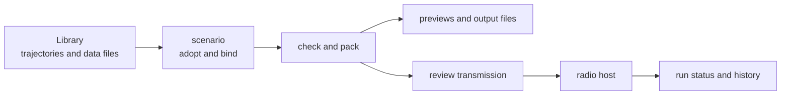

# User guide

This guide covers building LoomSky, preparing scenarios in the browser and
operating radio hosts. Its files and controls are described here; their
implementation is in [Design](../design/README.md).

| Page | Content |
|---|---|
| [Overview](overview.md) | the browser, web host, radio host, resources and files |
| [Quick start](quick-start.md) | one example from imported inputs to preview and transmission review |
| [Install](install.md) | dependencies, build outputs, services, web hosting and basemaps |
| [Host file](host.md) | station, token, allowed origins, bands and gain |
| [Library](library.md) | resource browsing, importing, picking and common navigation |
| [Scenarios](scenarios.md) | adopted trajectories, data bindings, editing, checks and export |
| [Trajectories](trajectories.md) | Plan geometry, events, rules, interactive solving and adoption |
| [Previews and outputs](previews.md) | maps, sky, timelines, effective values and modeled downloads |
| [Transmission](transmission.md) | registration, Live and Replay, review, Stop, commands and recovery |
| [Activity](activity.md) | Problems, Events, notifications and confirmations |
| [Browser storage](storage.md) | what survives reload, save failures, retained inputs and backups |
| [HTTP API](api.md) | integration with the radio host, including status and cancellation |

Field and file rules that belong to the simulator are linked to
[Pharos](https://github.com/Mirai-Research/Pharos/tree/main/docs). Each LoomSky
reference keeps its observable limits and messages with the operation
that produces them.
