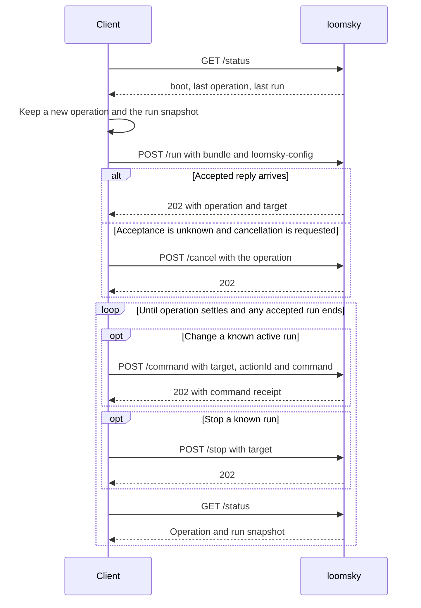

# The API

`loomsky` serves plain HTTP/1.1 at its configured address. A client
uploads a Pharos bundle, follows its operation and run identities, and
reads snapshots until the run ends. Browser use requires an origin
listed in the [host file](host.md#callers).



## Requests and replies

| Call | Request | Success |
|---|---|---|
| `GET /status` | no body | 200 with the snapshot |
| `POST /run` | binary bundle body and `loomsky-config` header | 202 with `{operation, target}` |
| `POST /command` | JSON `{target, actionId, command}` | 202 with `{target, actionId, command, state, applied}` |
| `POST /stop` | JSON `{target}` | 202, no body |
| `POST /cancel` | JSON `{operation}` | 202, no body |
| `OPTIONS` on any path | preflight | 204, no body |

| Header | Contract |
|---|---|
| `authorization` | `Bearer <token>`; required except on `OPTIONS` |
| `origin` | may be absent; when present, must exactly match a complete host-file entry |
| `content-length` | required by every POST call; chunked transfer encoding is refused |
| `loomsky-config` | required by `POST /run`; a JSON submission envelope |

The bearer token is compared in constant time after its length is
checked. An allowed origin is echoed in full. An unlisted origin is
refused before token or route handling, including for `OPTIONS`.

Authenticated POST calls to `/run`, `/command`, `/stop` and `/cancel`
refuse chunked transfer encoding with 400, even when `content-length`
is also present. The host closes the connection without reading the
body or dispatching the call.

| Response to an allowed origin | Header |
|---|---|
| every response | `access-control-allow-origin: <origin>` |
| every response | `vary: origin` |
| preflight | `access-control-allow-methods: GET, POST` |
| preflight | `access-control-allow-headers: authorization, content-type, loomsky-config` |
| preflight | `access-control-max-age: 600` |

Snapshots, accepted-run replies, command receipts and refusals have the
content type `application/json`. A refusal has the shape `{"error":"<text>"}`.
Snapshots also carry `cache-control: no-store`. A POST refused before
its body is read closes the connection.

JSON numbers are unquoted and finite; enum names are strings. Unknown
keys, missing required fields and duplicate keys are refused.

## Operations and runs

A process start creates a new `boot`: 64 random bits written as exactly
16 lowercase hexadecimal digits. Run and operation sequences belong to
that boot and are independent.

| Identity | Example | Use |
|---|---|---|
| run target | `{"boot":"9f2c61d0a4b3e857","sequence":7}` | command or stop a committed run |
| operation | `{"boot":"9f2c61d0a4b3e857","sequence":9,"nonce":"921dc9140ba44269beabebf05d00f992"}` | identify an upload, its accepted run or its cancellation |

For a new operation, use the snapshot's operation sequence plus one,
or 1 when `operation` is null. Generate a fresh 128-bit nonce, written
as exactly 32 lowercase hexadecimal digits. The nonce distinguishes
clients that saw the same preceding operation.

The host reserves only the next operation of its current boot, while
no upload or run is active. Once reserved, that sequence is consumed
even if the upload is rejected or cancelled. Run numbers increase only
when a bundle commits, so the two sequences can differ.

Commands and stops check the entire run target under the control lock.
A stop of the current run gets 202 even after it ends. A different
target gets 409. A new command gets 409 after command admission closes;
an exact retry can still retrieve its existing receipt.

## Submit a bundle

`POST /run` carries the bundle bytes in the body and the operation
and config in `loomsky-config`:

```text
loomsky-config: {"operation":{"boot":"9f2c61d0a4b3e857","sequence":9,"nonce":"921dc9140ba44269beabebf05d00f992"},"config":{"gain_db":30,"replay_ms":420000,"label":"luoyu_drive v3"}}
```

| Config field | Meaning |
|---|---|
| `gain_db` | required transmit gain in dB |
| `replay_ms` | nonnegative integer offset in ms from the window start; absent or null selects live |
| `label` | optional text echoed in status; absent or null gives no label |

The header is ASCII. Encode other characters in the label with JSON
`\u` escapes. The label is at most 256 bytes after decoding and is
never interpreted by the service.

The browser records the saved scenario version, exact build, Pharos engine
identity and bundle digest separately in its local submission record. It
associates that record with the accepted boot and run identity. These
document identities are not fields in `loomsky-config`; the native host
executes the uploaded bundle and echoes the label for display.

The host reserves the operation before reading the body. Its 202 reply
means the complete upload committed to a new run; plan validation,
device setup and transmission follow asynchronously. Read `status`
to distinguish an active run, a refused plan and a later failure.

## Cancel an operation

Use `POST /cancel` when the operation is known but the `/run` reply may
have been lost. It names the same operation sent in `loomsky-config`:

```json
{
  "operation": {
    "boot": "9f2c61d0a4b3e857",
    "sequence": 9,
    "nonce": "921dc9140ba44269beabebf05d00f992"
  }
}
```

| Operation at cancellation | Result |
|---|---|
| its upload is reserved | marks it cancelled; the upload cannot commit |
| its run was accepted | requests that run's stop; the operation keeps its accepted target |
| already cancelled or rejected | 202, no further change |
| superseded, including another nonce at the same sequence | 202, no change to the newer operation |
| the next sequence, host idle | retires it as cancelled before its upload arrives |
| the next sequence, another upload or run active | 409 |
| another boot, sequence 0 or a sequence beyond the next | 409 |

A cancellation's 202 acknowledges the cancellation request. For an
accepted run, wait for that target's `ended` snapshot to confirm the
stop. Late upload completion cannot commit to, replace or release a
newer operation. Host shutdown refuses both new admission and the
commit of an earlier upload.

### Lost replies

An aborted request or lost reply leaves acceptance unknown. Keep the
exact operation until a reply or snapshot establishes what happened.
An older idle snapshot does not prove the upload was refused. A new
boot or a newer operation proves the old operation can no longer run
or be accepted.

The page persists the operation and run snapshot before uploading,
including the saved source version, exact build and bundle. It also
persists Stop intent and reconciles it after reload;
[Transmission](transmission.md) describes that workflow. Closing the
page or losing its network connection leaves the native run active
until completion, stop or failure. Any client with the token can follow
and stop it.

## Commands

A command addresses one run and carries one action. All three request
fields are required:

```json
{
  "target": {"boot": "9f2c61d0a4b3e857", "sequence": 7},
  "actionId": "power-gps-7-01",
  "command": {"power": {"system": "GPS", "svid": 7, "dbhz": 45}}
}
```

`actionId` is a client-chosen JSON string containing 1–128 bytes after
decoding. Generate a new ID for each intended action. Keep the same
target, ID and command when retrying that action after an uncertain reply.

The `command` object contains exactly one action field:

| Action | Field | Value |
|---|---|---|
| signal power | `power` | an object with the power fields below |
| noise floor | `noise_floor_dbm_hz` | a number in dBm/Hz, such as -170 |
| elevation mask | `elevation_mask_deg` | a number in degrees, such as 10 |

| Power field | Values |
|---|---|
| `system` | `GPS`, `BDS`, `Galileo`, `GLONASS` |
| `svid` | satellite number, or 0 for the whole system |
| `dbhz`, `dbm`, `dbw` | at most one level; omit all three to restore the scenario's value |

The first accepted request returns 202 with a JSON receipt:

```json
{
  "target": {"boot": "9f2c61d0a4b3e857", "sequence": 7},
  "actionId": "power-gps-7-01",
  "command": {"power": {"system": "GPS", "svid": 7, "dbhz": 45}},
  "state": "accepted",
  "applied": null
}
```

| Receipt field | Content |
|---|---|
| `target` | the addressed run |
| `actionId` | the stored action ID |
| `command` | the stored command |
| `state` | `accepted`, `applied`, `rejected` or `discarded` |
| `applied` | null while queued; otherwise the [command disposition](#command-dispositions) |

HTTP handling checks the command's shape. The producer then converts
its satellite and submits its values to Pharos. A rejected command
remains in the snapshot with its message. A 202 confirms receipt;
the receipt's state and later snapshots show whether it applied.

Commands apply at the first epoch of a producer pull. An elevation-mask
change affects channel selection at the next re-plan, at most 1 s
later. See [command timing](../design/timing.md#commands) for admission,
queueing and final settlement.

### Retry a command

Within the current run, repeating an `actionId` with the same parsed
command returns its existing receipt without queueing another command.
The response is 202 even when that receipt now says `applied`, `rejected`
or `discarded`. Reusing the ID with a different command returns 409.

The host checks existing IDs before checking whether command admission
has closed, so an exact retry still works after Stop or the run's end.
Receipts remain available until another run commits. A different run
target, including one from an earlier boot, returns 409. Use the same
`actionId` to find the command in `status.commands` when reconciling a
lost reply.

## The snapshot

`GET /status` returns the latest operation and the latest committed
run. They can describe different submissions: for example, a cancelled
upload leaves the previous run's status in place.

```json
{
  "boot": "9f2c61d0a4b3e857",
  "run": 12,
  "device": "ready",
  "now_ms": 1787249281149,
  "operation": {
    "id": {
      "boot": "9f2c61d0a4b3e857",
      "sequence": 15,
      "nonce": "921dc9140ba44269beabebf05d00f992"
    },
    "state": "accepted",
    "target": {"boot": "9f2c61d0a4b3e857", "sequence": 12}
  },
  "station": {
    "name": "bench-1",
    "bands_hz": [[1559000000, 1610000000]],
    "max_gain_db": 60,
    "reference": "none"
  },
  "status": {
    "state": "on_air",
    "outcome": null,
    "config": {
      "gain_db": 30,
      "replay_ms": null,
      "label": "luoyu_drive v3"
    },
    "plan": {
      "rate_hz": 4000000,
      "centre_hz": 1575420000,
      "gain_db": 30,
      "start_gps_ms": 1471284018000,
      "start_gps_sub_ms": 0,
      "epochs": 1800000,
      "leap_seconds": 18,
      "leap_change_gps_ms": null,
      "leap_seconds_after": 18
    },
    "first": 478200,
    "sent": 481349,
    "counts": {"underflow": 1, "late": 0, "sequence": 0, "short": 0, "clipped": 0},
    "channels": [
      {"system": "GPS", "svid": 7, "signal": "L1CA"},
      {"system": "Galileo", "svid": 11, "signal": "E1"}
    ],
    "commands": [
      {
        "actionId": "power-gps-7-02",
        "command": {"power": {"system": "GPS", "svid": 7, "dbhz": 40}},
        "applied": {"epoch": 480900}
      },
      {
        "actionId": "mask-01",
        "command": {"elevation_mask_deg": 95},
        "applied": {"rejected": "submit rejected: InvalidValue"}
      }
    ]
  }
}
```

| Field | Content |
|---|---|
| `boot` | process identity |
| `run` | last committed run number, starting at 1; 0 before the first |
| `operation` | null initially; then `{id, state, target}` for the latest reserved or cancelled operation |
| `device` | last device-open state: `opening`, `ready`, `absent` or `failed` |
| `station` | the host file's `name`, `bands_hz`, `max_gain_db` and `reference` |
| `now_ms` | host Unix time at the snapshot, in ms |
| `status` | null before the first committed run; thereafter that run number's status |

An operation's state is `uploading`, `accepted`, `cancelled` or
`rejected`. Its target is null until accepted. The accepted operation
remains visible through the run's end unless a newer operation replaces
it. A changed `boot` means the previous process and its run have ended.

### Run status

| `status` field | Content |
|---|---|
| `state` | `starting` while preparing an entry, `waiting` before the window, `on_air` or `ended` |
| `outcome` | null until ended; the terminal outcome thereafter |
| `config` | submitted gain, replay offset and label, with absent optional fields shown as null |
| `plan` | null until tune, read-back checks and flush succeed; then settings, window and leap information |
| `first`, `sent` | first and last epochs of fully sent slots; null before the first such slot |
| `counts` | observed stream faults, including the final burst drain, expired first-slot deadlines, and clipped components in sent slots |
| `channels` | the channel set carried by the slot at `sent` |
| `commands` | one record per accepted action ID, in arrival order; each has `actionId`, `command` and `applied` |

`starting` includes both initial preparation and preparing another entry
after a fault or a missed first-slot deadline. During recovery, `first`
and `sent` retain the epochs of earlier fully sent slots. A complete
slot send sets the state to `on_air`.

`counts.late` includes radio time-error events and first slots discarded
locally because fewer than 50 ms remain before their scheduled start.
A local discard increases `late` without advancing `sent` or adding
clipped components.

The plan's `rate_hz`, `centre_hz` and `gain_db` are the radio's
read-back values. The window starts at
`start_gps_ms + start_gps_sub_ms` in GPS milliseconds and lasts
`epochs` one-millisecond epochs. Splitting the start keeps nanoseconds
out of JSON integer fields.

`leap_seconds` is the offset at the window start.
`leap_change_gps_ms` is null without a change; otherwise
`leap_seconds_after` applies from that GPS instant. Epoch k is scheduled
at the start plus k ms. [Timing](../design/timing.md) defines entry,
replay and recovery on that clock.

### Command dispositions

Receipts and snapshot command records use the same `applied` values.
Only receipts include the derived `state` field:

| Receipt `state` | Command's `applied` | Disposition |
|---|---|---|
| `accepted` | null | queued |
| `applied` | `{"epoch":k}` | Pharos applied it at epoch k |
| `rejected` | `{"rejected":"<text>"}` | conversion or Pharos submission rejected it |
| `discarded` | `{"discarded":"completed"}` | no epoch remained to apply it |
| `discarded` | `{"discarded":"stopped"}` | stopped before application |
| `discarded` | `{"discarded":"refused"}` | plan refused before application |
| `discarded` | `{"discarded":"failed"}` | failed before application |

Command admission closes at producer EOF, Stop or failure. Every
unapplied command receives a terminal disposition; an ended run has no
queued records.

### Run outcome

| `outcome` | Meaning |
|---|---|
| `{"completed":{}}` | no window epochs remain to transmit |
| `{"stopped":{}}` | a stop ended the run |
| `{"refused":{"reason":"<reason>","message":"<text>"}}` | the bundle or plan was refused before transmission setup |
| `{"failed":{"reason":"<reason>","message":"<text>"}}` | setup or transmission failed |

Reasons are `bundle`, `format`, `band`, `gain`, `window`,
`device`, `readback`, `clock`, `send`, `generator` or `host`.
The [runtime message reference](../design/timing.md#limits-and-messages)
gives their exact text. After a failure frees the device, the next
accepted submission with a valid plan attempts to open it again.

## Limits and messages

| Limit | Value |
|---|---|
| `loomsky-config` | 1024 bytes |
| `label`, once decoded | 256 bytes |
| `actionId`, once decoded | 1–128 bytes |
| a command, stop or cancellation | 1024 bytes |
| the bundle | 1 GiB |

A `<fault>` below is a JSON syntax fault with its position, a typed
field fault such as `UnknownField` or `UnexpectedToken`, or `a number
is not finite`. Numbers are unquoted and enum names are strings. A
config's fault may also be `label exceeds 256 bytes`.

| Status | `error` | Call |
|---|---|---|
| 401 | `a missing or wrong token` | any except `OPTIONS` |
| 403 | `the origin is not listed in the host file` | any |
| 404 | `no such call` | another path or method |
| 400 | `transfer-encoding is not supported` | `/run`, `/command`, `/stop`, `/cancel` |
| 400 | `loomsky-config is missing` | `/run` |
| 400 | `loomsky-config exceeds 1024 bytes` | `/run` |
| 400 | `loomsky-config: <fault>` | `/run` |
| 400 | `the bundle needs a content-length` | `/run` |
| 400 | `the bundle exceeds 1 GiB` | `/run` |
| 409 | `a transmission lives or uploads` | `/run`, `/cancel` |
| 409 | `the operation is not the next operation of this boot` | `/run` |
| 409 | `the operation was cancelled or superseded` | `/run` |
| 409 | `the host is closing` | `/run` |
| 500 | `out of memory for the bundle` | `/run` |
| 400 | `the command needs a content-length` | `/command` |
| 400 | `the command exceeds 1024 bytes` | `/command` |
| 400 | `the command: <fault>` | `/command` |
| 400 | `the command: actionId must contain between 1 and 128 bytes` | `/command` |
| 409 | `that run is not the current run` | `/command`, `/stop` |
| 409 | `the run no longer accepts commands` | `/command` |
| 409 | `the actionId already identifies a different command in this run` | `/command` |
| 500 | `out of memory` | `/command`, `/status` |
| 400 | `the stop needs a content-length` | `/stop` |
| 400 | `the stop exceeds 1024 bytes` | `/stop` |
| 400 | `the stop: <fault>` | `/stop` |
| 400 | `the cancellation needs a content-length` | `/cancel` |
| 400 | `the cancellation exceeds 1024 bytes` | `/cancel` |
| 400 | `the cancellation: <fault>` | `/cancel` |
| 409 | `the operation does not belong to this boot or its next sequence` | `/cancel` |

If a refusal cannot fit its response buffer, its JSON message is
`the refusal is too long to show`.
