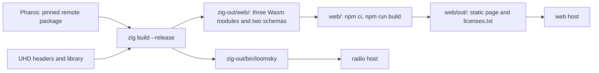

# Install

LoomSky has two build outputs: the `loomsky` service on the radio host
and a static page served to browsers. The native build also supplies the
Pharos WebAssembly modules and schemas used by the page.



## Build the radio host

| Dependency | Use |
|---|---|
| Zig 0.16 | builds the service and the Pharos outputs |
| Pharos, fetched by Zig | the typed Zig run module, three WebAssembly products and two schemas |
| UHD library and C headers | the radio driver linked by `loomsky` |
| B210 firmware and FPGA images | the images UHD loads when opening the radio |

`build.zig.zon` pins a commit from
[Mirai-Research/Pharos](https://github.com/Mirai-Research/Pharos) and its
package hash. `zig build` fetches that package into `zig-pkg/` as needed.
LoomSky imports its `pharos_run` Zig module directly. Only the UHD C
header is translated; `src/uhd.zig` owns the driver calls.

From the LoomSky repository:

```bash
zig build --release -Duhd=/path/to/uhd
```

Replace `/path/to/uhd` with the UHD installation prefix. The option adds
its `include/` and `lib/` directories. Omit `-Duhd` when both are in the
system search paths.

The Zig build omits debug information from the service, WebAssembly
modules and schema generator in every optimization mode.

| Output | Build mode or content |
|---|---|
| `zig-out/bin/loomsky` | ReleaseSafe with `--release` |
| Pharos linked into `loomsky` | ReleaseFast |
| `zig-out/web/pharos_traj.wasm` | trajectory geometry, solving and PHT generation; ReleaseFast with WebAssembly SIMD128 |
| `zig-out/web/pharos_pack.wasm` | scenario packing and navigation-file description; ReleaseFast with WebAssembly SIMD128 |
| `zig-out/web/pharos_obs.wasm` | modeled queries and observation/position outputs; ReleaseFast with WebAssembly SIMD128 |
| `zig-out/web/trajectory.schema.json` | trajectory Plan schema |
| `zig-out/web/scenario.schema.json` | scenario schema |

Install the B210 images supplied for the UHD installation; UHD provides
`uhd_images_downloader` for this. On hosts that require USB device rules,
give the service account access to the radio through those rules.

| Source-formatting step | Effect |
|---|---|
| `zig build fmt-check` | checks `build.zig`, `build.zig.zon` and `src/` |
| `zig build fmt` | formats those paths in place |

## Develop with Pharos

Use a local Pharos checkout without changing the pinned dependency:

```bash
zig build --release -Duhd=/path/to/uhd --fork=/path/to/Pharos
```

The same `--fork` option works with `web`, `fmt` and `fmt-check`. It
overrides Pharos for that invocation, including the native module,
WebAssembly and schemas.

After publishing a Pharos commit, update the pin from the LoomSky root:

```bash
zig fetch --save=pharos 'git+https://github.com/Mirai-Research/Pharos.git#<commit>'
```

Replace `<commit>` with its full commit ID. This writes the URL and
verified package hash into `build.zig.zon`.

## Run the service

Write a [host file](host.md) with the station, permitted bands, maximum
gain, token and page origins. Then start the installed executable with
an IP address, port and file path:

```bash
loomsky 192.168.1.20:8740 /etc/loomsky/host.json
```

The service binds the address and opens the radio. It continues serving
if the open fails; a later accepted submission with a valid plan can
try the open again. The host file is read once, so changing it requires
a restart.

Run the process under the host's restart-on-failure service. Restart
after a crash or an exit other than 0 or 2. A second process cannot bind
the same address; assign one process to each radio.

| Exit | Meaning | Service action |
|---|---|---|
| 0 | SIGTERM or SIGINT completed the stop and closed the radio | leave stopped |
| 1 | host failure: address, memory or thread creation | restart |
| 2 | invalid arguments or host file | correct the input before restarting |
| 3 | the watchdog found a stuck device call or stop | restart in a new process |

The [watchdog](../design/timing.md#the-watchdog) exits the process rather
than freeing objects beside a stuck thread. Every restart gives the
service a new `boot` identity.

## Build and serve the page

Use Zig 0.16 and Node 24 or later with npm. For a page hosted separately
from the radio, build just its Pharos assets; UHD is not needed. From the
LoomSky repository:

```bash
zig build web
cd web
npm ci
npm run build
npm run serve -- 192.168.1.10:3000
```

The default native build also installs these assets, so `zig build web`
can be skipped after building the radio host.

| Stage | Result |
|---|---|
| `prebuild` | copies the three Pharos WebAssembly modules, two schemas and three MapLibre `.mjs` modules into `web/public/` |
| `build` | runs Next.js, checks TypeScript and exports the page to `web/out/` |
| `postbuild` | writes dependency notices to `web/out/licenses.txt` |
| `serve` | serves `web/out/` over plain HTTP |

With no address, `npm run serve` listens on `127.0.0.1:3000`. Serve
`web/out/` at the site root. The included server serves existing files first.
GET and HEAD requests for `/library` or `/resource/<kind>/<id>[/<section>]`
fall back to `index.html`; `kind` is `scenario`, `trajectory`, `host` or
`file`, and each ID or section is one encoded path segment. Both forms
accept a trailing slash. Other missing paths, including assets, return 404.

Other static servers need the same UI path fallback. Send `.wasm` as
`application/wasm` and `.mjs` as JavaScript.
Production remains a static export and does not use Next.js rewrites.
The included server does not implement byte-range responses for map archives.

Add the page's origin to each radio host's `origins` array. For the
command above this is `http://192.168.1.10:3000`, with no trailing slash.
The browser connects directly to the radio host's
[HTTP API](api.md#requests-and-replies).

For development, `npm run dev` copies the same assets and starts Next.js
on port 3000. Open `http://localhost:3000` and list that origin in the host
file. Development-only rewrites serve the same UI paths through the root page.

## Serve basemaps

Basemaps are optional `.pmtiles` vector archives added through the map's
**Basemap** popover. Use archives with the Protomaps basemap layers. The
page requests archive headers, metadata and tiles as needed; it has no
default remote map source. One archive server can serve several browsers.

| Archive response | Purpose |
|---|---|
| `206 Partial Content` for a byte-range request | the page probes bytes 0–6, then reads the archive in pieces |
| `Access-Control-Allow-Origin` naming the page's origin | permits reads across origins |
| `Access-Control-Allow-Headers: Range` when answering a preflight | permits range requests |
| `Access-Control-Expose-Headers: ETag` | lets the PMTiles reader detect an archive replaced on the server |

The initial range probe must return the text `PMTiles`. The archive
header must identify vector tiles; raster archives are refused. The
page gives each archive request 5 s to answer.

### Archive server examples

These examples serve files from `/srv/maps` and allow the page at
`http://192.168.1.10:3000`. Use the appropriate block in the archive
server's configuration.

For nginx, add this location inside the selected server block. The
[header-module reference](https://nginx.org/en/docs/http/ngx_http_headers_module.html)
describes the response-header directives.

```nginx
location /maps/ {
    alias /srv/maps/;
    add_header Access-Control-Allow-Origin http://192.168.1.10:3000 always;
    add_header Access-Control-Allow-Methods "GET, HEAD, OPTIONS" always;
    add_header Access-Control-Allow-Headers Range always;
    add_header Access-Control-Expose-Headers ETag always;
    if ($request_method = OPTIONS) { return 204; }
}
```

For Caddy, this serves the directory on port 8080 with
[`file_server`](https://caddyserver.com/docs/caddyfile/directives/file_server)
and [`header`](https://caddyserver.com/docs/caddyfile/directives/header).

```caddy
:8080 {
    root * /srv/maps
    header Access-Control-Allow-Origin http://192.168.1.10:3000
    header Access-Control-Allow-Methods "GET, HEAD, OPTIONS"
    header Access-Control-Allow-Headers Range
    header Access-Control-Expose-Headers ETag
    @preflight method OPTIONS
    respond @preflight 204
    file_server
}
```

Add the resulting archive URL in **Basemap**: a path such as
`http://192.168.1.10:8080/lab.pmtiles` for the Caddy example. Check that a
range request receives 206 from the configured server, including any
proxy in front of it.

### Extract an area

The [PMTiles command-line tool](https://docs.protomaps.com/pmtiles/cli#extract)
can extract an area from a clustered archive. Replace the example URL
with the source archive you selected:

```bash
pmtiles extract 'https://example.com/source.pmtiles' lab.pmtiles --bbox=114.30,30.45,114.45,30.60 --maxzoom=15
```

The bounding box is west longitude, south latitude, east longitude,
north latitude. To extract a world overview, omit `--bbox` and choose a
lower maximum zoom, such as `--maxzoom=6`. Serve the resulting file on
the archive server. The page orders archives by maximum zoom and draws
finer archives over coarser ones.

## Dependency notices

The native executable links UHD, whose host-library licence is GPL-3.0-or-later.
The page's dependencies carry their own licences.

| Dependency | Use | Declared licence |
|---|---|---|
| `next`, `react`, `react-dom` | static export and views | MIT |
| `@codemirror/*`, `@lezer/highlight` | JSON editor | MIT |
| `jsonc-parser` | structured reads and edits of JSON | MIT |
| `maplibre-gl` | maps | BSD-3-Clause |
| `pmtiles` | archive reads | BSD-3-Clause |
| `@protomaps/basemaps` | map layers | BSD-3-Clause |
| `fflate` | ZIP export | MIT |
| `@fontsource/ibm-plex-sans`, `-sans-condensed`, `-mono` | fonts | OFL-1.1 |

TypeScript, Tailwind, its PostCSS plugin and the `@types/*` packages are
build dependencies. The notice collector walks the runtime dependency
graph and includes Next.js's bundled notices, including code outside
the page's chunks. If a package has no separate notice file, the output
records its declared licence. The export keeps these notices in
`web/out/licenses.txt`.

## Limits and messages

Native messages go to stderr with the prefix `loomsky: `. The host file
is limited to 1 MiB.

| Line after the prefix | Exit |
|---|---|
| `<name> on <address>, boot <16 hex digits>` | running |
| `usage: loomsky <address:port> <host.json>` | 2 |
| `<argument> is no address:port` | 2 |
| `cannot read <file>: <error>` | 2 |
| `<file>: <fault>` from the [host-file rules](host.md#limits-and-messages) | 2 |
| `<file>: token must be 64 hex digits; a fresh one: <64 hex digits>` | 2 |
| `<file>: token must be 64 hex digits; the system has no entropy for a fresh one` | 2 |
| `out of memory` | 1 |
| `cannot serve on <address>: <error>` | 1 |
| `cannot start the radio thread: <error>` | 1 |
| `cannot start the watchdog: <error>` | 1 |
| `the device call <call> has not returned for <n> s; exiting with 3` | 3 |
| `a stop has not finished for <n> s; exiting with 3` | 3 |

The page's build and static server also write to stderr.

| Line | Exit |
|---|---|
| `serve: the page on http://<address>` | running |
| `serve: <argument> is no address:port` | 2 |
| `serve: cannot serve on <address>: <error>` | 1 |
| `assets: missing <files>; run zig build in the repository first` | 1 |
| `licenses: out/licenses.txt, <n> packages and <n> bundled notices` | successful notice collection |
| `licenses: <package> is not in the lockfile` | 1 |
| `licenses: <package> carries no licence file or licence identifier` | 1 |
