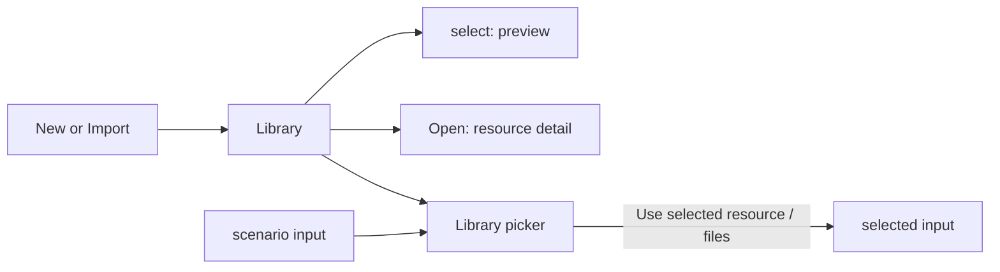

# Library

Library lists the scenarios, trajectories, data files and transmitters
kept by this browser. Select a resource to inspect it, open its detail
page to work on it, or choose it from a field's picker to use it in a
scenario.

The saved resources belong to the browser's storage. Their persistence,
backup and removal rules are in [storage](storage.md).

## Find and open a resource

Choose **Open Library** on Home or **Library** in the top bar. The left rail
filters the list to **All**, **Scenarios**, **Trajectories**, **Data files**
or **Transmitters**. Each category shows its resource count.

**Search Library** matches the resource name, type, status and the
secondary text beneath its name. Search ignores case. Separate words
with spaces; every word must occur somewhere in those fields. The
**Name**, **Type** and **Status** sort choices order the matching rows
in ascending order, with names breaking ties.

| Action | Result |
|---|---|
| click a row | selects it and updates Preview |
| double-click a row | opens its detail page |
| choose **Open** from the row's actions menu | opens the same detail page |
| choose **Preview** | hides or shows the preview pane |
| choose **Library** in a detail header | returns to the list |

The count below the list is the number of matching resources. An empty
search result does not remove resources or change their contents.
The list loads resource summaries. Opening a document or starting an action
loads its working content as needed. Library Preview reads saved versions
and retained results without generating trajectories or checking scenarios.

## Previews and details

Every detail page has a common header with the resource name, type,
Library return link and actions menu. Its status, tools and content
depend on the resource.

| Resource | Library preview | Detail page |
|---|---|---|
| scenario | latest saved version, retained checks, working-copy status, window, signals, selected trajectory and input files | [scenario setup, configuration and outputs](scenarios.md) |
| trajectory | latest saved version, working-copy status, retained solve result and track, and scenarios using it | [trajectory editor, JSON, properties and timeline](trajectories.md) |
| data file | type, size, import time, current uses, text and available navigation coverage | the same information with more space for the contents |
| transmitter | connection, device, current run and progress | [Run, Signal preview, Run history and Device](transmission.md) |

| Resource | Actions menu |
|---|---|
| scenario | **Duplicate**, **Export…**, **Delete…** |
| trajectory | **Duplicate**, **Export trajectory JSON**, **Export PHT**, **Delete…**; PHT export compiles and verifies its captured Plan |
| data file | **Rename…**, **Export**, **Remove from Library…** |
| transmitter | **Device settings**, **Remove connection…** |

Library rows also offer a scenario's **Transmit** shortcut, or **Save &
review** when it has unsaved work, and **Stop** for a transmitter that may
be active. Removal actions open a
[confirmation](activity.md#confirm-an-action).

Background operations remain visible in Activity. Repeating an identical
request joins that operation; changed content or another format can start
a separate one.

Library Preview shows the latest saved document and any retained build.
It identifies a version that has not yet been checked or solved; opening
the editor prepares the working copy. Preview lists unsaved working-copy
status separately and leaves unapplied edits alone. A scenario preview
uses the saved version's selected trajectory build. A transmitter preview
uses the submitted run available to this browser.

Preview maps start fitted to the available track. Moving their camera is
temporary. Map controls and the interpretation of predicted results are
described in [previews](previews.md).

## Save and version history

Scenario and trajectory headers show their working copy's saved version,
such as **v1**, beside **Save**. Edits remain in the working copy until you choose
**Save** or press **Ctrl+S** / **⌘S**. The header and Library row identify
unsaved changes separately from check or solve results.

Save retains a complete source snapshot and its selected inputs. It creates
the next version each time. Invalid JSON or failed
checks can be saved; a field or name that cannot be applied must first be
corrected or reverted. Preview, checks and exports do not save the original
document. **Duplicate** creates a separate document at v1 from the current
contents.

Saved Library changes appear in other tabs opened at the same page origin.
A document without local edits or editing history follows its latest saved
version. A document with local work keeps it; Save appends that work as the
next version. [Storage](storage.md) describes browser
persistence and Save failures.

Open the version control in a document header to inspect saved history.
Use its close control to return to the document. Browser Back follows the
previous page address.
Restoring an earlier version copies its contents into the working copy.
Choose **Save** to retain the restored contents as a new version; the earlier
history remains in place. See [scenarios](scenarios.md) and
[trajectories](trajectories.md) for the editing workflow.

**Delete…** removes a scenario or trajectory, its saved versions and builds,
and its unsaved working copy after confirmation. A saved scenario version
using a trajectory, or a pending transmission or submitted run using a
scenario, blocks deletion with an explanation. Shared file bytes remain in
browser storage. See [storage](storage.md#file-identities-and-deletion).

## Create and import

| Menu choice | Creates or reads |
|---|---|
| **New → Scenario** | a scenario opened directly in Setup with a default name ready to edit |
| **New → Trajectory** | one editable Plan with geometry, events and rules |
| **New → Add transmitter…** | a checked connection to a radio host |
| **Import → Scenario JSON…** | `.json` scenario files |
| **Import → Trajectory JSON…** | a `pharos.trajectory-plan` JSON document |
| **Import → Data file…** | files to keep as named Library entries |

The authoring pages describe the initial values and checks for
[scenarios](scenarios.md) and [trajectories](trajectories.md).
[Transmission](transmission.md#add-a-transmitter) describes checking and
adding a radio host.

Creating or importing a scenario or trajectory saves its first version,
**v1**. Later edits require **Save**.

Import can read several files. **Activity → Operations** lists each file's
progress and result, including files that failed or were not processed.
Completed imports stay in Library if a later file fails or the batch is
cancelled. To try again, select the unsuccessful files in a new import;
completed resources remain available. Closing the picker or leaving the
page view leaves the import running; cancelling the operation stops before its next file after any
save already in progress finishes.

You can keep browsing and selecting resources during an import. Selecting
another set of files starts an independent batch with its own progress and
cancellation controls.

An imported scenario keeps input filenames as hints. It starts without
selected input files or a trajectory binding. Choose each input and
trajectory explicitly, even when Library already contains a matching
filename. See [scenario imports and inputs](scenarios.md).

## Data files

A data-file entry records a name, detected type, extension, size, import
time and SHA-256 digest. Type detection uses recognizable content and
file extensions; unrecognized files appear as **Data file**. The type
label does not replace the checks performed when a scenario uses the
file.

Different contents can have the same filename. Importing the same name
and contents again reuses the existing entry. Entries with different
names may share the same stored bytes.

| Action | Effect |
|---|---|
| **Rename…** | changes this entry's name and extension; existing scenario bindings keep their names and contents |
| **Export** | downloads the original bytes under the entry's current name |
| **Remove from Library…** | opens a confirmation to remove the entry; existing scenarios and submitted runs keep their file contents |

The **Used by** list shows current scenarios and trajectories using the
file. Removing a catalogue entry leaves its stored bytes available;
[storage](storage.md) describes the separate lifetimes.

### Contents and coverage

Readable UTF-8 files show an excerpt under **Contents**. The excerpt
reads at most the first 8192 bytes and displays at most 60 lines and
6000 characters. A truncated excerpt says **Showing the beginning of
the file**. Binary or unreadable text has no text preview. **Export**
still writes the complete file.

Recognized navigation ephemeris files can also show **Navigation
coverage**: intervals by system, satellite counts, PRNs, and the overall
start and end in GPS time. Other file types do not have a structured
coverage view. A coverage error leaves the metadata and any readable
text visible. If the file itself cannot be read from browser storage,
the preview offers **Retry preview**.

## Choose an input

Scenario **Choose file**, **Replace** and trajectory controls open a
Library picker. It uses the same search, sort and preview controls, and
shows the resource kinds accepted by that field. A data-file field
shows its recognized file kind and unclassified data files; the
scenario checks the selected contents when it uses them.

1. Select a row. For a field accepting several files, use the checkboxes
   or click rows to add and remove selections.
2. Inspect Preview and the selected count. **Clear selection** clears
   the current choice.
3. Choose **Use selected resource** or **Use selected files** to apply
   it. The picker closes when the choice succeeds.

A single-file replacement uses the chosen entry's filename. A trajectory
picker lists saved versions and their source details. Browsing the list does
not start a build. Unsaved edits become available after Save in the editor.
**Use vN** prepares the chosen version when needed and fixes that version and
exact build in the scenario's working copy. An existing selected build is
reused. The scenario still needs **Save** to retain the selection. The version
selection rules are in [trajectories](trajectories.md).

If preparation fails, the picker stays open with the error. Choose **Use vN**
again to retry a temporary failure. If checks reject the source itself, correct
it in the editor and save a new version. A missing selected version is reported
instead of substituting another version.

**Upload…** imports a resource while the picker is open and selects
accepted results. It adds to an existing multiple selection. A file of
the wrong type stays in Library, with an explanation in the picker.
Uploading alone does not bind a file to the scenario.

Before applying a choice, **Cancel**, the close button, or a click
outside the picker closes it without selecting a new input. Uploaded
entries remain in Library. Closing the picker during an upload leaves
the import running. While **Applying…** is shown, selection and closing
controls wait for the operation to finish. A failed application keeps
the picker open so the problem can be reviewed.

Navigating elsewhere, including Browser Back, closes the picker and
releases its automatic preparation. Opening or closing a picker does not
add a browser-history entry, and Forward does not reopen it.

If the scenario or selected file changes while choosing,
the operation asks for a fresh choice. It does not apply the old review
to the changed target. Later trajectory edits do not change a selected saved
version or its build.

## Navigation and session state

| Address | Page |
|---|---|
| `/` | Home: brief introduction and **Open Library** |
| `/library` | Library |
| `/resource/scenario/<id>/<section>` | a scenario section; the default is `setup` |
| `/resource/trajectory/<id>` | a trajectory |
| `/resource/file/<id>` | a data file |
| `/resource/host/<key>/<section>` | a transmitter section; the default is `run` |

Back, Forward and refresh follow these addresses. Identifiers in the
address are URL-encoded. A resource address refers to this browser's
Library; it does not transfer the resource to another browser.
Scenario and trajectory addresses add `?view=json` for JSON; without it,
they open the form or visual editor. A trajectory's `?scenario=<id>` keeps
its return link to that scenario. Back and Forward restore the section
and editor view in the address. Navigation links can be copied or opened
in another tab. `/` always opens Home, without restoring the last page
from the tab session.

During the open page session, Back and Forward restore each recent Library
history entry's category, search, sort, selection, scroll position and
Preview visibility. A newly opened picker starts with its own search,
sort and selection. Opening a resource from Library uses its last section
and editor view. Switching resources keeps preview time, pinned runs,
signal selection and expanded rows. Switching sections or Form/JSON within
the same document keeps its editing input. Leaving an editor cancels an active
drag. History also restores editor scroll positions. Older view positions
can return to defaults during extended browsing. Maps open fitted to the
available track and editing geometry. Reload follows the current URL;
theme is shared with other tabs at this origin.
The broader persistence table is in [storage](storage.md).

Leaving an editor with unsaved work opens a small card at the bottom right.
Choose **Save and leave** to save before navigating, or **Discard and leave**
to drop the unsaved edits and unapplied inputs. Cancelling keeps the editor
open. Switching sections or Form/JSON in the same document needs no prompt.
Reloading or closing the browser page uses the browser’s own warning;
unsaved editing state is not stored for recovery.

Switching pages leaves host polling, pending Stop requests and captured
operations running. Automatic document checks stop when their editor closes;
operations continue preparing their captured sources. The logo button
switches between light and dark themes.
The [host strip](transmission.md#read-the-host-strip),
[Stop controls](transmission.md#stop) and [Activity](activity.md) remain
in the top bar.

## Keyboard

| Context | Key | Effect |
|---|---|---|
| controls | Tab / Shift+Tab | moves focus forward / backward |
| buttons | Enter or Space | activates the focused button |
| Library row | Up, Down, Home, End | moves to another row and selects it |
| Library row | Enter | opens the resource |
| Library or picker row | Space | selects the row, or toggles it in a multiple selection |
| multiple-selection picker | Up, Down, Home, End | moves focus and Preview without changing the checked selection |
| single-selection picker | Up, Down, Home, End | moves and selects the row |
| actions menu | Up, Down, Home, End | moves among enabled menu items |
| scenario or trajectory editor | Ctrl+S / ⌘S | saves the current document as the next version |
| editor outside a text input | Ctrl+Z / ⌘Z; add Shift to redo | cancels an active interaction; otherwise undoes or redoes draft drawing points or document history |
| unapplied editor field | Escape | reverts that field's unapplied text |
| active trajectory drag | Escape | cancels the drag |
| trajectory visual editor | Escape | cancels the current drawing or range draft, then returns to Select on successive presses |
| open popover | Escape | closes the popover |
| Activity | Escape | closes Activity when no popover is open |
| confirmation card | Escape | cancels an unstarted confirmation when it has focus |
| picker or transmission dialog | Escape | closes the dialog after Activity and popovers have closed; a picker applying its choice stays open |

The picker initially focuses Search Library. Tab cycles among its
visible controls unless Activity or a popover is open. Closing the
picker restores its previous focus when that control still exists.

Editor undo and redo apply where the editor has focus. Text inputs keep
their own text-editing behavior; Library, Activity and confirmation cards
do not undo a document behind them. See [scenario editing](scenarios.md)
and [trajectory editing](trajectories.md) for their shortcuts. Timeline
cursor keys are described in [previews](previews.md).

Escape never sends Stop. Use the named Stop control to request it.

## Limits and messages

| Condition | Result |
|---|---|
| browser window narrower than 1024 px | **LoomSky needs a wider window** replaces the workbench; host monitoring and existing runs continue |
| some resource lists fail to load | **Some resources could not be loaded** offers **View problems**; successful lists remain visible |
| no search matches | **No resources match this search** |
| a resource was removed | **This resource is no longer in the current browser's Library**; return to Library |
| an upload is unsuitable for the field | **The uploaded files are in Library, but their types do not match this field** |
| a choice cannot be applied | the picker stays open with its explanation and **View problems** |

Recovery actions for loading and saving failures are in
[Activity](activity.md); their storage consequences are in
[storage](storage.md).
