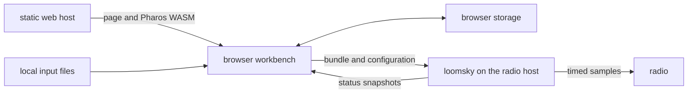
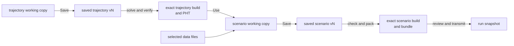

# Overview

LoomSky turns a GNSS scenario into timed radio output. The browser prepares
and inspects the scenario; the radio host generates its IQ16 sample stream
and sends it through UHD.

## What runs where

| Part | Responsibility |
|---|---|
| Static web host | serves the application and its assets; no scenario database runs here |
| Browser | owns the Library, working copies, saved versions, local input bytes, Pharos checks and previews |
| Radio host | validates and accepts a submitted bundle, generates samples and controls the radio |
| Radio | transmits the stream using its configured clock reference |

The web host and radio host can be separate computers. Each radio host
allows the browser origins listed in its [host file](host.md). A browser
registration stores the radio address and token locally. The browser page
requires a viewport at least 1024 CSS pixels wide.

## Library resources

Home at `/` gives a brief introduction and an **Open Library** link to
`/library`. Selecting a resource shows its preview; opening it shows its
tools in a common detail view. Scenario and trajectory previews use saved
contents and retained results.

| Resource | Contains | Used by |
|---|---|---|
| Scenario | scenario JSON, selected data files and a fixed trajectory version and build | checks, predictions and transmission |
| Trajectory | a Plan JSON document with geometry, events, sections and rules | any number of scenarios through an explicitly selected saved version |
| Transmitter | a radio-host registration and its reported state | review, run control and local history |
| Data file | reusable navigation, almanac, antenna or precise-product bytes | fields that explicitly select that file |

Importing a file puts it in Library. Choosing it for a scenario establishes
the binding. Names alone do not select bytes. See [Library](library.md) and
[Scenarios](scenarios.md).

## Working copy, saved version and run snapshot

| State | What later edits change |
|---|---|
| Working copy | changes as you edit; checks and previews follow it without saving |
| Saved version, such as v1 or v2 | retains the complete source and selected inputs at that Save |
| Successful generated build | retains its source version, exact Pharos engine identity, diagnostics and generated bytes |
| Selected trajectory version and build | stays fixed until the scenario explicitly selects another |
| Run snapshot | stays fixed for the associated run and its local history |

New, imported and duplicated documents begin at v1. **Save** creates the
next version only when the saved contents change. A version can retain
unfinished or invalid source; successful checks are a separate requirement
for using a generated trajectory or transmitting a scenario.

Saved builds keep the fingerprint of the exact Pharos WASM used and the
digests of their generated bytes. A matching build can be reused; rebuilding
adds a record without replacing earlier results.

A scenario can keep using an older trajectory version while the shared
trajectory is edited. A radio host can keep transmitting an accepted
scenario while its browser working copy changes. Selecting a trajectory
changes the scenario's working copy; save the scenario to retain that
selection. A transmission identifies the saved scenario version and exact
build it uses.

## Live and Replay

| Mode | Time relationship |
|---|---|
| Live | scenario epochs follow their GPS timestamps; the host enters the part of the window it can still transmit |
| Replay | the radio clock is set from a selected offset in the scenario window; the run follows that clock |

Replay makes a historical scenario usable without changing its navigation
data or start date. Both modes use the same packed scenario. Gain and mode
are reviewed separately before transmission. See [Transmission](transmission.md)
for eligibility, timing and stopping a run.

## Files and results

| Artifact | Role |
|---|---|
| Scenario `.json` | editable simulator configuration; imported file references need explicit bindings |
| `trajectory.json` | editable trajectory Plan; the map, properties and timeline edit this source |
| `.pht` | compiled runtime trajectory retained with a verified build |
| `.phb` | packed simulator inputs sent to the radio host |
| Scenario `.zip` export | the prepared working copy and its selected inputs |
| Observation and position downloads | modeled results from a scenario or a reported run span |

Maps, sky plots and effective values are computed from simulator inputs.
The radio host reports execution state, sent ranges and counters. See
[Previews and outputs](previews.md) for their contexts and limits.

## Persistence

Saved versions, their builds and input bytes, registrations and run snapshots
are stored in the browser's origin. Edits stay in the working copy until
**Save**; switching pages keeps that working copy for the current session.
Archiving a document removes it from the active Library while retaining
its saved history and run references. The radio host owns accepted execution,
so navigation or page closure does not stop it. On reload, the browser restores
its saved records and reconciles them with host status. See
[Browser storage](storage.md) for saved versus session state and
[Activity](activity.md) for failures, operations and confirmation cards.
