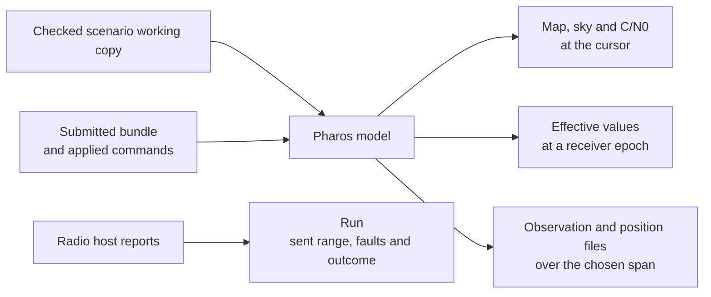

# Previews and output files

LoomSky uses Pharos to predict the receiver path, satellite geometry,
channel state and observation files. A preview has a source and an epoch:
the current scenario, a submitted run, or a saved run context. Its map,
timeline, sky and effective values share that context and inspection time.

Sky, C/N0 and downloaded observations are calculated values. Hardware
status is shown in the transmitter's **Run**. The model does
not measure received RF or establish continuous transmission.

## Contexts

| Where | Source | What changes it |
|---|---|---|
| Library scenario or trajectory Preview | latest saved document and its retained artifacts | saving a version or retaining a build |
| Trajectory editor | current Plan candidate, verified result or temporary edit preview; older results are marked | Plan source edits and gestures |
| Scenario preview pane | the successfully packed working copy | a new successful check of that working copy |
| Transmitter **Signal preview** | the followed or pinned submitted run and commands applied at their reported epochs | Follow selects the current run; manual inspection retains the chosen run |
| Transmitter **Run history** | the saved submission, recorded sent range and applied command context | the selected saved run |

A trajectory editor provides geometry, event and rule controls. A scenario
or transmitter preview is read-only. Its map never changes the source.

A scenario can retain its last packed preview while the working copy is
checking or has errors. The page labels it **Last passed checks**, and the
sky and C/N0 fade when it is older than the working copy. Effective values
inspect that same marked snapshot. Scenario output downloads capture and
check the requested working content before producing a file. These
operations do not save a document version.

Show or hide the scenario preview from the editor header, including in JSON
mode. Hiding it gives the editor the full width. When shown, it sits beside
configuration on wide screens and below on narrow screens. Choose **Map**,
**Sky / C/N0** or **Effective values**; each uses the same checked source and
inspection time. The shared timeline stays below the selected view. Drag the
configuration divider to resize side-by-side panes. The page session remembers
these choices for recent scenario views.

The preview header distinguishes the checked working copy from the last
passed checks. Until the first successful check,
it shows an unavailable or preparing state. A successful new check replaces
the preview source. If the inspection time falls outside its new window,
the cursor moves to the nearest bound and the page reports the adjustment.

A run always uses its saved scenario version and exact submitted build.
The run snapshot retains those identities, its bundle and frozen inputs.
Later scenario edits and trajectory selections do not change it. A run
started from another browser may have no matching bundle in this browser;
its host status remains
available, but its track and sky cannot be reconstructed here. History
also needs a saved sent range and command context for effective values
and modeled run outputs. See [transmission](transmission.md) and
[storage](storage.md) for run history and persistence.

Moving a transmitter's cursor or turning Follow off pins the run being
inspected, including its applied commands, inspection range and reported
timeline. A later run or host restart does not replace that snapshot.
Returning to a recent view reloads its saved bundle and track; if they are
unavailable, the preview reports that instead of displaying the current run
in their place. The page identifies a pinned earlier run; choose **Follow**
to inspect the host's current run again. Each scenario, trajectory, transmitter
and saved-run view has its own inspection time and signal selection.

## Map

Choose **Map** in the scenario preview. A transmitter's **Signal preview**
and the trajectory editor show their maps directly.

| Item | Meaning or action |
|---|---|
| Planned line | the generated receiver path, with minute marks |
| Start and end | a circle at the start and a square at the end |
| Bold stretch | the host's reported sent span along the path |
| Host marker | the host's position at its reported epoch, styled for its current state |
| Cursor marker | the position being inspected; a hollow ghost separates it from the host position when following is off |
| Readout | horizontal speed in m/s, altitude in metres, course clockwise from north, and latitude/longitude in degrees |
| **Zoom in**, **Zoom out** | change the map scale |
| **Fit the track** | fit the path and visible editing geometry |
| **Show the world** | return an empty map to the world overview |
| **Follow …** | follow the transmitter's current run and sent epoch |

Altitude is above the EGM96 geoid. A stationary path or an unavailable
heading displays `—`. The readout interpolates the display samples; use the
generated PHT or modeled position file for trajectory data.

Maps open fitted to the available track and editing geometry; empty maps
open at the world overview. Drag or zoom to inspect the current map, or choose
**Fit the track** to return to the full path. Opening a basemap leaves the
view in place. Reopening a map fits it again.
Library previews are smaller read-only views. Scenario host markers and
lanes appear only for runs using that scenario's current packed bundle.

Panning a transmitter map or moving its time cursor turns following off.
**Follow …** turns it back on for the current run. If host state becomes
unknown while following, inspection freezes at the last confirmed sent
epoch and applied commands. The hatched uncertainty stretch shows possible later progress
separately. Consult **Run** for the state and last RF bound.

For geometry points, guide curves, regions, event handles and trajectory
keyboard controls, see [trajectories](trajectories.md).

## Basemaps

Open **Basemap** using the layers control, or choose **Add a basemap…**
on an empty map. Enter an HTTP or HTTPS address for a vector `.pmtiles`
archive in the Protomaps schema. The server must support byte ranges and
allow this page's origin. [Installation](install.md) gives server setup
examples.

An address is kept in this browser only after its archive opens. The page
requests the archive metadata and tiles needed for the view. Archives
with a higher maximum zoom draw over coarser archives. Their own
attributions appear at the foot of the map.

Adding or removing an archive updates other LoomSky tabs at the same page
origin. Map labels are shared too. Panning and zooming affect the current map.

**Map labels** applies to every archive and is remembered in this browser.
It is on by default. Labels prefer English names and fall back to the
archive's local name when necessary.

An archive that opened previously but is unavailable on a later visit
stays listed with its problem. It is tried again when the page loads.
Use its remove control to remove the stored address.

The camera, track and editing controls remain usable while archives
open. Without a basemap, the map shows a graticule. Browsers without
WebGL2 also use that view. If the map renderer fails to initialise, the
page keeps the graticule and track and records **Basemap unavailable**
in Problems.

## Sky and C/N0

Choose **Sky / C/N0** in the scenario preview. Transmitter previews show
the same information in their **At the cursor** band. It uses the selected
bundle and, for a run, applied commands. Moving the cursor queries another
receiver epoch. While following, sky and effective values sample the exact
receiver time at most once per second while the source and commands remain
unchanged, retaining its millisecond precision. Manual seeking applies the
requested epoch immediately. A pending newer reading
shows the earlier reading's sampled time and its updating state; changing
the source or run does not show readings from the old context as current.

| Display | Interpretation |
|---|---|
| Filled satellite | at least one modeled signal has a channel |
| Hollow satellite | no channel; inspect its text for the reason |
| Faint satellite | below the elevation mask, unless a channel is being held there |
| Mask ring | the elevation mask at the cursor |
| Counts | one count per satellite; separate counts for channels, missing records and other states |
| PDOP, HDOP, VDOP | geometry of satellites with a channel; unavailable when that set cannot supply DOP |
| C/N0 bars | one signal per bar, grouped by constellation; scale marks at 30, 40 and 50 dB-Hz |
| Inverted mask or level | a value changed by an applied command |

Hover or focus a satellite or bar for its signal, level or no-channel
reason. In a scenario, selecting a satellite or bar keeps that target for
**Effective values**. **Inspect values** opens its values; **Power
settings** locates the configuration controls without changing them.
When a transmitter is armed or on air, selecting an available
satellite or signal fills the power command form. It does not send a
command; review and submit it in **Run**.

Without a samples block, the band shows geometric satellite visibility
and the mask. Set the sample rate and centre in **Signals** to obtain
channel C/N0 and channel-based DOP. These remain model predictions even
when the display says **on air**.

In transmitter previews, **Fold** reduces the band to a summary line and
timeline. **Show sky and C/N0** restores it. The folded state is remembered.

## Cursor and timeline

The timeline spans the scenario or submitted run window. Its flag gives
GPS time and the offset from the start; UTC is also shown when there is
room and is included in the cursor's accessible value.

Click or drag the timeline to set the inspection time in whole milliseconds.
Its keyboard slider accepts arrows, **Home** and **End**. These actions
inspect time without editing the trajectory and stop following a host.
While following a transmitter, the cursor rides its sent epoch and freezes
at the last confirmed epoch if host state is unknown. Manual inspection
keeps its time and pinned run when the host starts a later run.

In a scenario, the same inspection time drives Map, Sky / C/N0 and
Effective values. Selecting a power event or publication only opens its
controls. **Inspect time** and **Inspect start** explicitly move the cursor
within the checked window, and are available after the current checks pass.

| Lane or mark | Shows |
|---|---|
| Speed | the generated horizontal speed, when the path moves |
| Satellites | a coarse count with a record, above the original scenario mask and outside `maskOut` |
| Host lane | the reported sent stretch and current playhead |
| Dashed host stretch, **own clock** | Replay timing |
| Triangle | an applied command at its reported epoch |
| `!` | a recorded host fault |
| Hatched extension | uncertainty after the last confirmed sent epoch |
| **trajectory ends** | the generated trajectory ends before the configured scenario window |

The satellite-count lane is a sampled overview of the bundle. It does
not replay live commands; the sky and C/N0 at the cursor do. The
trajectory editor has a separate event and section timeline, with speed,
acceleration, jerk and altitude charts and rule handles, described in
[trajectories](trajectories.md).

## Effective values

Choose **Effective values** in the scenario preview, or **Inspect
effective values** in its message editor. Transmitter **Signal preview**
and **Run history** provide the same inspection for their run contexts.

Set the receiver **Epoch**, **Constellation**, **Satellite ID** and
**Signal**. Epoch is an integer number of milliseconds from the scenario
start, not a Unix timestamp. The displayed GPS time combines it with the
window start. **Enter** or leaving the field applies a valid changed epoch
to the preview's shared cursor and queries it; **Esc** restores the previous cursor
value. Applying a transmitter epoch turns following off and pins the run.
Satellite and signal selection is shared with Sky / C/N0 in the same
preview. While a new result is pending, the inspector labels any retained
values with their actual sampled epoch.

| Context | Epoch range | Requirements |
|---|---|---|
| Scenario | 0 through the modeled duration, inclusive | the current checked source or the marked last successful snapshot |
| Current transmitter run | 0 through the modeled duration, inclusive | the matching submitted bundle and run context |
| Saved historical submission | the recorded first through last sent epoch, inclusive | saved sent range and applied commands |

For a current run, values outside its reported sent span are still model
queries. They do not show that those epochs were transmitted. Historical
inspection is bounded to the context that was saved.

The tables group **Channel state**, **Model parameters**, **Navigation
parameters**, **Prepared message parameters** and **Service parameters**.
Each row carries its unit. Message groups include their own validity
intervals. `Unavailable` and `None` remain explicit rather than being
substituted with a guessed value.

The inspector shows the values used by the model and prepared navigation
parameters at a receiver epoch. It does not reconstruct the exact frame,
page or bits transmitted at that instant. For the meanings of the signal
and message fields, see the
[Pharos GNSS reference](https://github.com/Mirai-Research/Pharos/tree/main/docs/gnss).

If a query fails, open its problem and choose **Retry query** to retry the
selected source, epoch, satellite and signal. Changing those inputs starts
the corresponding new query.

## Output files

### Configure outputs

In the scenario's **Outputs** tab, enable the files needed before
submitting a run.

| Control | File | Defaults shown |
|---|---|---|
| **Include observation output** | RINEX 3.04 `.obs` measurements from the signal model | interval 1 s |
| **Include position output** | `.ecef`, `.lla` or `.kml` receiver positions | KML, interval 1 s |

Intervals are in seconds and are rounded to whole milliseconds. The
accepted input range is 0.0005 to 4 000 000 s. Each output has its own
interval and sampling grid, starting at epoch zero.

The observation file contains modeled pseudorange, carrier phase,
Doppler and signal strength. ECEF positions use metres; LLA uses degrees
and altitude in metres above the EGM96 geoid; KML uses longitude,
latitude and the same altitude datum. See
[Pharos: observations](https://github.com/Mirai-Research/Pharos/blob/main/docs/guide/observations.md)
for the complete format and observable definitions.

### Scenario prediction

Choose a filename button in **Outputs → Download predictions** to download
a prediction over the complete modeled window. The action first applies
valid pending scenario fields and table input, then captures the working copy for preparation.
Invalid or conflicting input must be corrected or reverted. Later source edits
do not change that export. Downloading does not save the working copy or
create a new document version.

Configured output buttons can start preparation while the working-copy
check is still running. The captured scenario must pass its own checks
before the browser receives a download request.

Output epochs are multiples of that file's interval from epoch zero,
through the last multiple at or before the modeled duration. If the
interval divides the duration, the final output epoch is the window's
endpoint, one millisecond after the last possible transmitted sample
epoch.

### Modeled outputs

Open **Run → Modeled outputs**, or select a saved run in
**Run history**. The submitted configuration must request the output, and a
reported sent range must be available. Enabling an output in a later
scenario version does not add it to an existing submission.

Clicking the file button freezes these inputs for that download:

| Input | Frozen value |
|---|---|
| Run identity | host boot and run sequence, matched to the submitted record |
| Model | the submitted saved version, exact build and bundle |
| Commands | commands with an applied model epoch |
| Span | the reported first sent epoch through the last sent epoch, inclusive |
| File | the filename and creation time chosen when the job starts |

The span is represented as `[first, lastSent + 1)` in milliseconds. A file
includes only its sampling-grid epochs inside that span. Its first sample
can therefore be later than `first`, and its last earlier than
`lastSent`. If the span contains no sample on that file's grid, the export
reports a problem instead of writing a misleading empty result. The
RINEX header uses the actual first and last output epochs.

Run filenames include the boot identity, run sequence and frozen range:
`run-<boot>-<sequence>-<first>-<end>.<extension>`. `end` is the exclusive
bound. Reports received after the click do not extend the download.

Modeled run files may include transmission gaps within the reported
span. They describe the expected model with applied commands; they do
not certify continuous RF coverage or provide receiver measurements.

### Progress and cancellation

During generation, the filename button becomes a percentage and
**Cancel** control. The percentage counts completed output epochs in the
chosen span. **Activity → Operations** shows the same export and controls
after leaving this view, alongside imports and duplication. Navigation and
later source edits do not change its captured inputs. Reloading or closing
the page ends unfinished operations.

The browser receives output in batches and uses temporary browser storage
where available. A storage limit or unavailable output destination is
reported in **Problems**. Cancel stops generation and discards the temporary
output before any unfinished file is handed to the browser. Completion records **Download
requested**, its filename and byte count; the browser then controls saving
the file. Completion and cancellation appear in **Events**. A failed or
cancelled operation keeps its result and explanation in Activity. Start
the export again from its source to try again; captured inputs are released
when the operation ends.

## Limits and messages

| Limit | Value or consequence |
|---|---|
| Basemap rendering | vector PMTiles in the Protomaps schema; WebGL2 required for archive rendering |
| Basemap request timeout | 5 s for each requested part |
| Display path sampling | base interval `max(1 s, duration / 20 000)`, plus the endpoint and inspection samples; this does not thin the exported PHT |
| Satellite-count lane | samples at least 10 s apart; coarser for long windows |
| Following sky and effective values | at most one new sampled epoch per second while source and commands remain unchanged; manual inspection keeps millisecond precision |
| Output availability | only files declared in the chosen scenario or submitted bundle |

| Message | Meaning or next action |
|---|---|
| **That is not an address.** | Enter an HTTP or HTTPS archive address; nothing was kept. |
| **No answer in 5 s.** | Check the archive server and connection. |
| **The server answered, but does not allow …** | Allow the page's origin in the server's CORS response. |
| **The server answered `<code>`.** | The archive request returned that HTTP status. |
| **The server sent the whole file: it does not answer byte ranges.** | Configure byte-range responses on the archive server. |
| **This is not a .pmtiles archive.** | Check the address and archive format. |
| **This archive holds raster tiles; a basemap needs vector tiles.** | Use a vector archive. |
| **Basemap unavailable** | Map renderer initialisation failed; the graticule and track remain available. |
| **Fix the scenario errors to see the sky.** | No usable packed scenario is available. |
| **Set the sample rate and centre in Signals to see C/N0.** | The bundle has no samples block; geometric sky remains available. |
| **… is from another browser: no track, no sky.** | This browser lacks the matching submitted bundle. |
| **Track unavailable** | The frozen trajectory could not be loaded or decoded; open the problem for the cause. |
| **Sky and C/N0 unavailable**, **Satellite timeline unavailable** | Open the problem and use **Retry preview** after resolving the cause. |
| **No sent epoch range is available for this run.** | A modeled run download cannot yet select a reported span. |
| **Invalid receiver epoch** | Use a whole millisecond inside the range shown by the inspector. |
| **Could not read effective values** | Open the problem and use **Retry query** for the selected source, signal and epoch. |

The [Activity guide](activity.md) explains locating, retrying and reviewing
these problems. Radio outcomes and recovery actions belong to
[transmission](transmission.md).
