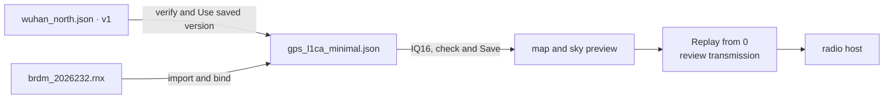

# Quick start

This page takes three existing Pharos example files through LoomSky's
Library, prepares an eight-second GPS L1 C/A scenario with a moving
receiver and reviews it for Replay. The inputs have a fixed historical
date, so the same navigation data can be used each time.



## Build and open the page

Follow [Install](install.md) to provide Zig 0.16, UHD and Node 24 or later.
Zig fetches the pinned Pharos package. From the LoomSky root:

```bash
zig build --release -Duhd=<prefix>
```

Write a [host file](host.md) with the radio's device arguments, allowed band
and gain. Include the page's exact origin in `origins`. For a browser and
both services on one computer, this can be `http://127.0.0.1:3000`.

Start the radio host in one terminal:

```bash
zig-out/bin/loomsky 127.0.0.1:8740 host.json
```

In another terminal, build and serve the page:

```bash
cd web
npm ci
npm run build
npm run serve -- 127.0.0.1:3000
```

Open `http://127.0.0.1:3000` in a desktop browser and choose **Open Library**.
For separate computers, use their reachable addresses and put the resulting
page origin in the radio host's file.

In Library, choose **New → Add transmitter…**. Enter `127.0.0.1:8740` and
the token from `host.json`, then choose **Check**. The reply shows the
station name, bands and gain limit. Choose **Add** to save the registration.
The transmitter appears in Library and the top strip; its device must
be ready before it can accept a transmission.

## Import the inputs

Use these files from the fetched Pharos package under
`zig-pkg/Pharos-<version>-<hash>/`. When building with `--fork`, use the
local checkout instead. Paths below are relative to the Pharos package:

| Library action | File | Expected resource |
|---|---|---|
| **Import → Trajectory JSON…** | `examples/trajectories/wuhan_north.json` | an editable Plan for 60 s of northward travel in Wuhan |
| **Import → Data file…** | `examples/data/brdm_2026232.rnx` | a navigation data file |
| **Import → Scenario JSON…** | `examples/scenarios/gps_l1ca_minimal.json` | a scenario with an 8 s window |

The scenario starts at **2026-08-20 18:00:00 UTC** and selects `L1CA` at
1575.42 MHz, sampled at 4.092 Msps. Its original trajectory filename is a
hint; the next step replaces it with the northward Plan. Importing JSON
does not bind the other files automatically.

Open `wuhan_north` from Library. Its **Editor** shows geometry, events and
rules; **Objects** in Details opens the object list. Wait for
**Verified** before using it. The import created saved version **v1**.
An unverified candidate can be inspected and edited but cannot supply a
runtime trajectory to a scenario.

## Select the trajectory and bind navigation data

Open the imported scenario.

1. In **Setup**, choose **Choose from Library…** under Trajectory.
   Select `wuhan_north`, choose saved **v1**, inspect its verified result
   and choose **Use v1**. The setup section shows the selected saved version.
2. In **Data**, find the referenced `brdm_2026232.rnx` file and
   choose **Choose file**. Select the imported data file, then **Use selected resource**.
   Its file size and navigation coverage appear beside the reference.
3. In **Signals**, choose **Use IQ16**. The source example uses
   IQ8; LoomSky's radio hosts require IQ16. Leave the centre and sample rate
   at 1575.42 MHz and 4.092 Msps.
4. Wait for the scenario to show **Ready**. Open any listed Problems and
   inspect their details before continuing.
5. Choose **Save** to retain the configuration and selected inputs as the
   next scenario version. Selecting inputs and passing checks do not save
   the working copy.

The sample band is 1573.374–1577.466 MHz. The station's configured band must
contain that entire interval. The scenario keeps its historical start time
and eight-second duration; changing it to the current date would require
matching navigation data.

To try source editing afterward, open the selected Plan and move a geometry
point, change a rule in Properties, or create an event target on the map
or timeline. Choose **Save**, then select the new saved version explicitly
in the scenario and save that scenario.
See [Trajectories](trajectories.md) for the shared Editor and JSON workflow.

## Inspect the scenario

Choose **Map** in the scenario's preview pane. The map shows the
receiver path; the sky and timeline show the modeled eight-second window.
A basemap is optional and is configured separately through the map's
Basemap control.

The scenario can also produce observation and position files. Enable the
desired output in **Outputs**, wait for the updated check and download
the modeled result. These operations work without transmitting. See
[Previews and outputs](previews.md) for their sampling and interpretation.

## Review and transmit

Choose **Transmit…** for the saved scenario, select the registered
transmitter and set:

| Setting | Value |
|---|---|
| Mode | **Replay** |
| **Replay offset** | `+00:00:00.000` |
| Gain | the gain chosen for the connected setup, within the station's limit |

If you changed the working copy after saving, use the explicit
**Save & review** action to save those changes before opening transmission
configuration. A saved scenario must pass its checks before it can be used.

Choose **Review**. The confirmation identifies the radio
host, saved scenario version, bundle digest, Replay offset, duration and
gain. Choose **Transmit on …** to start the reviewed transmission, or
**Cancel** to leave it unsubmitted.

The transmitter view reports preparation, timed execution and the terminal
result. **Stop** requests that the current run end; after completion, the
run remains available in that browser's history. Closing the browser leaves
an accepted run under the radio host's control. The full state and recovery
rules are in [Transmission](transmission.md).

## Keep the result

Choose **Save** for any remaining document changes. Use **Export…** in the
scenario's actions menu to download a ZIP of its prepared working copy and
selected inputs. Export does not save the original document. A ZIP is a
portable copy of the scenario inputs; [Browser storage](storage.md)
explains how to restore it and what other
state remains local to the browser.

## Limits and messages

| Case | Action |
|---|---|
| `assets: missing …; run zig build in the repository first` | complete the native build before building the page |
| The transmitter check fails | review its address, token, page origin and host process in [Transmission](transmission.md) |
| A referenced file is missing | use that field's Library picker to bind the imported resource |
| The bundle has IQ8 | choose **Use IQ16** and wait for the updated check |
| The live window has ended | use **Replay** with an offset inside the historical window |
| A review becomes outdated | reopen transmission configuration and review the current inputs and host state |
