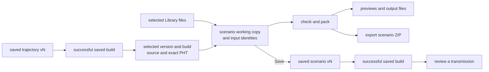

# Scenarios

A scenario combines a start time, a saved trajectory version and build,
selected input files, signals and output settings. LoomSky edits a working
copy in this browser and retains complete versions when you choose Save.
Pharos checks those inputs and packs the bundle used for
previews, downloads and transmission.

The browser workflow is described here. The full JSON keys, units,
defaults and diagnostics belong to the
[Pharos scenario reference](https://github.com/Mirai-Research/Pharos/blob/main/docs/guide/scenarios.md).
Its [models](https://github.com/Mirai-Research/Pharos/tree/main/docs/models) and
[GNSS reference](https://github.com/Mirai-Research/Pharos/tree/main/docs/gnss)
describe the physics and message content.

## Create or import

In [Library](library.md), choose **New → Scenario** to open Setup immediately.
The default **Name** is focused for editing; add a **Description** there if
needed. The new scenario has only its document version and name. Set the start,
choose signals, adopt a trajectory and select the required input files.
Configure the outputs you need; enabling IF samples leaves their format,
sample rate and centre frequency for you to choose. Set a duration when
you want to use less than the whole trajectory.

The new scenario begins at saved **v1** before all its inputs are available.
Further edits stay in the working copy until Save. Missing inputs
appear in **Problems**; they must be resolved before the scenario can
pack successfully.

**Import → Scenario JSON…** accepts `.json` files containing a JSON
object. Directory components separated by `/` or `\` are removed from
input references. The remaining filenames are hints: an imported scenario
has no selected files and no adopted trajectory, even when Library already
contains files with those names. Choose each input explicitly.

Imported scenarios receive an identifier based on the JSON filename,
with a suffix when that identifier is already used. The **Name** in Setup
is separate from this identifier. **Duplicate**, in the resource's action
menu, applies valid pending field text and creates a new scenario at saved
**v1**. It copies the current working content, selected file identities and
chosen trajectory version/build without saving the original scenario.
Later edits to either scenario are independent.

## Configuration and preview

Open the scenario to see its latest saved **vN**, save status and check
status. **Form / JSON** switches the editor view. **Save** or Ctrl+S / Cmd+S
retains the current content as the next complete version. Open **vN** for
**Version history**. The action menu contains **Duplicate**, **Export…** and
**Delete…**; **Transmit…** opens the transmission workflow. When the editor
has unsaved changes, **Save & review** explicitly saves them first.

Configuration has **Setup**, **Data**, **Signals**, **Messages** and **Outputs**
tabs. The header's preview control shows or hides the preview in Form and JSON.
When hidden, the editor uses the full width. When shown, the preview sits
beside configuration on a wide screen and below it on a narrow screen; drag
the divider to resize the side-by-side panes. Visibility, width, selected
view and satellite are remembered for recent scenario views in this page session.

| Section | What to configure |
|---|---|
| Setup | name, description, start and time scale, duration, adopted trajectory |
| Data | ephemeris, almanac, antenna, precise orbit and clock files, ionosphere and clock references |
| Signals | signals, IF format and band, satellite and elevation masks, noise, default power and timed power events |
| Messages | GPS, Galileo I/NAV and BDS D2 publications; Galileo HAS and BDS PPP-B2b settings; version metadata |
| Outputs | observation and position settings, plus prediction downloads |

The preview offers **Map**, **Sky / C/N0** and **Effective values**, with a
shared inspection time and timeline. Configuration tabs preserve the
chosen preview. The [preview guide](previews.md) explains checked working copies,
satellite selection and output availability.

The tabs and groups mark errors and warnings. Expandable groups show
their configured count and problems. Field hints distinguish **Explicit**
values, schema **Default** values, **Auto · after checks** and **Not set**.
These hints describe the input's source; effective values come from the
checked scenario.

Check status and save status are independent: **Saved** can describe a
scenario with invalid JSON, missing inputs or failed checks. Transmitter
buttons in the header open hosts using the scenario; run snapshots keep
their submitted saved version and build even when this working copy or its
latest saved version changes. [Storage](storage.md) explains what survives
reloading the page.

## Start and duration

Setup accepts UTC, GPS, Galileo, BDS and GLONASS time forms. Changing the
time scale preserves a valid instant. The readout shows the resolved
window in GPS and UTC, including a leap change when one is available.
**Now** sets the start to the next whole minute in the selected scale.

Duration is in seconds. Clear it to use the whole adopted trajectory.
The packer resolves the duration to whole milliseconds and rejects a
window longer than the trajectory.

The selected navigation files supply the coverage shown by **Coverage
issue**. **Move into coverage**, when available, changes the start to a
window that fits the common coverage for the selected signals. Review the
resulting time and checks before transmitting.

## Adopt a trajectory

Create or import the trajectory in Library, then return to Setup and
choose **Choose…**, or **Change…** for an existing selection. Select a
trajectory and a saved version. The picker shows its source and dependencies;
**Use vN** prepares the verified result when needed. Browsing does not build.
Save edits in the trajectory editor before selecting them as a version.

The selection fixes both the Plan source and exact compiled PHT. Setup
shows the trajectory's saved version. Editing or saving the shared
trajectory leaves this selection and previously submitted runs unchanged.
Each scenario chooses when to use an update.

**Open editor** opens the shared trajectory. Save any intended changes,
then choose the saved version to use in this scenario. The
[trajectory guide](trajectories.md) covers generation, editing and export.

Using a trajectory changes only the scenario working copy. Save the
scenario to retain that choice as part of its next complete version.
Changing only the `trajectory` filename in JSON does not select another
trajectory; use the picker to establish its saved version and build.

## Select input files

**Data** selects files already in Library or uploaded through its
picker. Select the entries, then apply them with **Use selected files** or
**Use selected resource**.

| Input | Selection |
|---|---|
| Ephemeris | one or more navigation files through **Add from Library…** |
| Almanac | one or more almanac files in **Supporting data**, through **Add from Library…** |
| Antenna | one ANTEX file through **Choose from Library…** |
| Precise orbit | enable **Precise product → Include**, then **Add orbit file…** |
| Precise clock | **Add clock file…** in the precise product |

An unresolved reference offers **Choose file**. A selected reference
offers **Replace**. Both write the chosen Library entry's filename into
the scenario and bind it to that entry's stored contents. **Remove**
removes that scenario input; it leaves the Library entry and stored bytes
available.

Names alone do not identify contents. Library can contain two files with
the same name and different bytes, but one scenario cannot bind that name
to different contents at the same time. Rename one Library entry before
selecting it when names collide. Renaming or removing a Library entry
later does not alter an existing scenario's selected name or contents.

File selection checks that the related reference and selected entries still match
what was reviewed. If they change while the picker is open or while bytes
are being read, close the picker, review the inputs and choose again.
Uploading through a picker saves the file in Library; cancelling the
picker leaves that entry available without applying it to the scenario.

Ephemeris rows show supported satellite coverage and the available time
span. Those summaries do not replace packing checks. The
[Pharos navigation-data guide](https://github.com/Mirai-Research/Pharos/blob/main/docs/guide/navigation-data.md)
defines file formats, record selection and precise-product requirements.

## Form, JSON and unapplied inputs

Form and JSON edit the same document and share its undo history. Opening
a section or switching views preserves unknown keys and explicit default
values. A JSON parse error disables the form controls until the text is
corrected; the diagnostic identifies its line and column. JSON uses the
configuration pane, or the full editor width when the preview is hidden. Map, sky,
timeline and effective values can show the same marked earlier checked
result; output downloads prepare and check captured working content. See
[previews](previews.md) for source and status details.

| Input or action | Effect |
|---|---|
| Enter in a single-line field | applies a valid value |
| Ctrl+Enter or Cmd+Enter in a multiline field | applies a valid value |
| Leaving a field | applies it when valid |
| Esc in an unapplied field, or **Revert** | discards that pending text and shows the applied value |
| Invalid input | stays marked **Not applied**; it does not overwrite the applied value |
| Applying an edit, undo or redo | changes the working copy and schedules checking |
| **Save** or Ctrl+S / Cmd+S | prepares pending fields and table input, then saves the current content as the next complete version |
| Publication copy, table fill or compound branch change | applies its related JSON changes as one document undo step |

Unapplied text follows the document across its sections and Form/JSON
views. Table selections, batch values and pasted table text also remain
available there. Leaving the editor with unsaved work offers **Save and
leave** or **Discard and leave** in a small card at the bottom right.
Discarding drops unsaved edits and pending inputs. Both count as **Unsaved** in the header. Save, export and duplication prepare pending field,
batch and paste values together; invalid or conflicting input must be
corrected or reverted first. Export and duplication leave the original
working copy unsaved. Ordinary controls and file or trajectory selection
change only their related fields and preserve unrelated pending text.

Batch and paste input is checked against the table and containing list as
they were when typing began. Unrelated edits preserve this input. Changing the table or
changing, reordering or removing its containing list retains the text but
blocks applying it until discarded. Choose **Discard pending input** beside
the table, or **Discard input** in Problems; the Problems action remains
available after a publication is removed. Save keeps the input visible and
reports the conflict instead of saving a partial version.

Fields on objects with an `id` follow that object if JSON reorders its list.
If the object disappears, its ID becomes ambiguous or the applied field
changes, the unapplied text is retained as a conflict. Problems offers
**Revert** when the object can no longer be located. Numeric table cells
continue to refer to their row and column positions.

The header has **Undo** and **Redo** beside Save. In Form, Ctrl+Z or Cmd+Z
outside a text input undoes a document edit; adding Shift redoes it. A focused input keeps its own text-editing keys.
The JSON editor uses its document undo and redo commands. Undoing a file
selection or trajectory adoption restores the JSON and selected input
identities together. The document's undo history follows it across sections
and Form/JSON views. Saved version history is separate: **Restore working
copy** replaces the working content and clears its unapplied input, including
table drafts. Save then appends a new version without deleting later history.

## Signals, power and ionosphere

Signals are selected by constellation. **Generate sample stream** adds or
removes the IF output settings. Sample rate is shown in Msps and centre
frequency in MHz; the band readout is centre ± half the sample rate.
Radio transmission requires `IQ16`; **Use IQ16** changes that setting.
Observation and position outputs can be configured without an IF stream.

**Elevation mask** sets the visibility floor. **Mask out** groups exclude
the selected satellites. **Power** sets noise density, default power and
optional elevation fading. In the timed schedule, add a target group,
choose its constellation and satellites, then add events. Event times are
seconds from scenario start on the millisecond grid. Each event either
sets a level or restores the default C/N0 and fade.

Target groups and events use compact lists with controls for the selected
row. Selecting a row leaves the inspection time unchanged. **Inspect
time** moves the preview cursor to the event when the current scenario
has passed its checks.

Ionosphere controls are in **Data**. The default is `klobuchar`.
A concrete model applies to every enabled constellation; choose
**Navigation data** or **Custom** coefficients where the model supports
them. Changing to a model with a different coefficient count removes the
old custom array as part of that edit. `none` disables ionospheric delay.

`auto` fixes a model at packing for each constellation with a listed
signal: GPS Klobuchar for GPS and GLONASS, NeQuick G for Galileo, and
BDGIM for BDS when available, otherwise BDS Klobuchar. Galileo and BDS
require their own navigation coefficients. `auto` accepts no custom
coefficient array. The
[Pharos ionosphere reference](https://github.com/Mirai-Research/Pharos/blob/main/docs/guide/scenarios.md#ionosphere)
gives the coefficient and fallback rules. **Effective values** shows what
the packed scenario resolved; see [previews](previews.md).

## Publications and services

**Messages** contains three publication lists. Use **Add
publication**, select its row and set its **From** and **Until** times.
**Duplicate** appends a copy after the last interval and preserves the
copied interval's duration when its times are valid. **Remove** deletes
the selected publication. Only the selected row's controls are expanded.
Selecting a publication leaves the inspection time unchanged; **Inspect
start** moves the cursor to its start when the current checks have passed.

| Publication | Form controls |
|---|---|
| GPS · LNAV / CNAV / CNAV-2 | integrity flags, broadcast text, SV configuration codes, integrity support and differential correction accuracy |
| Galileo I/NAV | `test`, `noData` and `horizontal` integrity-support branches; test payloads remain hexadecimal strings |
| BDS D2 | satellite quality declarations, a common GIVEI or individual grid values, and grid points not monitored |

A publication is a complete declaration over `[from, until)`: the start
is included and the end is excluded. Intervals in one list must be ordered
and non-overlapping; adjacent intervals are allowed. A gap or omitted
payload does not inherit earlier content. Publications change content,
not the message slots or cadence. The full payload rules are in the
Pharos [GPS](https://github.com/Mirai-Research/Pharos/blob/main/docs/gnss/gps/data.md),
[Galileo](https://github.com/Mirai-Research/Pharos/blob/main/docs/gnss/galileo/data.md)
and [BDS](https://github.com/Mirai-Research/Pharos/blob/main/docs/gnss/bds/data.md)
data references.

Indexed tables support selecting rows, assigning one value to the
selection and pasting values separated by whitespace or commas. Paste
one whole-number value per selected row, or per row when none is selected;
an invalid count or value leaves the table unchanged. **Resize to N
entries**, when offered, fills missing entries with zero and keeps the
existing entries within that size.

Galileo HAS and BDS PPP-B2b have separate enable controls and clock/orbit
intervals; HAS also has a status setting. Disabling either service keeps
its configured parameters. Message and service controls remain editable
when their carrier signals or sample output are absent; the page explains
why they are inactive. These controls do not add the carrier signals for
you.

## Checks, export and deletion

Applied source edits schedule a check while the scenario editor is open.
Leaving the editor releases automatic check work; returning prepares the
current result again. Operations check their captured sources separately.
Library Preview reads the saved version and retained results. Results
belong to the working content being checked; a result for an older input
cannot make newer
edits ready. Saving remains available while checking and after a failed
check. Errors prevent preparation for export, output generation or
transmission. Warnings remain visible without preventing a successful
pack. **Locate** in [Problems](activity.md) opens the affected form field
or JSON position.

**Export…** captures and prepares the current scenario, then writes a ZIP
containing its
`scenario.json`, exact adopted PHT, the adopted Plan as `trajectory.json`,
and selected input files. Everything is at the archive root and
the JSON uses filenames. Missing bytes or different contents that would
share an output filename stop the export. It does not substitute a newer
shared trajectory draft. [Exporting and restoring a scenario](storage.md#exporting-and-restoring-a-scenario)
describes the archive and restore steps.

**Delete…** opens a short confirmation naming the scenario and warning that
deletion cannot be undone. Confirming deletes every saved version and build and its unsaved
working copy. A pending transmission or submitted run using the scenario
blocks deletion with an explanation. Shared file bytes remain in browser
storage.

Use [previews and output files](previews.md) to inspect a checked result or
start an export from captured working content. **Transmit…** opens the
[transmission review](transmission.md) for a saved version and build.
