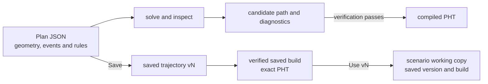

# Trajectories

A trajectory Plan describes the receiver's geometry, events and movement
rules in one editable JSON document. LoomSky solves the Plan, displays its
candidate path and checks the result before a scenario can adopt it.

The map, properties, timeline and JSON editor change the same source.
Changing a rule can change the path and timing elsewhere in the Plan.
Selection fixes the saved source and compiled build used by a scenario;
later working-copy edits and saves leave that selection intact.

## Create or import

Choose **Library → New → Trajectory**. The new Plan has its format,
version, name and coordinate reference, with empty geometry, events,
sections and rules. Add the intended locations, event sequence, movement
rules and timing. The new resource starts at saved **v1**. Its working copy
remains editable while required inputs are
missing; a new empty Plan has no generated path to adopt.

**Import → Trajectory JSON…** reads a Plan `.json` file. The format is
`pharos.trajectory-plan`, version 1; `trajectory.json` is the conventional
filename. The imported filename supplies the Library name, and the import
starts an independent resource at saved **v1**. PHT is the
compiled runtime artifact; trajectory authoring imports use Plan JSON.
For the complete source format, see
[Pharos: trajectories](https://github.com/Mirai-Research/Pharos/blob/main/docs/guide/trajectories.md).

## The editor

**Editor** opens with the map, expanded timeline and right-hand Details
panel. **Objects** and **Properties** share that panel, with Objects
selected initially; **Details** closes or reopens it. Objects lists
points, curves, regions, events, sections and rules. Selecting an object
there, on the map or in the timeline opens Properties; during a drag,
the panel waits until the gesture ends. On narrow layouts it overlays
the map. Close the panel to recover the map space.

The toolbar keeps **Select** and **Add point** visible. **Add…** contains
**Guide curve**, **Region**, **Direction**, **Event** and **Rule**.
**Charts** collapses or expands the timeline below the map. Properties groups less
frequent controls under **Advanced**, **Stop at this event**,
**Coordinates** and the selected object's **Delete** disclosure.

**JSON** opens the same Plan beside the map, or fills the editor on narrow
layouts. Field, map and JSON edits share the document's undo history for
the editing session. Correct a JSON syntax or structure error before using
controls that depend on that structure. A well-formed
Plan remains editable when its rules cannot be satisfied.

The header keeps the Library name, latest saved **vN**, solve state, save
state and duration in one row that wraps when space is limited. **Save**
or Ctrl+S / Cmd+S saves working content as the next complete
version. The **vN** control opens **Version history**.
**Enter** or leaving a valid name applies it; **Esc** restores the applied
name. An empty unapplied name must be corrected or reverted before Save,
duplication or export. The Plan's own `name` is also available in Plan properties.
If the applied Library name changes while a name draft is pending, the draft
is retained as a conflict instead of overwriting that change. Revert the
draft to return to the current applied name.
Name and field drafts, unfinished drawings and timeline range input stay
with the open editor when switching between its views. Leaving with unsaved
work offers **Save and leave** or **Discard and leave** at the bottom right.
See [unapplied inputs](scenarios.md#form-json-and-unapplied-inputs).

## Geometry, events and sections

| Object | Role | Controls |
|---|---|---|
| Point | reusable latitude, longitude and altitude | **Add point**, then click the map; move it or enter exact coordinates |
| Curve | cubic Bézier or polyline guide using point references | **Add… → Guide curve**, choose its type and draw; edit references and control points in Properties |
| Region | circle or convex polygon using geometry points | **Add… → Region**, choose its type and draw; edit its centre, radius or vertices |
| Event | a state in the ordered trajectory | **Add… → Event**; edit continuity, rules and initial state in Properties |
| Section | the interval joining consecutive events | select it in Objects, the map or timeline; attach interval rules |

Adding geometry does not require the receiver to visit it. A position
rule connects an event or time to a point. A **Follow curve** or **Inside
region** rule gives a curve or region its role in the solution. Moving a
shared point changes every curve, region or position rule that references
it.

Point latitude and longitude use degrees. Altitude uses metres above the
EGM96 geoid or WGS84 ellipsoid, selected in Plan properties. Bézier spans
are defined in ECEF space. Circle radii use metres; polygon vertices
must form a convex boundary.

The first event is at time zero. Sections connect events in order; event
times are solved from the rules and initial guesses. Adding an event
inside a section splits that section while keeping its existing rules
on the whole original interval.

| Event continuity | Values shared across the event |
|---|---|
| **C0** | position |
| **C1** | position and velocity |
| **C2** | position, velocity and acceleration; the default |

For a stop, select its arrival event, expand **Stop at this event** in
Properties and use **Add stop** with a positive duration. This adds a
departure event and a section with zero speed and the required duration.
Review nearby timing rules if the new stop makes the Plan infeasible.

## Rules

Choose **Add… → Rule**, then set its quantity, operator, value and scope
in Properties. A newly added rule begins as a
speed bound with an empty value on the selected event or section, or on
the whole trajectory when neither is selected. Enter the intended bound
or change its quantity and operator.

| Kind | Meaning |
|---|---|
| Hard | an equality or bound that must pass the result's verification |
| Target | a preferred value, with scale and weight controlling its penalty |
| Objective | a quantity to minimize or maximize, using its value, mean square or integrated square |

Scopes cover an event, section, interval between two events, absolute
time, time range or the whole trajectory. An event scope can select its
incoming or outgoing side. Numeric values may be constants, ECEF vectors,
geometry point references or values at another event. Event references
can apply a factor and offset; vector bounds act componentwise.

Available quantities include time and duration, speed, acceleration,
jerk, altitude, course, turn rate, turn radius and ECEF position, velocity
and acceleration. Speed, acceleration and jerk have separate magnitude
and directional quantities. Distances use metres, times seconds, course
degrees and turn rate degrees per second. Properties shows each field's
unit.

**Follow curve** and **Inside region** are hard or target relation rules.
Choose the referenced geometry and scope in Properties. Drawing a guide
or region alone leaves the movement rules unchanged.

Deleting an object that other objects use shows its dependencies. Edit
those references first, or use the Properties action to remove the object
and its dependent objects together. Compound changes, including stops
and dependency removal, form one undo step.

## Map edits and drag behavior

**Select** moves geometry points and exposes the selected event's position
and direction handles. **Add… → Direction** offers event direction editing.
Geometry handles edit their points or region dimensions directly. Curve
and region helper points appear when their object is selected.

The contextual **Drag sets** control appears for event editing and
determines what an event position, direction or time drag writes:

| Mode | Source change |
|---|---|
| **Target** | adds a preferred-value rule; the default |
| **Hard** | adds a required-value rule |
| **Initial** | changes the event's initial guess for the solver |

These event drags preserve existing hard rules. A new target may therefore
leave a hard-constrained result in place, and a conflicting hard rule may
make the Plan infeasible. Select the existing rule when the intent is to
change that requirement. Dragging an existing rule's numeric handle edits
that rule directly.

For a Bézier curve, click its start and end, then move its control points
to shape it. A circle uses its centre and an edge point. For a polyline or
convex polygon, click its vertices and choose **Finish** or press **Enter**.
**Backspace** removes the last draft point; **Esc** cancels drawing.
Changing tools or leaving the editor preserves unfinished points for each
curve or region type. Return to that tool to continue or cancel its drawing.

## Timeline

The timeline opens expanded below the map; the right-hand panel retains
its full height. When collapsed, the compact strip keeps the time cursor
and current result status usable. Choose **Charts** to expand it again.
The timeline shares one time axis for
events, sections and the selected chart: speed, acceleration, jerk or
altitude. The first three charts show magnitudes. Shaded bands show hard
limits; diamonds show targets.
Selecting a rule or section also selects its Properties.

Drag an event horizontally to set its time using the current drag mode.
Numeric rule handles change an equality, target or range endpoint. Click
the chart or move the time cursor to inspect the path without editing it.

Choose **Select range**, or Shift-drag on the chart, to select a time
interval. Set its bounds and value, then choose **Add maximum** for a hard
upper bound or **Add target** for a preference. Edit other quantities,
operators and scopes in Properties. Each chart retains its range and value
while you switch quantities or leave the editor; they become source content
only when you add the rule. **Collapse** or **Charts** returns to
the compact strip. The timeline's top edge resizes it; on short layouts,
its content scrolls within the available height.

## Gestures and keyboard

A drag builds temporary candidates from one source baseline. Releasing
writes one source edit, even when that candidate still needs corrections.
**Esc** cancels; undo restores the entire committed gesture. A source
change during a drag cancels the outdated gesture. Leaving the resource or
switching between Editor and JSON cancels an active drag while preserving
unapplied field, drawing and range input.

| Focus | Key | Effect |
|---|---|---|
| Map handle | arrows; **Shift + arrow** | move by 1 screen pixel; 10 pixels with Shift |
| Map handle | **Delete** or **Backspace** | request deletion; referenced objects require dependency handling |
| Timeline handle | arrows along its axis; **Shift + arrow**; **Alt + arrow** | adjust by 0.1, 1 or 0.01 of the displayed unit |
| Editor outside a text input | **Ctrl/Cmd + Z**; **Ctrl/Cmd + Shift + Z** | cancel an active interaction; otherwise undo/redo draft drawing points or a document edit |
| Unapplied field | **Enter**, valid blur; **Esc** or **Revert** | apply; restore the applied value |
| Visual editor | **Esc** | cancel the active interaction, then the current drawing or range draft, then return to Select on successive presses |
| Time cursor | arrows, **Home**, **End** | inspect another time |

Text inputs and the JSON editor keep their editing keys. Editor undo does
not act through another dialog or Activity.

## Solving, verification and saving

Source edits trigger solving automatically while the trajectory editor is
open. Leaving it releases automatic solve work; returning prepares the
result again. Library Preview reads the saved version and retained result.
PHT export captures the Plan and compiles that snapshot independently of
later edits.
When calculation fails, **Retry** prepares current inputs and retries it.
Problems offer **Locate** to open an affected field, rule or JSON position.

| Display | Meaning |
|---|---|
| **Solving…** | the current source is being evaluated |
| **Current candidate · not verified** / **Unverified candidate** | a result is available for inspection, but it has not passed all checks |
| **Previous solution** / **Previous result** | a retained result belongs to an older source or edit baseline |
| **Verified** | the current result passed trajectory verification |

Properties shows current event values, section times and rule residuals
when inspection data is available. A failed solve can still provide a
candidate to help adjust rules or initial guesses. Passing verification
does not establish that the solution is a global optimum.

Saving is separate from solving. **Saved** describes browser persistence;
**Verified** describes the current compiled result. Save can retain invalid
JSON or a Plan that fails to solve. Pending fields, the Library name, completed drawings and authored range
input are prepared before saving. Invalid, conflicting or incomplete input
stays visible and must be corrected or reverted; Save does not omit it.
Finish or cancel an active drag before saving. **Unsaved** covers
both document edits and pending input. **Save failed** opens the storage
problem.

Every Save appends a complete version.
**Version history** shows the working copy and all saved versions. Choose
**Restore working copy** to inspect or edit an older source, then Save
to append a new version. Restoration clears unapplied inputs and active
interactions even when the source text is unchanged. Earlier history
remains intact. See
[storage](storage.md) for restoration and backup.

## Export, duplicate and delete

| Action | Result | Compilation required? |
|---|---|---|
| **Export trajectory JSON** | the editable Plan `.json` | no |
| **Export PHT** | the compiled runtime trajectory | the captured Plan must compile and verify |
| **Duplicate** | an independent resource at saved v1, named with `copy` | no |
| **Delete…** | review before deleting the resource, its saved versions and builds, and unsaved edits | no |

Export and duplication prepare the same complete input as Save, including
completed drawings and range edits, and do not save the original working
copy. They continue from their captured input after navigation or later
edits. PHT export can start before the live working-copy solve is ready;
its captured Plan must pass verification before a download is requested.
Follow progress or cancel in **Activity → Operations**.
A saved scenario version using this trajectory blocks deletion; the message
identifies that scenario and version. Shared file bytes remain in browser
storage.

## Use a saved version

In **Setup → Trajectory**, choose **Choose…** (or **Change…**), select a
trajectory and a saved version, then press **Use vN**. The selected version
must have a verified saved build. Its reference includes the Plan source
and exact compiled PHT. Unsaved working content must be saved before it is
available as a version in this picker.

**Open editor** opens the shared working copy. Save the intended changes,
then select that saved version for the scenario. Using it changes only the
scenario working copy; Save the scenario to retain the new selection.
The header lists scenarios using this trajectory and their selected
versions.

Other scenarios keep their existing version and build. Submitted runs
retain the bundle that was sent, even after a scenario selects an update. See
[previews](previews.md) for those viewing contexts.
