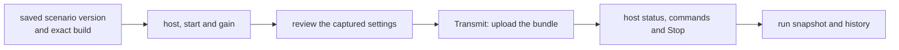

# Transmission

A transmitter is a radio host saved in this browser. The page sends it an
exact build of a saved scenario version, follows the run, and keeps its
run snapshot and bundle in Run history. The host runs independently of the
page: closing or reloading the browser leaves an accepted transmission running.

The host service and its configuration are covered by
[install](install.md) and [host](host.md). The radio's clock, lead and
fault recovery are in [timing](../design/timing.md).

## Add a transmitter

In Library, choose **New → Add transmitter…**. Enter an address such as
`192.168.1.20:8740` and the token from its host configuration, then choose
**Check**. An address without a scheme uses HTTP; an explicit `https://`
address uses HTTPS.

| Check result | What to do |
|---|---|
| the host's name, bands and maximum gain | choose **Add** to save the checked address and token |
| `The host refused the token (401).` | enter the token from that host's configuration and check again |
| `The host answered 200 without a status.` | the response was not a valid LoomSky status; check the address and host service |
| the host does not list the page's origin | add that origin to `origins` in the host configuration and restart the service |
| `No answer from <address> in 2 s.` | check the address, network connection and host service |
| `The host answered <code> without a status.` | inspect the reported HTTP response |

**View problem** opens a failed check in Activity. Editing either field
invalidates the checked result. **Cancel** clears both fields and the
result. **Add** finishes only after a new registration is saved, then
opens the transmitter. Adding an address already in the list opens its
existing registration; update its token in Device. Tokens are kept in
this browser.

## Read the host strip

The strip keeps transmitters in addition order. Select a name to open its
pages; the square Stop button beside it acts on that transmitter. Status
is polled at 5 Hz, or 1 Hz while the host is off.

| Class | Meaning | Strip |
|---|---|---|
| on air | the host reports an active transmission | red fill, **On air**, time left and Stop |
| armed | the bundle is uploading, the radio is preparing a burst, or the run awaits its window | red outline, **Uploading**, **Starting**, **Recovering** or **Waiting**, with progress or a countdown and Stop |
| unknown | acceptance or cancellation is unconfirmed, recovery records are loading or unavailable, or a previously active host has stopped answering | dashed red outline, **Unknown**, age or Stop state |
| alarm | the run failed, or the host restarted during it | fault outline, **Failed** or **Restarted**; **Acknowledge** is in its problem |
| off | no active run is reported and no recovery is pending | idle, completed, stopped, refused, no answer, token refused or origin not listed; a radio still opening or unavailable is named too |

**Recovering** means a run that has already sent a complete slot is
preparing its next burst. Its tally reads **Preparing the next burst**
and shows the latest reported sent epoch as a GPS/UTC time. Sent progress
advances between status updates only while the host reports **On air**.

A host last seen on air or armed becomes unknown after 3 s without a
usable status. After a reload, a saved active observation can make the
first failed status request unknown immediately. Unconfirmed submissions
and recovery do not wait for the 3 s threshold.

When space is short, the strip scrolls horizontally. Every transmitter
keeps its own entry, with Stop available when it may be active. Selecting
a transmitter scrolls its entry into view.

The transmitter has four pages:

| Page | Holds |
|---|---|
| **Run** | the status tally, Stop, run details, submitted configuration, commands, transmission faults and modeled outputs |
| **Signal preview** | the submitted run's read-only map, sky, C/N0, timeline and effective values |
| **Run history** | submissions saved by this browser, their frozen source and input files, and modeled run outputs |
| **Device** | connection, identity, capabilities, saved token and removal |

## Choose the transmission

Choose **Transmit…** from a saved scenario. If its working copy has
changes, **Save & review** explicitly saves them as the next version before
preparing transmission. Failed checks can be saved, but the saved version
must produce a valid build before it can be transmitted.

On a transmitter's Run page, **Transmit a scenario…** opens a
picker for a scenario and saved version. Select a version, inspect its
result and choose **Use vN** to open transmission configuration. The
configuration dialog keeps the host strip and Stop all available.

| Setting | Rule |
|---|---|
| **Radio host** | a connected, ready radio with no active run, unresolved submission or alarm; unavailable hosts show why |
| **Scenario version** | the saved version and exact build, with its window in GPS and UTC; **Choose version…** opens the saved-version picker |
| samples | the scenario must request IQ16; centre frequency ± half the sample rate must fit wholly inside one of the host's bands |
| **Start** | Live or Replay, as below |
| **Gain** | a finite value in dB, no greater than the displayed host maximum; the saved gain is offered when available |

Choosing a version uses its saved contents. The picker identifies an
unsaved working copy as **Save first**; open its editor and save to make
those edits available. Resolve any scenario errors in
[the scenario editor](scenarios.md). A run already on the host continues
with its submitted version and build when the working copy changes.

### Live and Replay

| Mode | Start | End |
|---|---|---|
| **Live** | the host's GPS time within the scenario window; a future window starts by itself | the scenario window's end |
| **Replay** | the radio's clock is placed at the chosen offset into the scenario | the remaining scenario window, on that clock |

Live aligns hosts by GPS time. Replay uses each host's own replay clock;
the dialog warns when other hosts are already transmitting the scenario.
An ended Live window requires Replay. The dialog initially chooses Live
when the window has time left, otherwise Replay.

The **Replay offset** field accepts `+HH:MM:SS.mmm`; the plus sign
and fractional seconds are optional. Minutes and seconds are below 60.
The offset must be at least zero and less than the window's duration.
Opening transmission from a scenario captures that preview's inspection
time as the initial offset; other entry points start at zero. The value is
bounded to the selected saved version's window. Editing it changes only
this transmission configuration. An invalid value disables **Review**.

Both modes need room for the radio's 200 ms lead. In Replay, the first
epoch is selected at least that far after the requested offset. A value
very near the window's end can therefore pass the field check and still
be refused by the host. The actual first and last sent times appear in
Run; [timing](../design/timing.md) gives the entry rule.

## Review and transmit

Choose **Review** to capture the host settings with the
selected saved version and exact build. The same dialog shows the host,
scenario version, bundle digest, mode, window and gain. Choose **Back** to
change the configuration, **Cancel** to close it, or **Transmit on \<host>**
to upload the bundle.

The reviewed settings are checked again before sending. Changed host
settings, a restarted or busy host, or an ended Live window requires a new
review.
Later editor changes leave the selected saved version and build unchanged.
Choose another version and review again to transmit different contents.
The browser saves the submission's recovery record and gain before
uploading. If either cannot be saved, nothing is transmitted.

The display label names the scenario and saved version, such as **v3**.
The submission separately records the scenario identity, saved version,
exact build, Pharos engine identity and full bundle digest. Its run snapshot
retains the source, selected inputs and exact bundle. An upload reaching
100% means the bytes were sent; the host still has to accept and start the run.

## Unconfirmed submissions and reloads

A lost upload response can leave acceptance unknown. The host might have
accepted the bundle. The page keeps checking that submission, prevents a
new transmission on the same host, and shows **Radio state unknown** with
the reason **Submission acceptance unconfirmed**. **Retry now** requests
another status; **Stop \<host>** requests cancellation of that submission.

Cancellation follows the submitted operation. If it has already become
a run, cancellation stops that run. The page waits for the host to
confirm that the operation was cancelled or rejected, its run ended, or
the host has moved beyond it. An aborted browser upload alone does not
confirm cancellation.

After reload, saved transmitters are polled and unfinished submissions
and Stop requests are restored. An accepted run keeps running. A Stop or
cancellation already requested resumes its attempts for the original
run or upload. A host restart or a later run does not transfer an old
Stop to the new run.

Recovery records are removed after the host has resolved their operation
and any accepted submission has been archived. A storage failure keeps
the record for retry and raises a problem. **Run recovery could not be
saved** asks you to keep the page open; **Run recovery unavailable**
offers **Retry now** to load the saved records again. The full browser
storage lifetimes are in [storage](storage.md).

## Stop

Stop acts immediately, without a confirmation card.

| Control or state | Effect |
|---|---|
| square Stop on a strip entry; **Stop \<host>** in the tally | targets that host's current run or pending submission |
| **Stop all (n)** | targets every host on air, armed or unknown; with one target it reads **Stop \<host>** |
| **Stop pending** | cancellation or the saved run identity still needs confirmation |
| **Stop queued** | no acceptance of the Stop has been received; the page retries |
| **Stop sent** | the host accepted the request; the page still waits for the run to end |

Requests retain the run or upload identity they target. A Stop pressed
while recovery records are loading applies only to submissions already
pending when it was pressed. Stop and cancellation attempts repeat after
3 s while unresolved, including after a reload. If saving a Stop fails,
the page reports the failure and still attempts it; keep the page open
until recovery is saved or the host confirms the end.

After 5 s without confirmation, **Stop not confirmed** appears as an
urgent problem and card. Its actions are **Stop \<host> again** and
**Retry connection**. A Stop request, a closed page, or a lost connection
does not itself establish that RF has ended.

For an unknown host, the tally and problem show the last known state and
an **RF at most until** time when enough information exists. No bound is
shown for a submission whose acceptance is still unknown.

## Send a command

The Run page can send commands once a run exists and the connected
host is on air or armed. Commands are unavailable while an upload has
not yet become a run, while status is unknown, and after the run ends.

| Command | Fields | Effect |
|---|---|---|
| **Signal power** | system, satellite number, level and unit | a level in dB-Hz, dBm or dBW; satellite `0` selects all in the system; **The scenario's level** restores its default |
| **Noise floor** | dBm/Hz | changes the run's noise floor |
| **Elevation mask** | degrees | takes effect at the next re-plan, at most 1 s after application |

Review the command fields, then choose **Send to \<host>**. Selecting a
C/N0 bar or a satellite in the sky fills the system and satellite and
focuses the level; it does not send
the command.

| Command log state | Meaning |
|---|---|
| queued | admitted by the host, awaiting application |
| a GPS time, with UTC on hover | applied at that scenario epoch |
| **Rejected · View problem** | the generator refused the command; the problem gives its reason |
| **Discarded · View problem** | the run ended before it applied; the problem gives the outcome |

If the request fails or its reply is lost, its problem offers **Retry command**.
The retry checks that the original run is still active and connected, then
uses the same command identity. If the host already accepted that command,
it returns the existing receipt without applying a second copy.
Commands never carry forward to a later run. The
[API](api.md) owns the command payloads; [timing](../design/timing.md)
explains when queued commands apply and how a run settles them.

## Outcomes and run history

The tally follows the host's reported progress. Run details include the
mode, window, first sent time, last reported sent epoch, radio readback
of frequency/rate/gain, outcome, and boot/run identity. **Transmission
faults** lists their counts; the page marks when it first observed a new
fault. **Late** includes radio time-error events and first slots discarded
by the host because fewer than 50 ms remain before their scheduled start.

| Result | Meaning | Next action |
|---|---|---|
| completed | the host reached the end of the run | inspect the sent range and any transmission faults |
| stopped | the run ended after Stop, possibly before any epoch was sent | inspect its last reported sent time |
| refused | the host rejected the run before transmission | open **View problem**, correct the cause, then review again |
| failed | an unrecoverable run failure ended transmission | open **View problem** for the reason; **Acknowledge** clears the alarm |
| restarted | a new host boot replaced a previously active run | the old run ended; inspect and acknowledge the restart problem |

An unknown state is unresolved status. It is not a completed or stopped
result. Fault recovery can leave gaps even when a run eventually
completes. Exact native reasons and messages are in
[timing: limits and messages](../design/timing.md#limits-and-messages).

**Open run snapshot** shows the captured source read-only.
**Open scenario** opens the separate Library scenario and its working copy.
Run details identify whether that scenario has the same saved version and
whether it has unsaved changes. In Run history, choose **View** to
inspect a saved submission, **Bundle** to download its `.phb`, **Save scenario JSON** or
**Save trajectory JSON** to save the selected source, and **Save file**
for a frozen input. The captured trajectory includes its Plan source and
exact compiled PHT. **Refresh history** reads saved entries again.

History belongs to this browser. A run started elsewhere can expose
status and its label while its source and bundle remain unavailable.
Reloading restores a locally saved run snapshot for preview; it
does not reconstruct another browser's inputs.

Modeled run downloads need a saved bundle, requested observation or
position outputs, and a reported sent range with applied command context.
They freeze that range and context when Download is clicked. The files
describe the expected signal over the range and can include transmission
gaps. [Previews](previews.md) covers the plots, effective values and output
interpretation.

## Connection settings and removal

Device shows the address, reported name, connection, last status age,
boot identity and clock offset from this computer. Capabilities give the
radio state, bands, maximum gain, clock reference and saved gain. When the
connection is lost, retained capabilities are marked as last reported.

Use **Retry connection now** to poll immediately. **Save token** saves a
replacement token and retries the connection; **Forget token** removes
the saved token. Neither changes the token configured on the host.

**Remove transmitter** opens a confirmation card. Removal deletes the
registration from this browser's list and stops its monitoring. Stored
submissions and history remain. An active transmission continues until
its scheduled end or a Stop; remove a running host only when that is the
intended result.

## Limits and messages

Each open tab polls its registered transmitters independently. Closing or
reloading a tab does not send Stop. A frozen page pauses its polling and
reconciles saved recovery work when resumed; other open tabs can continue
monitoring.

| Limit | Value |
|---|---|
| host polling | 5 Hz; 1 Hz while off; requests do not overlap for one host within a tab |
| ordinary status request | 1 s timeout; a network failure can add a separate origin probe with another 1 s timeout |
| **Check** request | 2 s timeout; a network failure can add a separate origin probe with another 2 s timeout |
| active status becomes unknown | 3 s since the last usable status; restored active observations and unresolved recovery are handled separately |
| Stop confirmation warning | 5 s after the request |
| unresolved Stop or cancellation retry | 3 s after an attempt finishes |
| replay offset | whole milliseconds, from zero to less than the scenario duration; the host also requires room for its 200 ms lead |
| gain | finite dB, no greater than the host's configured maximum |

| Page problem | Meaning or action |
|---|---|
| **Live window ended** | choose Replay |
| **Invalid replay offset** | use the displayed time format and stay inside the window |
| **Invalid transmit gain** | enter finite dB within the displayed maximum |
| **Radio state unknown** | inspect the reason, retry status, or request Stop |
| **Stop not confirmed** | the host has not yet confirmed the targeted end |
| **Host token refused** | update the browser's token in Device |
| **Page origin not allowed** | update the host's `origins`, restart its service, then retry |
| **Run snapshot unavailable** | retry loading the saved submission |
| **Run history could not be saved** | the page retries; **Retry now** requests an immediate attempt |

The [API reference](api.md) lists HTTP refusals.
[Timing](../design/timing.md#limits-and-messages) lists the host's exact
run failure messages. Problems and their actions are described in
[Activity](activity.md).
